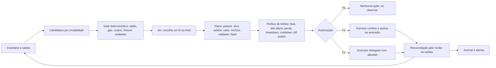

# Central de operações do Jev: decisões de arquitetura

Data: 2026-10-10. Estado: decisões do arquiteto, baseadas em evidência pública e leitura de código. Não certifica execução, lucro nem segurança, e não concede nenhuma autorização financeira. Não é recomendação de investimento: os números abaixo são engenharia de risco e cálculo, não previsão.

Evidência de base: [R1 Onchain OS](research/R1-onchain-os-capacidades.md), [R2 carteira e delegação](research/R2-carteira-permissoes-delegacao.md), [R3 estratégias e alavancagem](research/R3-estrategias-e-alavancagem.md), [R4 revisão do executor](research/R4-revisao-seguranca-operador-20261010.md), [qualificação para execução real](LIVE-QUALIFICATION.md), [prontidão](READINESS-SPEC.md) e [lucro](PROFIT-SPEC.md).

## 1. O que a evidência decide

1. **Não há vantagem líquida demonstrada.** Nas fontes de R3, nenhuma modalidade tem retorno líquido auditável e acessível a uma carteira pequena automatizada. Carry e basis rendem 1,4 a 3,9% sobre o capital (abaixo do T-bill de 4,05%), arbitragem DEX e CEX-DEX são território de searchers, e o market making da Kuru tem receita total estimada de cerca de US$ 269 por dia para todos os makers.
2. **Alavancagem não cria crescimento.** O crescimento logarítmico é `g(L) = L*mu - 0,5*L^2*sigma^2`. Sem vantagem validada (`mu = 0`), toda alavancagem acima de zero reduz a mediana: com sigma de 4% ao dia, 10x leva a mediana de 30 dias a 0,09 do capital e a chance de tocar a liquidação em 7 dias é 34,5%. Validar um Sharpe 2 exige cerca de um ano de dados.
3. **O caso "US$ 68 para US$ 6.700" não tem fonte e não pode ser parâmetro.** Para qualquer estratégia sem vantagem, a chance de chegar a 98,5 vezes é no máximo 1,0%. Entre milhares de tentativas alavancadas, algumas parecem geniais por sobrevivência.
4. **Nenhuma API da OKX assina ou envia sozinha** (R1). Swap, DeFi e ponte devolvem calldata. A unidade de saída das cotações não é declarada, simulação e broadcast exigem whitelist, e nenhuma capacidade entra no laço de 300 ms da Kuru.
5. **O teto tem de estar no saldo, no contrato e no humano, nunca no modelo** (R2). O OKX Wallet principal não documenta delegação com limites. Os produtos de agente da OKX guardam a chave em TEE do fornecedor, com política de poucas regras definida só no portal.
6. **Cotar a cada bloco custa cerca de US$ 253,71 por dia só de gás** (R3, medição do repositório), contra uma receita estimada de US$ 269 por dia para todos os makers. Por isso o contrato de prontidão (intervalo de 100 blocos e portão econômico) é o padrão.

Consequência: a central de operações é desenhada para **medir antes de operar**, **operar só dentro de limites duros** e **reinvestir apenas lucro líquido realizado e conciliado**. "Crescimento exponencial" não é requisito do sistema e não é prometido.

## 2. Decisões

| ID | Decisão | Por quê | Estado |
| --- | --- | --- | --- |
| D1 | O Jev é um **seletor tipado**: escolhe o id de um candidato já elegível, ou `hold`. Não tem ferramenta de escrita, não monta calldata e não recebe texto externo no prompt (nomes de token, descrições). Jev indisponível significa `hold`. O custo de inferência é contabilizado. | R2 (injeção por metadados de token, excesso de agência), R3 (confiança do Jev não é calibrada). | Implementado no operador (`src/operator/jev-selector.ts`). |
| D2 | **Um único pipeline**: inventário, candidatos, gate determinístico, Jev, plano, política de limites, autorização, executor, reconciliação, journal. Modalidades novas entram como tipo de candidato. Nenhuma ganha caminho próprio até o executor. | Evita regras de risco duplicadas e divergentes. | Pipeline no operador; novas modalidades pendentes. |
| D3 | **Ordem de entrada das modalidades**: 1) monitores de rendimento, 2) funding e basis, 3) market making na Kuru (paper), 4) arbitragem DEX, 5) entre venues, 6) loops alavancados (só simulação), 7) sinais e memes (só pesquisa). Cada uma só passa de fase com evidência fora da amostra. | R3, seção 5. | Ver seção 6. |
| D4 | **Alavancagem é um botão de risco, não de lucro.** Fase 0: 0x. Fase 1: 1x spot, sem empréstimo. Fase 2: no máximo 2x e no máximo 0,25 do limite inferior do Kelly estimado, só com vantagem medida fora da amostra no mesmo instrumento. Perp e empréstimo só como simulação até lá. | R3, seções 4 e 6. | Avaliador offline em desenvolvimento; execução não implementada. |
| D5 | **Permissões em níveis** T0, T1, T2-A, T2-B e T2-C (seção 4). O padrão é T0. O Jev nunca recebe chave nem a carteira principal: opera, no máximo, uma **fatia designada** em endereço separado. | R2. | T0 implementado; T1 e T2 não habilitados. |
| D6 | **Custódia**: chave de agente dedicada, com saldo máximo definido pelo dono, nunca a chave principal. Cofre do sistema operacional ou HSM em vez de `.env` quando houver execução real. | R2, R4 (achado 6). | Recomendação; depende do dono. |
| D7 | **Cadência**: manter o contrato de prontidão. O modo a cada bloco fica como opção de paper. Sem Jev disponível, `hold`. | Seção 1, item 6. | Padrão em `main`. |
| D8 | **Limites por fase** como configuração nomeada e verificável (seção 5), com a fase mais conservadora como padrão. | R3, seção 6. | O operador informa os perfis `micro` (padrão: 5 USD ou 5% do patrimônio por plano, 20 USD e 4 planos por dia, cooldown de 15 min) e `standard`. Paradas por perda diária e semanal e por drawdown ainda não existem porque falta PnL realizado conciliado. Módulo de verificação do envelope em implementação. |
| D9 | **Interface**: rota `/central` do dashboard com permissões e limites, risco e alavancagem, e mapa do ecossistema. Sem controle de execução. Rótulos honestos, sem promessa de ganho. | Pedido do dono; design em `INONU-DESIGN-SPEC.md`. | Em implementação. |
| D10 | **Verdade e reconciliação**: sucesso só pelo recibo na cadeia, lucro só realizado e conciliado, estado desconhecido trava (latch `hold`) até reconciliar. | Contratos de prontidão e de qualificação. | Parcial. |
| D11 | **Governança**: nada passa de dry run para execução real sem (a) registro de autorização do dono com limites, (b) checklist `qualify:live` completo, (c) revisão independente do código final e (d) um commit separado que levante o gate. O assistente nunca preenche o registro, fornece chaves nem executa uma sessão real. | `LIVE-QUALIFICATION.md`. | Em vigor. |

## 3. Pipeline

O Jev só atua entre o gate e o plano. Tudo depois dele é código determinístico que o modelo não controla.

## 4. Níveis de permissão e custódia

| Nível | O que é | Viável hoje | Limite real | Condição |
| --- | --- | --- | --- | --- |
| **T0** | Observar: contas, saldos e candidatos, sem assinar. | Sim, implementado. | Não opera. | Padrão. O pacote do painel não deve conter chamadas de assinatura ou envio. |
| **T1** | O Jev propõe um plano; o humano confere e assina na extensão do OKX Wallet. Serve para financiar o agente com valor exato, aprovar valor exato, revogar e mover entre redes. | Sim, sem mudar o signatário. A assinatura na extensão precisa ser testada pelo dono com valor mínimo. | Humano não acompanha blocos de 300 ms: não sustenta "ordem a cada bloco". | Plano com hash, decodificação determinística do calldata, conta e rede conferidas antes e depois. |
| **T2-A** | Carteira de agente dedicada, chave própria em cofre, saldo e margem mínimos como teto duro, gate determinístico e kill switch em quatro camadas. | Esforço pequeno. | O teto real é o saldo; o gás também precisa de teto. | Bloqueada por código (`Market.init()`) até qualificação, reconciliação e revisão independente. |
| **T2-B** | Safe com Roles ou Allowance Module na Monad, com allowlist de alvo e seletor on-chain. | Parcial, esforço grande. A X Layer não tem Allowance Module nem Roles oficial. | Versão corrigida e auditada do Roles ainda não confirmada. | Teste em fork, revisão e contrato aceitar Safe como maker (não confirmado). |
| **T2-C** | Agentic Wallet da OKX, com limites baixos no portal, só para swaps pontuais fora do laço da Kuru. | Parcial. | A política não filtra contrato nem seletor, e onde e como é aplicada e revogada não é documentado. | Teto baixo, plano de saída e revisão do instalador e da CLI. |
| Não viáveis hoje | ERC-4337 com sessão, EIP-7702 com delegado próprio, ERC-7715 e ERC-7710 no OKX Wallet, Trader Mode na conta principal (envia a chave ao TEE). | Não. | | |

Para o Kuru, a allowlist de um futuro T2 é o mercado `0x065C9d28E428A0db40191a54d33d5b7c71a9C394` com `batchUpdate` (`0x5339c59f`) e `batchCancelOrders` (`0x23afbff3`), com saque e depósito da MarginAccount negados (detalhes e fontes em R2). A tensão com a mensagem central (ordem a cada bloco) fica registrada: nenhum nível acima relaxa os gates de prontidão.

## 5. Política de limites por fase

Parâmetros de engenharia de risco derivados de R3, seção 6. Não são recomendação personalizada.

| Parâmetro | Fase 0: paper e leitura | Fase 1: micro-live spot, só com autorização explícita | Fase 2: vantagem validada fora da amostra |
| --- | --- | --- | --- |
| Alavancagem máxima | 0x | 1,0x, sem empréstimo | 2,0x e no máximo 0,25 do limite inferior do Kelly |
| Capital exposto | zero | carteira operacional separada, perda total aceitável pelo dono | até 25% da carteira operacional por venue |
| Ordem individual | não se aplica | até 1% do capital operacional | até 2% |
| Posição por ativo | não se aplica | `f <= min(25%, 2% / (2 * sigma))` | idem, com nocional total até 2x o capital |
| Parada diária | não se aplica | -2% do patrimônio do início do dia (UTC), sem novas ordens | idem |
| Parada semanal | não se aplica | -5% | -5% |
| Drawdown de pico a vale | não se aplica | -10%: encerra e exige reativação manual | -10% |
| Distância mínima de liquidação | não se aplica | não se aplica | `>= max(35%, 2,5 * sigma * raiz(7))` |
| Cooldowns | não se aplica | 15 min após parada de operação, 24 h após a diária, 72 h após a semanal, manual após drawdown | idem |
| Kill switches | dado velho, divergência de reconciliação, gás acima de 2x a mediana, falha de assinatura | idem | idem |
| Reinvestimento | só lucro líquido realizado e conciliado | idem | idem |

Critérios para promover de fase (todos): autorização financeira explícita e assinante separado; janelas congeladas fora da amostra, com custos conservadores contra caixa e contra manter inventário; limite inferior do retorno líquido diário acima de zero com t maior ou igual a 2 (Sharpe 2 exige cerca de 365 dias; Sharpe 4, cerca de 90); fills reais conciliados. A fase 1 testa operação (assinatura, reconciliação, saída), não prova lucro. Observação prática de R3: com uma carteira de cerca de US$ 80, a ordem mínima de 200 MON na Kuru já passa de 1% do capital.

## 6. Modalidades: ordem de entrada e estado

| # | Modalidade | Estado no repositório | Próximo passo | Execução |
| --- | --- | --- | --- | --- |
| 1 | Rendimento (Earn, staking, lending) | Descoberta DeFi offline (`okx:defi`); busca ligada no operador, sem estimativa de custo de subscrição | Monitor somente leitura que compara APY, TVL, prazo e liquidez de saída | Nenhuma |
| 2 | Funding e basis | Avaliador offline em desenvolvimento (custos, margem, liquidação, estresse); candidato `research_only` no operador | Integrar o avaliador ao candidato; dados públicos de funding | Nenhuma (resultado líquido abaixo do T-bill nas fontes) |
| 3 | Market making na Kuru | Trader paper existente | Capturas paper longas e fora da amostra com Jev real | Bloqueada |
| 4 | Arbitragem DEX | Scanner e cotador; `research_only` até a unidade de `toTokenAmount` ser confirmada | Confirmar a unidade com a OKX e teste autenticado autorizado | Bloqueada |
| 5 | Entre venues | Não implementado | Somente medição de diferenças | Nenhuma |
| 6 | Loops alavancados | Não implementado | Somente simulação | Nenhuma |
| 7 | Sinais, smart money, memes | Scanners somente leitura | Avaliação fora da amostra | Nenhuma |

## 7. Interface: central de operações

A rota `/central` agrupa o que o dono precisa para decidir e vigiar, sem nenhum controle de execução:

- **Permissões e limites:** nível ativo e o que cada nível permite, perfil de limites por fase com valores calculados para o capital informado, e um construtor local do registro de autorização que gera o JSON lido por `bun run qualify:live`. O assistente nunca o preenche.
- **Risco e alavancagem:** calculadora honesta que mostra, para a alavancagem e a volatilidade escolhidas, o arrasto de volatilidade, a distância e a probabilidade de liquidação e a riqueza mediana sem vantagem. Torna visível por que alavancagem não substitui vantagem validada.
- **Ecossistema OKX:** mapa das capacidades com estado (implementado, somente leitura, bloqueado, não confirmado), fonte e o que bloqueia cada integração.

O painel principal (mercado, decisão do Jev, carteira, relatório DEX e feed) permanece como está. Regras de design: tokens e contraste de `INONU-DESIGN-SPEC.md`, alvos de 44 px, sem indicador piscante ou pulsante, sem travessões nem pontos medianos em texto renderizado, rótulos de proveniência em todo dado.

## 8. Roadmap

1. **Agora (fase 0):** paper e leitura. Medir, com Jev real, a distribuição de latência, a taxa de blocos tardios e o custo por decisão. Fechar a unidade de saída das cotações com a OKX. Repetir a revisão do executor sobre o código final.
2. **Antes da fase 1:** pacote de qualificação completo (`qualify:live`), autorização do dono com limites, carteira de agente dedicada com saldo mínimo, ensaio de desligamento cronometrado, revisão independente.
3. **Fase 1:** micro-live spot, só para testar operação. Não é prova de lucro.
4. **Fase 2:** só com vantagem medida fora da amostra e janela suficiente. Alavancagem apenas nesse ponto.

## 9. Pendências e bloqueios

- A unidade de `toTokenAmount` e de `minReceiveAmount` não é declarada pela OKX. Enquanto isso, ida e volta via API ficam `research_only`.
- Latência de assinatura remota contra o bloco de 300 ms: não medida. Nenhuma carteira remota está provada para o laço da Kuru.
- Disponibilidade dos produtos no Brasil (perp, Earn, Agentic Wallet) e tratamento tributário: não confirmados.
- Proteções de recibo mais estritas existem só na branch `hermes/release-v0.0.2-receipt-safety` e não estão integradas em `main`. Os testes de conformidade estão preservados e opcionais.
- Reconciliação de ordens e saldos na inicialização, cancelamento de emergência e duração de sessão não são aplicados pelo código (lacunas G1 a G10 em `LIVE-QUALIFICATION.md`).
- O executor do operador está na branch `feature/okx-operator` de outra sessão e ainda não foi commitado nem mesclado em `main`. Esta arquitetura assume as correções que ela informou (livro de orçamento, kill switch, máquina de estados das pernas, allowlist de router, aprovação de valor exato, assinante Solana próprio) e exige nova revisão independente sobre o código final antes de qualquer qualificação.
- Paradas por perda diária e semanal e por drawdown não existem no operador: dependem de PnL realizado conciliado, que é a próxima peça dele.

## 10. O que não fazemos

- Prometer crescimento exponencial, ganho ou retorno, ou usar relatos sem fonte como parâmetro.
- Dar ao Jev a chave principal, ou "toda a carteira". Ele opera, no máximo, uma fatia designada e limitada.
- Usar alavancagem, empréstimo ou perp em execução antes da fase 2.
- Deixar o modelo montar calldata, escolher destino ou aprovar valores. O modelo escolhe um id ou `hold`.
- Levantar o gate de execução real, ou executar uma sessão real, sem os quatro itens da decisão D11.
