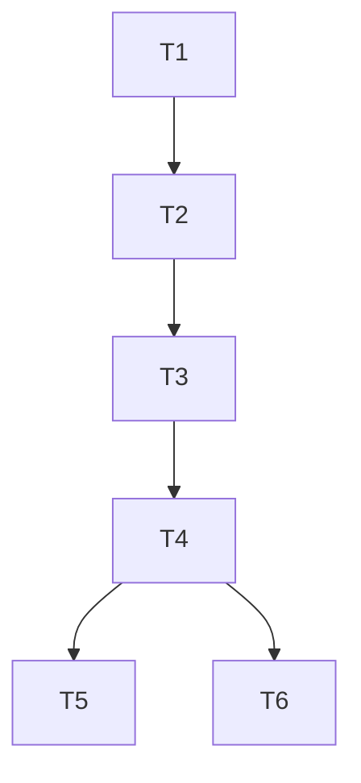

# Revisao de integracao de branches, 2026-10-17

Status: parcial, promocao bloqueada. Esta sessao preservou a main, o remoto e os checkouts preexistentes. Nenhuma operacao financeira foi iniciada.

## Escopo e plano

Pedido: revisar branches e worktrees, preparar a integracao na main e verificar prontidao. Preservar trabalho concorrente, gates, limites, journals e credenciais; sem force-push, exclusao de branches, migrations ou novas dependencias de producao.

| Task | Depende | Done verificavel | Estado |
| --- | --- | --- | --- |
| T1 Inventario | nada | refs, worktrees, conflitos e remoto conferidos por Git | feito |
| T2 Isolamento | T1 | worktree propria da main a589688, lockfiles existentes instalados sem alteracao | feito |
| T3 Ensaio WIP | T2 | cinco conflitos resolvidos, indice e arquivos identicos a main | feito, merge sem commit |
| T4 Verificacao | T3 | checks obrigatorios verdes e revisao do diff | parcial, ver resultados |
| T5 Promocao | T4 | commit e integracao somente com T4 concluida | bloqueado |
| T6 Producao | T4 | qualificacao de runtime comprovada | bloqueado; nenhum processo financeiro iniciado |

## Refs e remotos

Main local: a589688. Origin main: b587759, confirmado por git ls-remote --heads origin. A main local tem 335 commits a frente e zero atras de origin/main.

Origin e o fork ori-inonu/inonu-trader. A main ainda rastreia upstream/main, de jarrodwatts/jev-trader. Nao usar push implicito. Nenhum push foi feito.

Das 16 branches locais anteriores a esta sessao, 15 sao ancestrais da main: main, autoresearch/quero-que-voc-crie-m-tricar-e-ciclos-de-melhoria-20261016, codex/decision-weight-evidence, feat/cerebro-grafo-v2, feat/retorno-composto-por-ciclo, fix/autoresearch-real-online-20261016, fix/jev-executable-decision-20261016, goal1/motor-decisao-onchainos, integracao/autoresearch-na-main, integracao/decisoes-jev-2, integracao/evidencias-codex, integracao/goal1-na-main e worktree-wf_1930517d-e57-54/55/56.

A unica nao ancestral e codex/learning-evidence-wip, 12a5bfa. Seu conteudo de entrega ja foi reconciliado por 0f049ae. Os cinco arquivos divergentes sao copias antigas; os outros 30 arquivos da entrega sao identicos.

## Worktrees

| Local em C:/Users/gabri | HEAD | Estado e destino |
| --- | --- | --- |
| jev-trader | d513d60 | Merge de c67b39e interrompido, 13 caminhos nao resolvidos. Commits da branch ja integrados, mas resolucoes e alteracoes locais ainda precisam de revisao. Preservado. |
| .codex/worktrees/decision-weight-evidence/jev-trader | 00a593b | 33 arquivos nao rastreados. Codigo e documentacao comparados sem diferencas com a main. Preservados, sem duplicar. |
| .codex/worktrees/jev-executable-delivery-20261016/jev-trader | c67b39e | feat/cerebro-grafo-v2 limpa e ja integrada. Preservada. |
| .codex/worktrees/learning-evidence/jev-trader | 12a5bfa | WIP limpa, ensaiada nesta sessao em outra arvore. |
| jev-trader-goal1 | a4a9ef5 | Commit ja integrado. Mais de 1.800 entradas locais agrupadas e 2.246 caminhos com -uall no snapshot. Reorganizacao extensa, exclusoes de codigo, mudancas e fallow como nova devDependency. Preservado para revisao por fatias. |
| jev-trader-main | 3b695ed detached | Limpa, 137 commits atras da main. Documentos identificam esta pasta como producao nas portas 3020/3021; processos e operacoes atuais nao foram certificados. Preservada. |

Worktree propria criada: C:/Users/gabri/.codex/worktrees/main-integration-review-20261017/jev-trader, branch codex/main-integration-review-20261017.

## Ensaio da WIP

Merge sem commit de 12a5bfa sobre a589688, somente na worktree propria. Cinco conflitos add/add resolvidos preservando os blobs da main:

| Arquivo | Razao |
| --- | --- |
| src/outcomes/store.ts | Preserva validacao estrita do vetor, instrumento, instante, motivos de null e controle total de tamanho/rotacao. |
| src/outcomes/types.ts | Preserva StopBasis e a origem opcional da parada. Nenhum schema ou dado foi migrado. |
| src/intel/features/types.ts | Preserva flowReason. |
| src/learning-evidence/dataset.ts | Preserva a adaptacao ao parser estrito e a contagem dos defeitos das features. |
| scripts/learning-dataset.test.ts | Preserva os motivos de null exigidos pelo contrato atual. |

Provas executadas apos resolver: git diff --cached --exit-code HEAD e git diff --exit-code, ambos 0; nenhum caminho nao resolvido. O candidato preserva exatamente o codigo da main. Ainda nao existe commit do merge.

## Verificacao

| Comando | Resultado observado |
| --- | --- |
| bun --no-env-file install --frozen-lockfile --ignore-scripts | exit 0, 160 pacotes existentes no lockfile |
| mesmo install em web | exit 0, 27 pacotes existentes no lockfile |
| bun --no-env-file run --cwd web typecheck | exit 0, tsc --noEmit |
| bun --no-env-file run --cwd web test | apos a correcao: exit 0, 3821 pass, 0 fail, 59679 expects, 252 arquivos, 19,90 s |
| bun --no-env-file run test | exit 0: 8393 pass, 2 skip, 0 fail; 8395 testes em 523 arquivos, 322,41 s |
| bun --no-env-file run typecheck | nao executado: revisao automatica rejeitou o comando |
| bun --no-env-file run test:lab | nao executado: revisao automatica rejeitou o comando |
| typecheck:all e test:all | nao certificados; verificacoes componentes ainda nao satisfazem o gate |

Na primeira rodada o painel tinha duas falhas em web/src/lib/hud/hud.test.ts:82 e :679. Foram corrigidas na retomada, com as dependencias web instaladas. A suite web passa; isto nao satisfaz os checks ainda bloqueados nem comprova prontidao de producao.

Diagnostico: a fixture antiga fornece book.atMs sem observedAtMs. O parser conserva a observacao desconhecida, e o modelo da HUD usa o campo explicito para os horarios da carteira. Os testes agora cobrem o horario explicito, o legado sem horario de observacao e a separacao entre performance.series e a leitura da carteira. Nao foi adicionado fallback ao codigo de producao. O patch de um arquivo foi revisado, aplicado na worktree propria com git apply --check seguido de git apply e validado pela suite web completa e pelo typecheck web (ambos exit 0).

## Achados e impedimentos

1. Bloqueante: checks obrigatorios do core e do laboratorio ainda nao executados impedem promocao. As duas falhas do painel foram resolvidas.
2. Bloqueante: checkout principal com 13 conflitos, inclusive marcadores em src/agent/{entry-cost.test.ts,model.test.ts,wire.ts,wire.test.ts}; nao e um artefato de release utilizavel.
3. Importante: nao incorporar a arvore goal1 inteira. Inclui exclusoes de src/desktop/spike/selftest.ts e src/okx-market/{dex-fixture.ts,okx-api.ts,okx-api.test.ts}, milhares de mudancas documentais e lockfiles alterados.
4. Importante: origem de push deve ser explicita, pois main rastreia o repositorio original de terceiros.
5. Producao: testes com fixtures nao provam qualificacao financeira ou de runtime. Nenhum gate foi alterado, nenhum processo de trading foi iniciado, nenhum fundo foi movimentado.

A primeira revisao automatica retornou: "dynamic execution still needs concrete local review; its recommendation does not grant authority". A reavaliacao apos a instalacao completa das dependencias retornou: "Dynamic execution could not be validated; no fabricated approval was substituted". Nao houve autorizacao especifica e nenhuma protecao foi removida. Desafios mais recentes: core typecheck fcd0a5ec7b03 e test:lab e8c26912fe0d; consulta gh de PRs f5e3533157f1. Eles podem expirar e nao constituem autorizacao. A mensagem generica de continuar nao foi tratada como a permissao de uso unico exigida pelo controle.

O export via scripts/cerebro.ts tambem foi rejeitado; procedimentos e fatos foram lidos como dados estaticos. O apply_patch fora da raiz original foi rejeitado por coordenacao de escrita; este relatorio foi colocado na raiz autorizada, sem alterar o runtime do controle. Nenhum PR foi consultado ou criado. Nenhuma branch ou worktree foi apagada.

## Decisoes e continuidade

Recomendacoes Jev tipadas tool: c31ea5b3-b856-4a00-87b2-236538868359, isolamento, confianca 0,92; 7863b96d-2f66-48a8-a75e-ed6acf6c0a9a, ensaio preservando os cinco blobs atuais, confianca 1; 657678b6-c039-46ba-a0dd-4c556d31f297, alinhar os testes HUD ao contrato explicito, confianca 1. A interface conectada nao foi chamada como consensus_plan/consensus_run. Recomendacoes nao autorizam acoes nem substituem runners.

Checkpoint desta sessao mantido pelo MCP Jev com hashes, paths, resultados e bloqueios; nao substituir o objetivo de outra sessao em .claude/goal. Os runners iniciados encerraram, com os resultados acima. Enquanto houver falhas ou verificacoes obrigatorias bloqueadas, nao commitar nem promover o candidato, conforme skill-ship-pr.

## Proxima fatia

1. Feito: reconciliar os dois testes da HUD com o contrato explicito e repetir suite e tipos web.
2. Resolver os bloqueios de inspecao do typecheck do core e da suite dedicada test:lab, mantendo os hooks ativos; completar tambem os comandos agregados exigidos pelo projeto.
3. Somente com todos os checks verdes, registrar o merge ensaiado e revisar a publicacao explicitamente no fork.
4. Revisar as mudancas nao commitadas da raiz principal e da goal1 por fatias; nada nelas e declarado integrado por este ensaio.

## Decisoes por ciclo e trabalho novo da goal1

O scheduler da main compartilha um unico ciclo entre chamadas concorrentes e aguarda os passos de antes e depois. O runner consulta model.choose com o Brief preparado e registra consulta, tempos, uso e decisao. Porem nao consulta o modelo quando nao ha candidatos, nada a decidir, modelo disponivel ou orcamento, e pode devolver sem_mudanca antes de settings.refreshMin. Este levantamento nao altera cadencia, limites nem o comportamento das ordens. Logo, nao afirmar que a main ja consulta o Jev em todo tick nem que produz lucro em todo ciclo.

Na goal1, varias alteracoes locais sao reorganizacao documental e remocao de exports, enquanto outras tocam o cliente de autenticacao OKX e existem exclusoes e lockfiles. Copiar a arvore inteira sobre a main sobrescreveria integracoes mais recentes. Mantida a revisao por fatias, sem aplicar esse pacote ao runtime.

Implementacao nova identificada: src/prob e scripts/prob-cycle.ts. Biblioteca pura com calibradores, walk-forward, purga, bootstrap agrupado, Brier/AUC e auditoria de dados. Executado somente bun --no-env-file test ./src/prob na worktree goal1: exit 0, 131 pass, 0 fail, 12591 expects, 15 arquivos, 22,28 s. Nenhum journal real foi lido. A documentacao da propria pasta ainda registra lacunas de escala de facetas, cobertura, textos fixos e ausencia de verificacao de tipos. O CLI nao foi executado; a biblioteca nao foi importada para a main nem ligada ao agente. Esse teste comprova os casos sinteticos da biblioteca, nao edge liquido, retorno ou qualificacao financeira.

## Verificacao final da integracao local

Esta secao atualiza os estados de bloqueio das rodadas anteriores. Os comandos typecheck:all e test:all terminaram com exit 0 nesta execucao; o typecheck core passou separadamente e o laboratorio dedicado passou com 650 testes e zero falhas. O grafo foi verificado antes e depois da nova iteracao append-only.

O candidato revisado e integrado com commit de merge, seguido de avancar a main local apenas por fast-forward. As precondicoes recusam HEAD, indice, arquivos ou main que mudaram desde a revisao. Nenhum push ou processo financeiro e executado. As alteracoes nao commitadas da raiz principal e da goal1 continuam preservadas e fora deste merge; o objetivo completo e a qualificacao de producao continuam pendentes.
