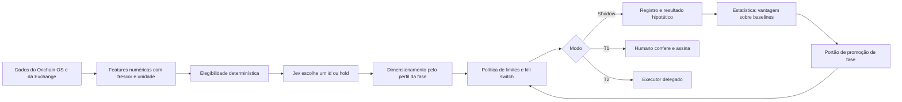

# Tomada de decisão do Jev sobre o Onchain OS: como construir

Data: 2026-10-11. Complementa [ARQUITETURA-CENTRAL-DE-OPERACOES.md](ARQUITETURA-CENTRAL-DE-OPERACOES.md) (decisões D1 a D11) e usa as pesquisas [R1](research/R1-onchain-os-capacidades.md), [R2](research/R2-carteira-permissoes-delegacao.md), [R3](research/R3-estrategias-e-alavancagem.md) e [R5](research/R5-revisao-operador-codigo-final-20261010.md). Não é recomendação de investimento, não promete retorno e não autoriza execução.

## 1. O objetivo e o que a evidência permite

O objetivo do dono é fazer o capital crescer com a inteligência do Jev, com alavancagem se ela ajudar. A evidência reunida diz três coisas que o desenho precisa respeitar:

1. **Ainda não há vantagem demonstrada.** Nenhuma modalidade alcançável pela OKX tem retorno líquido auditável para uma carteira pequena automatizada (R3). O crescimento exponencial relatado em casos isolados não tem fonte verificável e, para qualquer estratégia sem vantagem, a chance de multiplicar o capital por 98,5 é no máximo 1,0%.
2. **Alavancagem multiplica o que já existe, inclusive o arrasto.** Com crescimento logarítmico `g(L) = L*mu - 0,5*L^2*sigma^2`, sem vantagem toda alavancagem acima de zero reduz a mediana. Ela só vale sobre uma vantagem líquida, medida e estável.
3. **Provar uma vantagem leva meses.** Detectar um Sharpe 2 exige cerca de um ano de dados; um Sharpe 4, cerca de 90 dias.

Consequência de projeto: a "tomada de decisão do Jev" não é um robô que persegue lucro. É um **laço de descoberta de vantagem com estatística honesta**. Se existir vantagem em alguma modalidade, o laço a encontra, mede e só então libera mais risco, por fases. Se não existir, o resultado correto é manter capital em rendimento seguro e em `hold`, e isso é um resultado válido, não uma falha.

## 2. O laço de decisão

Em todas as fases o caminho passa pelo registro. O modo `Shadow` (laboratório) é o padrão: cada decisão é gravada com o que cada política teria escolhido, e o resultado é calculado depois, sem look-ahead. Só o resultado estatístico pode abrir uma fase seguinte.

## 3. O que o Jev recebe

Um estado tipado, só com números, enumerações e ids. Nunca texto livre (nomes de token, descrições, notícias), porque isso é a porta da injeção de prompt (R2, seção f).

| Grupo | Features (exemplos) | Fonte no Onchain OS (R1) | Observação |
| --- | --- | --- | --- |
| Preço e fluxo | retornos em 1, 5, 20 e 100 velas, volatilidade realizada, volume, razão compra/venda | Market: candles, trades, price-info | Frescor e `confirm` da vela entram como feature. |
| Liquidez e execução | profundidade a X bps, impacto de preço para o tamanho, taxas embutidas | Trade: cotação; Market: top-liquidity | A unidade de saída da cotação não é declarada pela OKX: ida e volta ficam `research_only` até confirmar. |
| Saúde do token | flags de risco como enumeração, concentração de holders em percentual, idade | Security (token-scan), Market: holder, cluster | "Sem ação" não prova que dá para vender; nunca vira autorização. |
| Fluxo inteligente | contagem de sinais, compra líquida de smart money, desempenho do leaderboard | Signals, Leaderboard, address-tracker | Premium; Monad fora dos exemplos; janela temporal do sinal não documentada. |
| Sentimento | razões de 0 a 1, contagens | Social (consulta por símbolo) | Só como número; nunca o texto. Sem contrato, viola a identidade chain mais contrato: baixa confiança. |
| Rendimento | APY, TVL, prazo, liquidez de saída | DeFi: search e detail | APY anunciado não é retorno líquido. |
| Custos | gás, taxas, slippage, custo de inferência | Gateway: gas-price; cotação | Custo desconhecido é indisponível, nunca zero. |
| Conta e risco | fatia designada, exposição, perda do dia, drawdown, cooldown, fase | Inventário e ledger locais | O Jev vê números, não endereços nem saldos brutos por carteira. |

Cada valor traz instante de observação e origem. Dado ausente, velho ou de unidade incerta aparece como desconhecido e torna o candidato inelegível; não é preenchido com zero.

## 4. O que o Jev devolve

- Um **id de candidato elegível ou `hold`**, com probabilidades. A confiança não é calibrada (R3): a calibração é medida no laboratório (Brier e tabela de confiabilidade), não presumida.
- **Nada mais.** O Jev não escolhe alavancagem, tamanho livre, destino, calldata, aprovação nem prazo. O tamanho vem do perfil da fase (ordem de até 1% do capital operacional na fase 1, por exemplo). A alavancagem vem da fase e da política de limites. Isso mantém "o teto no saldo, no contrato e no humano, nunca no modelo" (R2).
- Jev indisponível, atrasado ou com resposta inválida significa `hold`.

## 5. Elegibilidade determinística (antes do Jev)

Um candidato só chega ao Jev se todas as condições forem verdadeiras: dados completos e frescos; custos conhecidos; unidades confirmadas; verificação de segurança aprovada sem tratar o resultado como prova de venda; profundidade de saída maior que um múltiplo do tamanho; impacto de preço abaixo do teto; resultado líquido conservador maior que o buffer; orçamento diário e de perda disponíveis; a fase permite a modalidade; kill switch desligado. Sem candidato elegível, o Jev nem é consultado e não há custo de inferência.

## 6. Dimensionamento e alavancagem

- **Tamanho:** fração do perfil da fase, nunca livre. Dentro dele, usar o limite inferior do retorno esperado (não a estimativa pontual) para o Kelly fracionado: com 30 dias de dados e vantagem zero, o Kelly estimado tem desvio de 4,6x, então a estimativa pontual é ruído. A função `kellyLowerBound` de `src/policy/envelope.ts` calcula esse limite.
- **Alavancagem:** fase 0 em 0x; fase 1 em 1x spot, sem empréstimo; fase 2 em no máximo 2x e no máximo 0,25 do limite inferior do Kelly, só em modalidade com vantagem medida fora da amostra e em instrumento idêntico. Perp e empréstimo antes disso só existem em simulação.
- **Pisos:** distância de liquidação de pelo menos `max(35%, 2,5*sigma*raiz(7))`; parada diária de -2%, semanal de -5% e de drawdown de -10% com reativação manual; cooldowns de 15 minutos, 24 horas e 72 horas.

## 7. Roteiro por modalidade

| Modalidade | Dados do ecossistema | O que o Jev escolhe | Estado |
| --- | --- | --- | --- |
| Rendimento (Earn, staking, lending) | DeFi search e detail; saldos | Entre produtos elegíveis, ou `hold` | Monitor somente leitura; sem estimativa de custo de subscrição. |
| Carry e basis | Exchange pública (funding, mark, livro) e spot; avaliador `src/okx-derivatives` | Abrir, não abrir ou reduzir, com margem e liquidação calculadas | Avaliador pronto, só pesquisa; resultado líquido abaixo do T-bill nas fontes (R3). |
| Rotação spot em tokens avaliados | Market, Security, Signals, holders | Entre tokens elegíveis, com prazo de retenção fixo | Pesquisa; memes só como pesquisa. |
| Arbitragem DEX e entre venues | Cotações; gas-price | Entre rotas elegíveis | `research_only` até a unidade de saída ser confirmada; competição extrema. |
| Market making na Kuru | Livro on-chain | Compra ou venda por bloco (trader atual) | Paper; contrato de prontidão. |
| Loops alavancados | Lending e preço | Nada em execução | Somente simulação. |

## 8. O laboratório: onde a vantagem é descoberta

O Laboratório de Decisão (`src/lab`, em desenvolvimento) implementa o laço de aprendizado:

1. Em cada época grava os candidatos, as features e o que cada política escolheria: `hold`, aleatória com semente, comprar e manter, regra de momentum, regra de carry e o Jev.
2. Depois do horizonte, calcula o resultado líquido hipotético com custos conservadores e sem usar dados do futuro.
3. Compara o Jev com as políticas simples por diferença pareada, com intervalo de confiança, correção para múltiplas comparações e tratamento da autocorrelação de horizontes sobrepostos.
4. Calcula a calibração das probabilidades e o que a alavancagem de 1x, 2x, 3x, 5x e 10x teria feito com as mesmas decisões: riqueza mediana, probabilidade de liquidação e ruína.
5. Aplica o portão de promoção de fase: mínimo de dias, limite inferior do retorno líquido acima de zero com t maior ou igual a 2, e o limite de Kelly. O portão só **recomenda**; quem decide é o dono, com o checklist de qualificação.

Os dados reais entram por captura somente leitura (Exchange pública sem chave; Onchain OS com a chave do Developer Portal; segundo R1, a Market tem franquia mensal gratuita de 100 mil chamadas Basic e 100 mil Premium e a Trade tem um Trial de 60 dias com 1 RPS) e são reproduzidos pelo mesmo laboratório. O que o dono precisa fazer para começar a coletar: criar a chave no Developer Portal e configurar `OKX_WEB3_API_KEY`, `OKX_WEB3_API_SECRET` e `OKX_WEB3_API_PASSPHRASE` no `.env` local.

## 9. O que não usamos do ecossistema, e por quê

- **Skills, MCP e plugins de estratégia da OKX para decidir ou executar.** O MCP local expõe ferramentas que movem fundos sem modo somente leitura global, e plugins de estratégia contradizem "o Jev decide" (R1). Usamos a Open API somente leitura para dados.
- **Agentic Wallet** só para swaps pontuais e fora do laço da Kuru, com limites baixos no portal (T2-C), e depois de revisão: a política não filtra contrato nem seletor e onde é aplicada não é documentado (R2).
- **Trader Mode na conta principal:** envia a chave ao TEE do fornecedor.
- **Pagamentos x402:** fora do escopo, seguem não autorizados.

## 10. Estado e próximos passos

| Peça | Estado |
| --- | --- |
| Pesquisa (R1 a R5) e decisões D1 a D11 | Em `main` |
| Motor de limites por fase (`src/policy`) | Em `main` |
| Avaliador de derivativos (`src/okx-derivatives`) | Em `main` |
| Checklist de qualificação (`qualify:live`) | Em `main` |
| Operador (candidatos, gate, executor) | Em `main`; R5 manda manter em dry run até F1 a F8 |
| Inventário completo do Onchain OS (R6, catálogo JSON) | Em andamento |
| Laboratório de Decisão (`src/lab`) | Em andamento |
| Clientes de dados das famílias ainda sem cobertura (candles, holders, signals, segurança, social, gás) | Próximo, depois do formato de captura do laboratório |
| Captura contínua somente leitura e relatório semanal | Depois dos clientes; exige a chave do dono |

## 11. Expectativa honesta

Os resultados plausíveis, pela evidência de R3, são: rendimento de baixo risco com retorno próximo do juro livre de risco, e nenhuma vantagem de trading demonstrada para uma carteira pequena. O sistema serve para **descobrir com rigor** se algo melhor existe e para **limitar o dano** se não existir. Ele não promete, e não deve ser usado esperando, crescimento exponencial.
