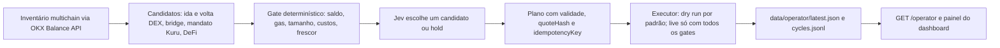

# Jev como operador financeiro da carteira OKX (multichain)

Data: 2026-10-10. Objetivo autorizado: ampliar o Jev (TypeSafe AI) de "decide buy/sell no MON/USDC" para "operador financeiro" que observa o patrimônio da OKX Wallet em todas as redes, recebe candidatos de lucro já filtrados, escolhe um ou mantém, e deixa um plano executável atrás de um gate separado. Este documento registra o que o ecossistema OKX OnChain OS oferece, o que foi implementado nesta entrega e o que continua bloqueado.

## 1. O que a OKX OnChain OS oferece e como o projeto usa

Fontes lidas em 2026-10-10 em web3.okx.com/onchainos/dev-docs. Todas exigem chave de projeto (OK-ACCESS-KEY, SIGN HMAC, PASSPHRASE, TIMESTAMP) no servidor; a extensão não concede essa chave.

| Família | Endpoint | Para que serve no operador | Estado nesta entrega |
| --- | --- | --- | --- |
| Wallet / Balance | `GET /api/v6/dex/balance/all-token-balances-by-address` (até 50 chains por chamada, `excludeRiskToken`) | Inventário multichain do mesmo endereço, com preço unitário USD quando a OKX informa | Implementado: `src/okx-wallet/portfolio.ts` |
| Wallet / Balance | `GET /api/v6/dex/balance/total-value-by-address` (`assetType` tokens, DeFi ou ambos) | Valuation agregada de conferência | Implementado no cliente, não usado no ciclo |
| Trade / Swap | `GET /api/v6/dex/aggregator/quote` | Cotação por tamanho de cada perna de ida e volta | Implementado: `okxSwapQuoter` em `src/okx-wallet/trade.ts` |
| Trade / Swap | `GET /api/v6/dex/aggregator/swap` (+ `approveTransaction=true`) | Calldata do router e `minReceiveAmount`; nada é assinado | Implementado: `prepareEvmSwap` |
| Trade / Cross-chain | `GET /api/v5/dex/cross-chain/quote` e `build-tx` (caminhos confirmados no código do SDK oficial okx/okx-dex-sdk; a CLI oficial usa `slippage` em fração, divergência registrada) | Rebalancear USDT/USDC entre redes, por exemplo X Layer para Solana ou Monad | Cotação implementada; candidatos research only até `OPERATOR_TRUST_BRIDGE_API=true` |
| Onchain Gateway | `GET /api/v6/dex/pre-transaction/gas-price`, `POST .../simulate` (whitelist), `POST .../broadcast-transaction` | Simular antes de enviar; MEV protection em ETH, BSC, SOL e Base | Caminhos registrados; não chamados |
| Market | Meme Pump, price-info, advanced-info, top-liquidity, signals (já existentes) | Pesquisa; nunca elegível para execução | Já existia (`okx:market-scan`, `okx:signals`) |
| DeFi | `POST /api/v6/defi/product/search` (rate em fração, tvl em USD), `POST /api/v6/defi/transaction/exit`, posições do usuário | Rendimento como candidato com APY anunciado | Fonte live ligada (`src/okx-wallet/defi.ts`); custo de subscribe ainda desconhecido, então o gate rejeita por `costs_incomplete` |
| Derivativos | OKX Exchange API v5 pública `GET /api/v5/public/funding-rate` (sem autenticação) | Funding carry (spot long + perp short) como pesquisa; X Layer "Exchange OS" para perps on-chain anunciado em 2026 sem API pública documentada | Candidatos `perp_funding_carry` research only; nenhuma posição alavancada é aberta |
| Dapp Connect | provider EVM (`window.okxwallet`) e provider Solana (`window.okxwallet.solana`: `connect`, `accountChanged`, `disconnect`) | Leitura no navegador sem assinatura | Implementado: `web/src/lib/okx-solana.ts` |

Redes e chainIndex adotados: Monad 143, X Layer 196, Solana 501, Ethereum 1, BNB Chain 56, Base 8453, Arbitrum 42161, Polygon 137, Optimism 10; Tron 195, Sui 784, TON 607 e Bitcoin 0 constam no registro para inventário, sem par de negociação.

### Signatários e alternativa

- EVM: `OPERATOR_PRIVATE_KEY` de uma carteira dedicada ao operador (nunca a `PRIVATE_KEY` do trader), com saldo limitado ao capital aceito para perda; o endereço derivado dela deve ser igual a `OPERATOR_ADDRESS`, o que é verificado uma vez por plano, antes do primeiro envio.
- Solana: `SOLANA_PRIVATE_KEY` (base58) e `OPERATOR_RPC_501` não alimentam nada em produção: o signatário de `src/okx-wallet/solana-signer.ts` (ed25519 com `node:crypto`) só é criado em testes; a execução Solana está desligada no executor (`SOLANA_LIVE_ENABLED=false`) até existir política de transação.
- Alternativa documentada pela OKX: Agentic Wallet do Onchain OS (chaves em TEE da OKX, subcarteiras, limites e whitelist configurados no portal). Não integrada aqui; candidata a substituir a chave no .env em uma etapa de qualificação.

## 2. Arquitetura entregue



Módulos:

- `src/okx-wallet/chains.ts`: registro de redes, validação de lista e de formato de endereço por família (EVM, Solana, Tron, Sui, TON, Bitcoin).
- `src/okx-wallet/portfolio.ts`: cliente assinado somente leitura e `normalizeInventory`. Saldo inválido fica `null`, preço ausente deixa a rede como "parcial"; nunca vira zero.
- `src/okx-wallet/trade.ts`: cliente assinado para quote, swap, approve, gas-price e cross-chain, com fila de uma requisição por vez; `prepareEvmSwap` monta a transação e não envia.
- `src/operator/candidates.ts`: pares padrão stablecoin para moeda nativa por rede; tamanho limitado por `OPERATOR_MAX_PLAN_USD`, fração do patrimônio e 90% do ativo; líquido = saída da segunda perna menos entrada menos taxas de rede menos custo de inferência.
- `src/operator/risk-gate.ts`: motivos explícitos (`gas_below_reserve`, `quote_stale`, `net_below_minimum`, `costs_incomplete`, `source_balance_insufficient`, `research_only`...).
- `src/operator/jev-selector.ts`: pergunta `choice` do TypeSafe com critérios `hold` + ids dos candidatos elegíveis. O estado enviado ao Jev não contém endereço, contratos, credenciais ou cotações brutas. A resposta só vale se for um id conhecido com probabilidades válidas.
- `src/operator/plan.ts` e `executor.ts`: plano com validade (`OPERATOR_PLAN_TTL_MS`), chave idempotente sha256(candidato, quoteHash, tamanho) e `maxLossUsd`; execução EVM via ethers, só quando `OPERATOR_EXECUTE=true`, `OPERATOR_LIVE_ACK=OWN_FUNDS_RISK_OPERATOR`, `OPERATOR_PRIVATE_KEY`, o modelo real (`--jev`), um ledger criado e, por chainIndex, `OPERATOR_RPC_` e as allowlists `OPERATOR_ROUTER_`, `OPERATOR_SPENDER_` e `OPERATOR_SELECTORS_` existem; `DRY_RUN` e `LIVE_ACK` do trader não são consultados, a `PRIVATE_KEY` do trader é lida só para recusar uma chave igual (não é gate) e a execução Solana está desligada. O executor conduz as duas pernas: approve de valor exato, com calldata local, para o spender que a OKX informa e que precisa estar na allowlist (nunca `signatureData` remoto), perna 1, recibo, perna 2 com o mínimo garantido da perna 1, recibo. Tron, Sui, TON e Bitcoin não têm signatário: ficam em dry run.
- Perfis de política (`OPERATOR_PROFILE`): `micro` é o padrão (5 USD ou 5% do patrimônio por plano, 20 USD de notional por dia contando as duas pernas (até 2 planos de 5 USD) e no máximo 4 planos por dia, cooldown de 15 min) e `standard` mantém os limites de pesquisa (25 USD, 25%, 100 USD, 10 planos, 2 min). Variáveis explícitas sobrepõem o perfil. Com uma carteira de cerca de 80 USD, o mínimo de 200 MON na Kuru já supera 5%, então o mandato Kuru não é dimensionado por este perfil.
- `src/operator/ledger.ts`: ledger persistente (`data/operator/ledger.json`) com chaves executadas, teto diário de notional e de planos, cooldown, kill switch por arquivo (`data/operator/STOP`) e máquina de estados das pernas (`leg1_sent`, `leg1_confirmed`, `leg2_sent`, `reconciliation_required`, `closed`, `failed`). Uma perna aberta bloqueia o mesmo par; uma perna `reconciliation_required`, `failed` ou antiga bloqueia qualquer plano até reconciliação manual.
- Barreira de unidades: `toTokenAmount` da OKX não tem unidade declarada em nenhuma página oficial (ver `docs/okx-dex-units-v3` e `docs/okx-dex-sdk-units-v1`). O que existe é um auxiliar de exibição no SDK oficial que divide o valor por `10^decimal`; isso não qualifica a unidade. Por isso idas e voltas via API ficam research only até `OPERATOR_TRUST_QUOTE_UNITS=true`, decisão explícita do operador humano após um teste autenticado de menor valor.
- Reconciliação: depois de um plano `completed` o ciclo marca a perna como `reconciliation_required`, o que bloqueia qualquer novo plano, relê o inventário e informa a variação observada (`observedBalanceDeltaUsd`) só como diagnóstico, sem atribuí-la ao plano; `realizedUsd` fica `null` e o ledger não recebe nada automaticamente. Só `--reconcile <planId> <closed|failed> --realized <usd>` lança o resultado assinado (gás incluído, conferido no explorer) no dia, na semana e no drawdown, e é isso que alimenta as paradas por perda (`OPERATOR_MAX_DAILY_LOSS_USD`, `OPERATOR_MAX_WEEKLY_LOSS_USD`, `OPERATOR_MAX_DRAWDOWN_USD`).
- `bun run okx:operator --live --routers` imprime o router que o endpoint de swap usaria em cada rede EVM, para conferência no explorer antes de copiar em `OPERATOR_ROUTER_<chainIndex>`; a OKX não publica uma tabela oficial de routers por rede nas páginas lidas.
- `src/operator/cycle.ts`: um ciclo completo; Jev só é consultado quando há elegíveis, então um ciclo sem candidato não gera custo de inferência. O estado persistido tem o endereço reduzido. O Jev tem prazo para decidir (`OPERATOR_DECISION_TIMEOUT_MS`, padrão 10000, inteiro de 1 a 30000): passado o prazo o ciclo registra `decision_timeout` e não envia nada. A linha do journal é gravada antes de trocar o `latest.json`, e no Windows a troca é repetida (até 4 tentativas) quando um leitor segura o arquivo.
- `scripts/okx-operator.ts`: CLI (`bun run okx:operator`), com `--live`, `--jev` e `--loop`.
- `src/server.ts`: `GET /operator` serve o último ciclo.
- Dashboard: `MultichainPanel` lê a mesma conta EVM em oito redes por RPC pública sem trocar a rede da extensão, conecta a conta Solana pela OKX e mostra inventário, candidatos, decisão do Jev e estado da execução.

## 2b. Correções após a revisão independente R5 (2026-10-11)

A revisão `docs/research/R5-revisao-operador-codigo-final-20261010.md` vetou o estágio live e listou as condições F1 a F8. Estado após esta rodada:

| Condição | Aplicado | Onde |
| --- | --- | --- |
| F1 Solana | Execução Solana desligada no executor (`SOLANA_LIVE_ENABLED=false`) com teste de guarda; o signatário fica para testes e trabalho futuro com política de program ids e simulação | `executor.ts`, `operator.test.ts` |
| F2 EVM | `value` exato (0 para ERC-20, tamanho para nativo), teto de gas limit, selector obrigatório na allowlist, router obrigatório, spender vindo de `approve-transaction` e obrigatório na allowlist, `eth_call` antes de cada perna | `executor.ts` (`checkPreparedLeg`), `trade.ts` (`fetchApproveSpender`) |
| F3 Ledger | `--init-ledger` explícito, ausência bloqueia execução, parse estrito, escrita atômica, caminhos absolutos a partir da raiz do repositório, lock de processo | `ledger.ts`, `config.ts`, CLI |
| F4 Idempotência e STOP | `quoteHash` sem timestamps; kill switch lido antes de cada envio | `candidates.ts`, `executor.ts` |
| F5 Gates próprios | `OPERATOR_LIVE_ACK`, `OPERATOR_PRIVATE_KEY`, `--jev` obrigatório; `DRY_RUN` e `LIVE_ACK` do trader não são consultados e a `PRIVATE_KEY` do trader só serve para recusar uma chave igual; bridge nunca vira plano live | `config.ts` (`operatorLiveGate`), `plan.ts` |
| F6 Reconciliação | o gás dos recibos é somado em `gasCostNative` no resultado do ciclo, só como informação, e não é deduzido de nada; as paradas diária, semanal e de drawdown ficam no ledger e só recebem dados de `--reconcile <planId> <closed\|failed> --realized <usd>` (o valor informado deve incluir o gás) | `executor.ts`, `ledger.ts`, CLI |
| F7 Exposição | erros sanitizados (sem URL, calldata ou chaves); rotas `/operator*` só para origens do painel, token opcional, cache do journal e limite de tamanho; divulgação das RPCs de terceiros no painel | `executor.ts` (`sanitizeError`), `operator/http.ts`, `MultichainPanel` |
| F8 Testes | gates, Solana bloqueado, segunda perna revertida, STOP no meio do plano, ledger em arquivo real com lock, parse estrito, handler HTTP | `operator.test.ts`, `ledger.test.ts`, `http.test.ts` |

Ainda sem solução nesta rodada: política de transação Solana (fica desligado), reconciliação on-chain por recibo em vez de leitura da API de saldo (o gás já entra), rotação do journal, e a origem oficial dos routers (a OKX não publica tabela; `--routers` mostra o `tx.to` para conferência manual). Tetos duros em `HARD_LIMITS` impedem o env de ultrapassar 100 USD por plano, 500 USD por dia, 24 planos por dia e cooldown abaixo de 60 s.

## 2c. Após a re-revisão R8 (2026-10-11)

`docs/research/R8-re-revisao-operador-f1-f8-20261011.md` manteve o veredito de não liberar o estágio 3 e listou as condições C1 a C9. O commit 9fd6f39 mudou a semântica da conclusão: um plano `completed` vira `reconciliation_required` e bloqueia o operador até reconciliação manual; o ciclo não calcula mais o resultado realizado. Correções desta rodada (outras já tinham entrado na `main` por outras sessões: lock em todos os escritores do CLI, validação do contexto de decisão com recusa do `mock`, tentativa de renomeação do ledger no Windows):

| Item | Aplicado | Onde |
| --- | --- | --- |
| C1 (N1) piso da perna 2 | A saída vende o mínimo garantido da perna 1 e o esperado escala proporcionalmente (`scaleExpectedOut`); os fakes dos testes aplicam o desconto de slippage nas duas pernas. O piso da perna 2 não tem tolerância contra a cotação do candidato: uma queda de 0,01% no ativo intermediário, ou 1 ponto base adverso só na perna 2, recusa a saída depois da perna 1 e deixa a posição presa até a reconciliação manual; cerca de 0,5% do ativo intermediário fica na carteira. | `executor.ts`, `operator.test.ts` |
| C3 (N3, N7) ledger e reconcile | `--init-ledger` recusa quando já há histórico (exige `--accept-history`, que só vale junto de `--init-ledger`); `--reconcile <planId> <closed\|failed> --realized <usd>` registra o resultado assinado, com gás. `--realized <usd>` é obrigatório, aceita no máximo 2 vezes `OPERATOR_MAX_PLAN_USD` (o limite por plano do perfil quando a variável não está definida) em valor absoluto e registra o resultado uma única vez por plano, na mesma escrita que troca o estado da perna; o valor é FINAL: lance-o só depois de desfazer a posição aberta e de conferir o total no explorer (a perna `failed` já bloqueia o operador até lá), porque um parcial lançado antes impede lançar o total depois e deixa as paradas de perda subestimadas; uma perna que já tem resultado lançado muda de estado com `closed` sem novo `--realized`, uma perna `failed` do fluxo antigo, sem o campo, fecha com `--realized 0`, e `--realized` sem `--reconcile` é recusado | `scripts/okx-operator.ts`, `src/operator/ledger.ts` |
| C4 (N5) gates | `OPERATOR_LIVE_ACK` vazio vale como ausente; `OPERATOR_PRIVATE_KEY` igual à `PRIVATE_KEY` do trader é recusada somente quando as duas estão no mesmo ambiente (a comparação é pelo texto da chave ao carregar a configuração e pelo endereço que ela deriva antes de criar o signatário; no modo `--env-file=.env.operator` que o guia manda usar a `PRIVATE_KEY` do trader não existe e nada é comparado; confirme você mesmo que a chave é de uma carteira dedicada); o script `okx:operator` roda com `--no-env-file` | `config.ts`, `cli-guards.ts`, `package.json` |
| C7 (F8) testes | piso proporcional com desconto, janela de saída, gates um a um, chave do trader recusada; o teste de approval identity escreve no diretório temporário do sistema, não no repositório | `operator.test.ts`, `executor.approval-identity.test.ts` |
| C9 (N8) prazo da saída | `OPERATOR_EXIT_WINDOW_MS` dá à perna 2 uma janela própria após a confirmação da perna 1, nunca menor que o prazo do plano. Padrão 0 mantém a regra atual do dono (prazo de entrada vale para a saída) até a decisão D2 | `executor.ts`, `config.ts` |

Seguem abertos e dependem do dono (D1 a D8 da R8): política do repo sobre `LIVE_ACK`, semântica do STOP no meio do plano, exposição de `/operator*`, guarda da chave fora do `.env`, reconciliação on-chain automática (hoje um plano por intervenção manual), tetos duros adicionais, origem oficial de routers e spenders e rotação do journal. C2 (decodificar receiver e minReturn do calldata) e C8 (teste autenticado de menor valor) também seguem abertos.

## 3. Como rodar

Demonstração offline (sem rede, sem credenciais):

```bash
bun run okx:operator
```

Antes de qualquer execução, crie o ledger uma única vez (sem ele a execução fica bloqueada; com histórico já existente acrescente `--accept-history`):

```bash
bun run okx:operator --init-ledger
```

Depois de cada plano concluído, confira as transações no explorer e feche a perna informando o resultado assinado em USD, com gás; só esse registro alimenta as paradas de perda:

```bash
bun run okx:operator --reconcile plan_xxxxxxxxxxxx closed --realized -0.42
```

Inventário e cotações reais (somente leitura; nada é enviado):

```bash
OKX_WEB3_API_KEY=... OKX_WEB3_API_SECRET=... OKX_WEB3_API_PASSPHRASE=... OPERATOR_ADDRESS=0xSuaConta bun run okx:operator --live
```

Com decisão do Jev real e repetição contínua:

```bash
bun --no-env-file --env-file=.env.operator run scripts/okx-operator.ts --live --jev --loop
```

O painel em http://localhost:3001 mostra o ciclo via `GET /operator` do backend na porta 3000. Para Solana, conecte a conta Solana da extensão no painel; a conta EVM e a conta Solana são endereços distintos, e a API de saldo precisa do endereço da família certa (`OPERATOR_ADDRESS` EVM cobre as redes EVM; para incluir Solana no inventário do backend use um ciclo separado com o endereço Solana e `OPERATOR_CHAINS=501`).

### Lock obsoleto (`Operator lock present`)

Todo escritor do CLI (o ciclo, `--init-ledger` e `--reconcile`) toma o lock `data/operator/LOCK` (ou `OPERATOR_LOCK_PATH`) antes de ler o ledger e o solta ao terminar. Se o CLI recusar com `Operator lock present at <caminho>; another operator may be running`, ou há outro operador vivo, ou um encerramento forçado (queda de energia, console fechado, processo morto) deixou o arquivo para trás. O lock nunca é removido automaticamente. Para decidir:

1. Abra o arquivo do lock e leia o pid: ele guarda uma linha `<pid> <data ISO>`.
2. Confira o processo: `tasklist /FI "PID eq <pid>"`. O Windows reaproveita pids, então um pid vivo só prova que o operador roda se a imagem for o `bun.exe` do operador.
3. Operador vivo: não apague nada; deixe o ciclo terminar ou encerre-o pelo console dele.
4. Processo inexistente (o `tasklist` informa que nenhuma tarefa corresponde) ou pid de outro programa: o lock é obsoleto. Apague o arquivo LOCK à mão, nunca com o operador vivo.
5. Depois confira o ledger (`data/operator/ledger.json`). Se houver perna aberta (`leg1_sent`, `leg1_confirmed`, `leg2_sent`, `reconciliation_required` ou `failed`), confira as transações no explorer e desfaça a posição aberta à mão. Só então feche o plano, uma única vez, com o resultado FINAL assinado (gás incluído): `bun --no-env-file --env-file=.env.operator run scripts/okx-operator.ts --reconcile <planId> <closed|failed> --realized <usd>`. O ledger guarda um único resultado por plano, então um valor parcial lançado antes impede lançar o total depois. Uma perna `failed` não desbloqueia o operador antes de ser fechada com `closed` ou lançada com o resultado final.
6. Para corrigir um valor lançado por engano ou parcial, pare o operador, tome o lock (crie o arquivo LOCK do passo 1 com uma linha `<pid> <data ISO>`) e, depois de copiar `data/operator/ledger.json`, edite o arquivo: na perna do plano ajuste `realizedUsd`; some a diferença a `dailyRealizedUsd` do dia do lançamento e a `cumulativeRealizedUsd`; recalcule `peakRealizedUsd` como o maior valor que `cumulativeRealizedUsd` já atingiu. Apague o lock ao terminar. O CLI recusa, com o motivo, um ledger que não passe na leitura.

## 4. O que o ciclo sintético mostra hoje

O fixture sintético dá à X Layer uma ida e volta com líquido positivo (cerca de 0,13 USD em 25 USD) e às demais redes um líquido negativo. O Jev mock escolhe a ida e volta na X Layer, o plano sai `qualified_dry_run` e a execução registra `dry_run` porque o gate está fechado. O produto DeFi sintético é rejeitado por custo de subscribe desconhecido e o funding carry aparece como pesquisa. Lucro real depende de cotações reais que mostrem desvio entre rotas, de unidades qualificadas e de execução reconciliada; nenhum lucro foi realizado nesta entrega.

## 5. O que continua bloqueado e por quê

- Execução live: exige os gates acima e, pelo contrato de readiness, revisão independente e reconciliação de recibos. O executor envia a segunda perna só após o recibo da primeira; se a segunda falhar, a posição fica registrada como `failed` e bloqueia o operador até reconciliação manual.
- Cross-chain: caminhos v5 confirmados no SDK, mas a CLI oficial usa outra convenção de slippage; bridges ficam research only até `OPERATOR_TRUST_BRIDGE_API=true`.
- Revisão de segurança da sessão paralela (2026-10-10) tratada: limites acumulados, idempotência persistente, máquina de estados, allowlist de router com approve exato, conferência de `minReceiveAmount` contra a cotação e igualdade de endereço do signatário.
- Simulate API e MEV protection: whitelist da OKX.
- Alavancagem, futuros e empréstimo: não implementados. Crescimento composto usa apenas resultado líquido realizado; promessas de multiplicação de capital não são parâmetro do sistema.
- Preço de alguns tokens pode vir vazio na Balance API (ex.: USDC na Solana no fixture); a rede fica marcada como parcial e o tamanho desse ativo não é calculado.

## 6. Próximos passos sugeridos

1. Rodar `--live` com as credenciais OKX e o endereço real para capturar inventário e cotações reais por alguns dias em dry run; medir quantos candidatos passam pelo gate.
2. Ligar `DefiSource` ao `okx:defi` existente com o cliente assinado.
3. Adicionar assinatura Solana no navegador (a extensão oferece `signAndSendTransaction`) para planos Solana aprovados pelo operador, mantendo a confirmação explícita do usuário.
4. Reconciliar fills do executor com o journal existente antes de permitir a segunda perna automaticamente.
