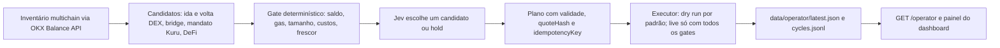

# Jev como operador financeiro da carteira OKX (multichain)

Data: 2026-10-10. Objetivo autorizado: ampliar o Jev (TypeSafe AI) de "decide buy/sell no MON/USDC" para "operador financeiro" que observa o patrimônio da OKX Wallet em todas as redes, recebe candidatos de lucro já filtrados, escolhe um ou mantém, e deixa um plano executável atrás de um gate separado. Este documento registra o que o ecossistema OKX OnChain OS oferece, o que foi implementado nesta entrega e o que continua bloqueado.

## 1. O que a OKX OnChain OS oferece e como o projeto usa

Fontes lidas em 2026-10-10 em web3.okx.com/onchainos/dev-docs. Todas exigem chave de projeto (OK-ACCESS-KEY, SIGN HMAC, PASSPHRASE, TIMESTAMP) no servidor; a extensão não concede essa chave.

| Família | Endpoint | Para que serve no operador | Estado nesta entrega |
| --- | --- | --- | --- |
| Wallet / Balance | `GET /api/v6/dex/balance/all-token-balances-by-address` (até 50 chains por chamada, `excludeRiskToken`) | Inventário multichain do mesmo endereço, com preço unitário USD quando a OKX informa | Implementado: `src/okx-wallet/portfolio.ts` |
| Wallet / Balance | `GET /api/v6/dex/balance/total-value-by-address` (`assetType` tokens, DeFi ou ambos) | Valuation agregada de conferência | Implementado no cliente, não usado no ciclo |
| Trade / Swap | `GET /api/v6/dex/aggregator/quote` | Cotação por tamanho de cada perna de ida e volta | Implementado: `okxSwapQuoter` em `src/okx-wallet/trade.ts` |
| Trade / Swap | `GET /api/v6/dex/aggregator/swap` (+ `approveTransaction=true`) | Calldata do router e `minReceiveAmount`; nada é assinado | Implementado: `prepareEvmSwap` |
| Trade / Cross-chain | `GET /api/v5/dex/cross-chain/quote` e `build-tx` (caminhos confirmados no código do SDK oficial okx/okx-dex-sdk; a CLI oficial usa `slippage` em fração, divergência registrada) | Rebalancear USDT/USDC entre redes, por exemplo X Layer para Solana ou Monad | Cotação implementada; candidatos research only até `OPERATOR_TRUST_BRIDGE_API=true` |
| Onchain Gateway | `GET /api/v6/dex/pre-transaction/gas-price`, `POST .../simulate` (whitelist), `POST .../broadcast-transaction` | Simular antes de enviar; MEV protection em ETH, BSC, SOL e Base | Caminhos registrados; não chamados |
| Market | Meme Pump, price-info, advanced-info, top-liquidity, signals (já existentes) | Pesquisa; nunca elegível para execução | Já existia (`okx:market-scan`, `okx:signals`) |
| DeFi | `POST /api/v6/defi/product/search` (rate em fração, tvl em USD), `POST /api/v6/defi/transaction/exit`, posições do usuário | Rendimento como candidato com APY anunciado | Fonte live ligada (`src/okx-wallet/defi.ts`); custo de subscribe ainda desconhecido, então o gate rejeita por `costs_incomplete` |
| Derivativos | OKX Exchange API v5 pública `GET /api/v5/public/funding-rate` (sem autenticação) | Funding carry (spot long + perp short) como pesquisa; X Layer "Exchange OS" para perps on-chain anunciado em 2026 sem API pública documentada | Candidatos `perp_funding_carry` research only; nenhuma posição alavancada é aberta |
| Dapp Connect | provider EVM (`window.okxwallet`) e provider Solana (`window.okxwallet.solana`: `connect`, `accountChanged`, `disconnect`) | Leitura no navegador sem assinatura | Implementado: `web/src/lib/okx-solana.ts` |

Redes e chainIndex adotados: Monad 143, X Layer 196, Solana 501, Ethereum 1, BNB Chain 56, Base 8453, Arbitrum 42161, Polygon 137, Optimism 10; Tron 195, Sui 784, TON 607 e Bitcoin 0 constam no registro para inventário, sem par de negociação.

### Signatários e alternativa

- EVM: `PRIVATE_KEY` de uma carteira dedicada ao operador, com saldo limitado ao capital aceito para perda; igualdade com `OPERATOR_ADDRESS` é verificada antes de enviar.
- Solana: `SOLANA_PRIVATE_KEY` (base58) e `OPERATOR_RPC_501`; a assinatura ed25519 é feita com `node:crypto`, sem dependências, reproduzindo o fluxo do SDK (base58, blockhash renovado, slot 0).
- Alternativa documentada pela OKX: Agentic Wallet do Onchain OS (chaves em TEE da OKX, subcarteiras, limites e whitelist configurados no portal). Não integrada aqui; candidata a substituir a chave no .env em uma etapa de qualificação.

## 2. Arquitetura entregue



Módulos:

- `src/okx-wallet/chains.ts`: registro de redes, validação de lista e de formato de endereço por família (EVM, Solana, Tron, Sui, TON, Bitcoin).
- `src/okx-wallet/portfolio.ts`: cliente assinado somente leitura e `normalizeInventory`. Saldo inválido fica `null`, preço ausente deixa a rede como "parcial"; nunca vira zero.
- `src/okx-wallet/trade.ts`: cliente assinado para quote, swap, approve, gas-price e cross-chain, com fila de uma requisição por vez; `prepareEvmSwap` monta a transação e não envia.
- `src/operator/candidates.ts`: pares padrão stablecoin para moeda nativa por rede; tamanho limitado por `OPERATOR_MAX_PLAN_USD`, fração do patrimônio e 90% do ativo; líquido = saída da segunda perna menos entrada menos taxas de rede menos custo de inferência.
- `src/operator/risk-gate.ts`: motivos explícitos (`gas_below_reserve`, `quote_stale`, `net_below_minimum`, `costs_incomplete`, `source_balance_insufficient`, `research_only`...).
- `src/operator/jev-selector.ts`: pergunta `choice` do TypeSafe com critérios `hold` + ids dos candidatos elegíveis. O estado enviado ao Jev não contém endereço, contratos, credenciais ou cotações brutas. A resposta só vale se for um id conhecido com probabilidades válidas.
- `src/operator/plan.ts` e `executor.ts`: plano com validade (`OPERATOR_PLAN_TTL_MS`), chave idempotente sha256(candidato, quoteHash, tamanho) e `maxLossUsd`; execução EVM via ethers e Solana via signatário próprio só quando `OPERATOR_EXECUTE=true`, `DRY_RUN=false`, `LIVE_ACK=OWN_FUNDS_RISK`, chave dedicada, `OPERATOR_RPC_<chainIndex>` e `OPERATOR_ROUTER_<chainIndex>` existem. O executor conduz as duas pernas: approve com calldata local de valor exato para o router da allowlist (nunca `signatureData` remoto), perna 1, recibo, perna 2 com o mínimo recebido, recibo. Tron, Sui, TON e Bitcoin não têm signatário: ficam em dry run.
- Perfis de política (`OPERATOR_PROFILE`): `micro` é o padrão (5 USD ou 5% do patrimônio por plano, 20 USD e 4 planos por dia, cooldown de 15 min) e `standard` mantém os limites de pesquisa (25 USD, 25%, 100 USD, 10 planos, 2 min). Variáveis explícitas sobrepõem o perfil. Com uma carteira de cerca de 80 USD, o mínimo de 200 MON na Kuru já supera 5%, então o mandato Kuru não é dimensionado por este perfil.
- `src/operator/ledger.ts`: ledger persistente (`data/operator/ledger.json`) com chaves executadas, teto diário de notional e de planos, cooldown, kill switch por arquivo (`data/operator/STOP`) e máquina de estados das pernas (`leg1_sent`, `leg1_confirmed`, `leg2_sent`, `closed`, `failed`). Uma perna aberta bloqueia o mesmo par; uma perna `failed` ou antiga bloqueia qualquer plano até reconciliação manual.
- Barreira de unidades: `toTokenAmount` da OKX não tem unidade declarada na documentação (ver `docs/okx-dex-units-v3`); a evidência disponível é o SDK oficial, que divide por `10^decimal`. Por isso idas e voltas via API ficam research only até `OPERATOR_TRUST_QUOTE_UNITS=true`, decisão explícita do operador humano após teste autenticado.
- Reconciliação: após um plano `completed`, o ciclo relê o inventário e calcula o resultado realizado como variação do ativo base ao preço observado antes do plano; o valor vai para `dailyRealizedUsd` do ledger e alimenta a parada por perda diária (`OPERATOR_MAX_DAILY_LOSS_USD`). Saldo ou preço desconhecido deixa o resultado `null`, nunca zero.
- `bun run okx:operator --live --routers` imprime o router que o endpoint de swap usaria em cada rede EVM, para conferência no explorer antes de copiar em `OPERATOR_ROUTER_<chainIndex>`; a OKX não publica uma tabela oficial de routers por rede nas páginas lidas.
- `src/operator/cycle.ts`: um ciclo completo; Jev só é consultado quando há elegíveis, então um ciclo sem candidato não gera custo de inferência. O estado persistido tem o endereço reduzido.
- `scripts/okx-operator.ts`: CLI (`bun run okx:operator`), com `--live`, `--jev` e `--loop`.
- `src/server.ts`: `GET /operator` serve o último ciclo.
- Dashboard: `MultichainPanel` lê a mesma conta EVM em oito redes por RPC pública sem trocar a rede da extensão, conecta a conta Solana pela OKX e mostra inventário, candidatos, decisão do Jev e estado da execução.

## 3. Como rodar

Demonstração offline (sem rede, sem credenciais):

```bash
bun run okx:operator
```

Inventário e cotações reais (somente leitura; nada é enviado):

```bash
OKX_WEB3_API_KEY=... OKX_WEB3_API_SECRET=... OKX_WEB3_API_PASSPHRASE=... OPERATOR_ADDRESS=0xSuaConta bun run okx:operator --live
```

Com decisão do Jev real e repetição contínua:

```bash
bun run okx:operator --live --jev --loop
```

O painel em http://localhost:3001 mostra o ciclo via `GET /operator` do backend na porta 3000. Para Solana, conecte a conta Solana da extensão no painel; a conta EVM e a conta Solana são endereços distintos, e a API de saldo precisa do endereço da família certa (`OPERATOR_ADDRESS` EVM cobre as redes EVM; para incluir Solana no inventário do backend use um ciclo separado com o endereço Solana e `OPERATOR_CHAINS=501`).

## 4. O que o ciclo sintético mostra hoje

O fixture sintético dá à X Layer uma ida e volta com líquido positivo (cerca de 0,13 USD em 25 USD) e às demais redes um líquido negativo. O Jev mock escolhe a ida e volta na X Layer, o plano sai `qualified_dry_run` e a execução registra `dry_run` porque o gate está fechado. O produto DeFi sintético é rejeitado por custo de subscribe desconhecido e o funding carry aparece como pesquisa. Lucro real depende de cotações reais que mostrem desvio entre rotas, de unidades qualificadas e de execução reconciliada; nenhum lucro foi realizado nesta entrega.

## 5. O que continua bloqueado e por quê

- Execução live: exige os gates acima e, pelo contrato de readiness, revisão independente e reconciliação de recibos. O executor envia a segunda perna só após o recibo da primeira; se a segunda falhar, a posição fica registrada como `failed` e bloqueia o operador até reconciliação manual.
- Cross-chain: caminhos v5 confirmados no SDK, mas a CLI oficial usa outra convenção de slippage; bridges ficam research only até `OPERATOR_TRUST_BRIDGE_API=true`.
- Revisão de segurança da sessão paralela (2026-10-10) tratada: limites acumulados, idempotência persistente, máquina de estados, allowlist de router com approve exato, conferência de `minReceiveAmount` contra a cotação e igualdade de endereço do signatário.
- Simulate API e MEV protection: whitelist da OKX.
- Alavancagem, futuros e empréstimo: não implementados. Crescimento composto usa apenas resultado líquido realizado; promessas de multiplicação de capital não são parâmetro do sistema.
- Preço de alguns tokens pode vir vazio na Balance API (ex.: USDC na Solana no fixture); a rede fica marcada como parcial e o tamanho desse ativo não é calculado.

## 6. Próximos passos sugeridos

1. Rodar `--live` com as credenciais OKX e o endereço real para capturar inventário e cotações reais por alguns dias em dry run; medir quantos candidatos passam pelo gate.
2. Ligar `DefiSource` ao `okx:defi` existente com o cliente assinado.
3. Adicionar assinatura Solana no navegador (a extensão oferece `signAndSendTransaction`) para planos Solana aprovados pelo operador, mantendo a confirmação explícita do usuário.
4. Reconciliar fills do executor com o journal existente antes de permitir a segunda perna automaticamente.
