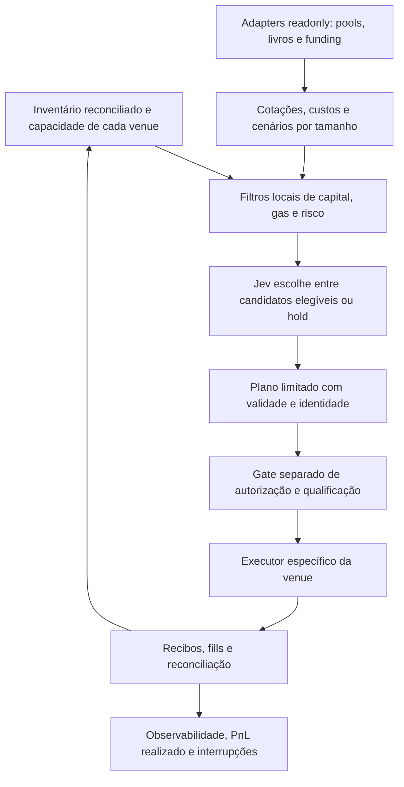

# Evolução do INONU TRADER: inventário e oportunidades

2026-10-09. Proposta técnica no objetivo autorizado; execução financeira permanece desligada. Critérios A1–A4: `WALLET-OPPORTUNITIES-SPEC.md`.

## Estado atual e primeira entrega

O projeto tem uma estratégia spot MON/USDC com ledger e cálculo de custos. A conexão OKX Web3 atual é um recurso readonly do navegador; não financia o ledger do backend, não habilita Exchange/futuros nem cria um signer. O painel e o feed de demonstração têm proveniências distintas: preço/mock/paper não certifica valor de carteira nem lucro real.

A correção permite consultar ativos identificados por rede + contrato: Monad e X Layer, com variantes USDT/USDC separadas. A cobertura é finita e explícita, sem total USD. Um endereço pode possuir ativos em outras redes. Quantidade de token não é valuation, margem disponível ou autorização de gasto.

## Arquitetura proposta

Todos os blocos novos são propostos, não instalados ou ativados por este documento. Reutilizar `src/economics.ts` e `src/risk.ts` quando seus contratos spot forem adequados; não generalizar margem/funding por multiplicar o ledger spot.

### Contratos dos módulos

| Módulo | Entrada e saída pública | Invariantes |
| --- | --- | --- |
| Inventory | `AssetId(chainId, contract/native)`, local da custódia, quantidade inteira, reservado/disponível, instante/bloco, cobertura | Não misturar conta Web3, Exchange, posições, dívida e ativos reservados. Dados inválidos não viram zero; sem saldo passado ao Jev automaticamente. |
| VenueAdapter | capacidades, instrumento, tamanho, quote/taxas/limites, freshness, identificador de versão e rota | Sem signer no adapter readonly. Tipar unidades e versões de API. Não presumir disponibilidade regional/credenciais/fills. |
| OpportunityEngine | snapshots e tamanhos → candidatos reproduzíveis com custos e cenários | Identidade de token por contrato. Não converter entre USDT/USDT0/USDC por igualdade do símbolo. Não supor 1 stablecoin = 1 USD realizável. |
| RiskGate | candidato + inventário + configuração → elegível ou motivos determinísticos | Capital/gas/reserva, tamanho mínimo, perdas, concentração, latência, validade, margem e hedge locais; obrigatório antes e imediatamente antes de executar. |
| JevSelector | resumo sanitizado de candidatos já elegíveis → ID finito ou `hold` | IDs conhecidos; texto do modelo não é instrução de execução. Confiança não calibrada não representa probabilidade de ganho. Sem segredos, conta, transcript ou código privado. |
| ExecutionPlan | passos, AssetIds, limites, expiry, quoteHash, risco máximo, idempotencyKey | Qualificação e autorização separadas. Revalidar cotação/saldo/limites; alteração exige novo plano. Nenhuma ordem por retorno arbitrário do modelo. |
| Reconciler | tx/order IDs e fills reais → posições, reservas, custos e PnL | Registrar custo de falhas; não contar o mesmo fill duas vezes. Estado desconhecido trava novo uso do capital até reconciliação. |

Cada adapter recebe um `CapabilitySnapshot` com leitura/autenticação/demo/live e seus bloqueios observados. Wallet conectada prova apenas acesso ao provider da rede atual. Disponibilidade de API, papel permitido, saldo livre, gas e venue devem ser verificados em gates separados.

## Leque de estratégias e critérios de qualificação

| Estratégia | Fonte e cálculos necessários | Dependências/riscos a comprovar | Próxima fase |
| --- | --- | --- | --- |
| Arbitragem DEX na X Layer | rotas em ao menos dois pools para mesmo par/tamanho/bloco, ida e volta no mesmo ativo, `amountOutMin`, taxas, gas em OKB e custo da decisão | Liquidez efetiva, contrato/roteador, token com taxa, simulação da transação e execução atômica. Quote não garante inclusão, proteção MEV ou lucro. | Scanner readonly com recibos públicos; paper sobre dados reais. |
| Spot/market making | livros sincronizados, lotes/tick, maker/taker, fila, fill parcial, inventário | Evitar comparar melhor ask/bid sem profundidade. Dois fills não são garantidos; seleção adversa e custos de cancelar. A estratégia atual deve permitir hold. | Reutilizar ledger atual, capture/replay e avaliação fora da amostra. |
| Arbitragem entre venues | preço executável para mesmo tamanho + capital pré-posicionado por venue; hedge/transfer costs | Duas pernas não atômicas, depósitos/saques suspensos, taxas, atraso e risco de custódia. Bridge futuro não torna uma diferença de preços disponível agora. | Somente adapters readonly; paper de fills/latência conservadores. |
| Futuros/perpétuos e basis/funding | mark/index, funding com sinal e agenda, spread spot-perp, borrow, lotes, margem e liquidação | Conta Exchange/API apropriada, produto/região permitidos, funding variável, hedge, margem inicial/manutenção e cenário de choque. Alavancagem não cria vantagem econômica. | Adapter separado; demo com motor de margem e perdas, sem credenciais herdadas da Wallet. |
| Yield/staking/lending | remuneração verificável, prazo, liquidez de saída, dívida, taxas/recompensas e valuation | APY não equivale a lucro realizável; variação de preço, contrato e lockup. Não usar saldos staked como livres. | Pesquisa e adapter futuro; não habilitado nesta entrega. |

Não priorizar pelo maior retorno percentual isolado. Um candidato pequeno com custo fixo alto pode ser inelegível; outro pode exigir gas ou inventário em uma venue onde não há fundos disponíveis. A seleção considera ganho líquido absoluto, retorno sobre capital comprometido, risco de perda, tempo de retenção e evidência da estimativa.

## Cálculo econômico

Expressar valores na mesma unidade de conta, com cotação de conversão executável, fonte e validade. Armazenar valores monetários como inteiros por escala ou decimal exato, nunca usar precisão binária sem política de arredondamento. Em falta de conversão válida, resultado é indisponível.

Para um ciclo DEX atômico que começa e termina no mesmo ativo:

`resultado_minimo_estimado = amountOutMin - amountIn - gas_convertido - custos_externos`

`amountOutMin` já incorpora a tolerância de saída; taxas/impacto embutidos na rota não são subtraídos uma segunda vez. Custo de IA/infra pertence ao orçamento do scanner e aos ciclos consultados, inclusive hold/fracassos; amortização deve ser explícita. Taxas não incluídas pela fonte devem ser adicionadas com evidência.

Para planos com pernas não atômicas, usar cenários: fills completos, parciais, uma perna sem hedge, cancelamento, slippage adversa e funding/borrow. `EV = Σ p(cenário) × PnL(cenário) - custos fora dos cenários` somente quando probabilidades forem estimadas com dados válidos e calibração documentada; score do Jev não substitui essa evidência. Sem calibração, reportar intervalo/cenários e exigir limite conservador positivo, não chamar spread de lucro esperado.

Gates mínimos:

1. Fonte íntegra e recente; mesma rede/contrato/tamanho e validade compatíveis.
2. Custo completo com unidades e taxas documentadas; não inferir custo zero quando ausente.
3. Saldo livre suficiente, reservas por plano e gas separado; na X Layer, gas usa OKB.
4. Resultado líquido conservador maior que o buffer configurado mais a margem de incerteza; custos já deduzidos uma única vez. Tamanho respeita liquidez e mínimo da venue.
5. Perda máxima por plano/dia, drawdown, exposição por ativo/venue e capital comprometido dentro dos limites configurados.
6. Executor e estratégia qualificados em ambiente apropriado, sem discrepância de reconciliação.

Retorno composto só pode usar resultado líquido realizado, conciliado e disponível, respeitando reservas e limites. Lucro projetado, valor aberto e depósitos não são ganho realizado. A história de crescimento extraordinário relatada não tem identidade/transações/fontes primárias suficientes para auditoria; não fornece parâmetro, expectativa ou garantia para o sistema.

## Operação contínua

Scanner e executor devem rodar como serviço supervisionado, sem depender de aba do navegador aberta. Separar cadências: mercado/cotação, reconciliação, decisões e health; evitar uma consulta Jev por cada bloco sem candidato elegível. Cache por snapshot/tamanho e validade, bounded retries com backoff e circuit breaker por venue. Timeout não significa ordem recusada: reconciliar antes de repetir.

Persistir journal de planos/ordens/fills e checkpoint de reservas com IDs idempotentes. Após restart, reconstruir estado e comparar com a venue antes de liberar o capital. Lock de execução evita dois workers gastando a mesma reserva. Worker parado, fonte stale, contabilidade divergente ou violação de limite entram em estado interrompido, com motivo visível e alertas acionáveis.

Medir uptime de dados válidos, candidatos rejeitados por motivo, quote→simulação→fill, slippage prevista/real, gas e custos totais, PnL realizado líquido, capital comprometido, drawdown e custo Jev por candidato/decisão aceita. Não misturar métricas paper/synthetic/live. Enforce limites localmente mesmo com Jev indisponível; fallback permitido é hold.

## Sequência mínima de implementação futura

| Etapa | Entrega verificável | Gate de saída |
| --- | --- | --- |
| 0 — carteira (presente) | ativos curados e rede correta, atualização/eventos e escopo honesto | Regressões, build, revisão independente; saldo nativo observado separadamente se possível. |
| 1 — oportunidades readonly | `src/opportunities/types.ts`, adapter X Layer, scanner bounded e journal sem signer; dois pools/rotas, quotes por tamanho e custo OKB | Fontes/contratos verificados, API disponível, corpus capturado com datas e custos; cada candidato tem recibo ou motivo de rejeição. Testes de taxas/unidades/stale e fixture sem oportunidades. |
| 2 — paper/demo | Replay dos snapshots sem hindsight, fills conservadores e custos de falha; hold e limites de capital/perdas | Relatório fora da amostra, cenário de choque e divergência de reconciliação. Resultado sintético não é lucro real. |
| 3 — qualificação | Simulação/transações demo, margens ou planos atômicos conforme adapter; acesso e escopo do executor comprovados | Revisão independente, limites congelados, desativação e recuperação exercitadas. Validação de assinatura/autorização ainda separada. |
| 4 — execução limitada | Executor real por venue com capital/limites explicitamente autorizados e reconciliação | Autorização financeira própria, observação real e expansão condicionada ao desempenho líquido e incidentes. Sem promessa de operar lucrativamente 24h. |

A próxima tarefa técnica elegível é especificar e construir o scanner readonly X Layer da etapa 1. Operar dinheiro, futures ou leverage automaticamente depende da etapa 4; este documento não concede essa autorização. API/credenciais/cobertura não observadas são dependências registradas, não valores assumidos.

## Fontes e distinções de versão

As fontes primárias, contratos, acesso e conflitos estão em `wallet-opportunity-research.md`. As propostas de módulos e gates acima são inferências de arquitetura a partir dessas fontes e do código local, não recursos já ativos.

Onchain OS v6 usa `slippagePercent` em percentual; v5 usava `slippage` em fração. Fixar versão/tipos e testes de unidades por adapter, não transportar parâmetros entre versões. Patrimônio multichain por API exige cobertura e acesso qualificados; não substituir a correção readonly pelo pressuposto de uma API já habilitada.
