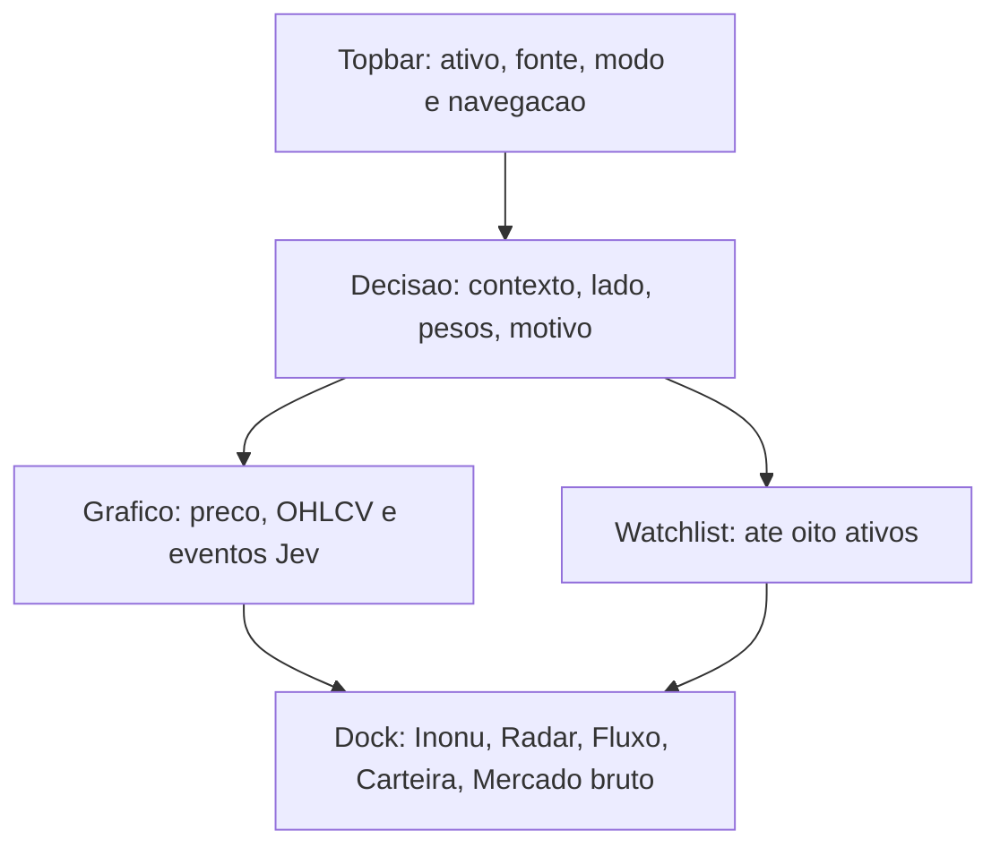

# Design e organização propostos

Este documento especifica a direção, não um redesign implementado. Mantém a linguagem Inonu existente e torna a origem Jev verificável. A decisão delegada escolheu primitivas compartilhadas com modos separados, evitando confundir observação CEX, análise Inonu, proposta de carteira e execução Jev/Kuru. R01-R20 em [requirements.md](requirements.md) são a aceitação futura.

## Hierarquia desktop

| Região | Conteúdo primário | Conteúdo progressivo | Restrições |
|---|---|---|---|
| Topbar | Marca, Mesa/Rastreador, seletor de ativo, fonte e modo, estado da carteira | Fontes, horário comparado, configurações e Doctor em popovers acessíveis | Estado de rede legível, nome nos ícones; não lotar de latência/modelo/totais de chamadas |
| Faixa de decisão | Par, preço/unidade, variação com período, lado Jev, três pesos válidos e um motivo | Origem/modelo, horário/bloco, detalhes do evento | Um mesmo evento; sem indicador numérico substituindo dado ausente; estado vazio compacto |
| Centro | Gráfico e toolbar de par/timeframe/tipo, inspeção OHLCV | Indicadores opcionais e eventos genuínos | G1 área útil >=900x420 em 1600x900 e >=680x320 em 1280x720, foco e hit-test preservados |
| Apoio à direita | Watchlist com até oito ativos e valores/frescor | Favoritos e seleção de mercado | Livro/fluxo/derivativos saem do apoio permanente e vão às abas previstas; não mostrar Ao vivo sem dado próprio |
| Dock inferior | Inonu, Radar, Fluxo, Carteira, Mercado bruto | Subviews e detalhes do item selecionado | Preservar cinco abas e orçamento de linhas; IDs por instância; corpo ativo somente |



Em 1280/1024px, o apoio pode recolher e ser aberto por controle nomeado, mantendo a decisão e a área de gráfico. Não fixar uma altura arbitrária que provoque clipping. Grid usa minmax(0,1fr), limites por região e scroll localizado quando necessário. Mudanças de perspectiva, glow e profundidade ficam secundárias à leitura; layout e foco não se movem com pointer. Tokens existentes são ajustados em vez de criar outra identidade.

Mapa de detalhes: JevIndicators e DerivativesStrip no Radar; FlowGauge e fita no Fluxo; observação/proposta no painel canônico Carteira; estado bruto e origem em Mercado bruto/Fontes; diagnóstico de integração em Doctor. A remoção de Ecossistema em info-diet não apaga os requisitos de acesso a fonte/status: T00 reconcilia DOC-3/AC-DOC-2 com destino rastreável.

## Mobile e tablet

Preservar as cinco entradas Inonu, Gráfico, Livro, Fluxo e Fontes. Cada aba mostra uma região principal. A visão Inonu começa com ativo/fonte/mode, seguida de preço, decisão/pesos e motivo, em altura natural, sem centralizar o conteúdo dentro de um card vazio de quase toda a viewport. Contexto de fonte e indisponibilidade permanece acessível, mesmo quando os controles de topbar viram ícones.

Em 390px: margem de 12-16px como ponto inicial a validar, gutters consistentes, botão padrão >=44px e barra inferior com safe-area. Em 320px e zoom 200%: preço e estado usam linhas próprias, controles quebram linha ou oferecem disclosure, sem fonte financeira microscópica para caber. Gráfico tem scroll/inspeção próprios, sem aprisionar o scroll do documento. Sticky nav não cobre foco, última linha, popover ou teclado virtual. 820px é testado dos dois lados do breakpoint, não tratado como garantia por CSS.

O público Jev/Kuru usa a mesma regra de separar preço e estado em mobile, mas só recebe mudança depois que T00 identifica a fonte do deploy. Não apontar esse layout diretamente para MesaView por suposição.

## Estados e evidência financeira

| Estado | Apresentação | Ação permitida |
|---|---|---|
| Request inicial pendente | Carregando dados da fonte, sem valores simulados; skeleton estático com espaço reservado quando útil | Aguardar; não reiniciar por render |
| Sem observação disponível | Sem dados, fonte e causa conhecida, ou causa desconhecida declarada | Abrir Fontes/Doctor ou retry de leitura existente |
| Backend offline/erro/schema inválido | Causa específica e último sucesso, quando existe; valores antigos rotulados | Retry único de leitura, com pending; sem fallback fabricated |
| Stale | Horário/idade e fonte, valor antigo claramente marcado | Inspecionar origem; atualização conforme contrato |
| Simulado/mock | Modo explícito junto da decisão/resultado, sem linguagem de trade real | Observar demo, sem promover a real por botão visual |
| Observação válida | Par/rede, origem, timestamp e estado do dado | Inspecionar dados e pedir leitura por gesto existente |
| Decisão Jev | Lado, pesos, motivo e identity do mesmo evento | Inspecionar leitura; sem executor inferido de lado |
| Proposta/Accept | Estado canônico proposto e revisão, pré-condições verificáveis | Accept mantém no-send; fluxos manuais existentes seguem própria autorização |
| Execução comprovada | Estado real exato enviado/colocado/fill/reverted segundo contrato, link/hash quando presente | Inspeção de evidência, não inferência de fill a partir de sent |

Sem nova camada de verdade paralela. A implementação primeiro reutiliza envelopes/tipos já existentes; helper de apresentação puro só mapeia estado conhecido a texto/semântica. Uma interface ilustrativa mínima, a adaptar aos tipos reais, é:

```ts
type EvidencePresentation = {
  label: string;
  sourceLabel: string | null;
  observedAtMs: number | null;
  mode: "simulated" | "observed" | "unknown";
  // executionLabel vem exclusivamente da evidencia canonica, nunca de mode.
  executionLabel: string | null;
};
```

Isso não cria estado operacional nem normaliza ausência para zero. Chave de associação do evento usa os campos reais disponíveis (ID/bloco/origem), sem gerar uma identity falsa quando faltam. Só mostrar BUY 94% quando essa probabilidade pertence ao evento exibido; HOLD, LATE e indisponível são categorias distintas. Histórico declara sua ordenação, mantém blocos reais e pode separar recebimento de execução.

Números usam fonte tabular, unidade explícita e precisão orientada pelo ativo já normalizado. Valores longos podem ter resumo legível e valor exato acessível. Tooltip não é a única forma de obter unidade/fonte. Saldo/PnL seguem cobertura, quote currency e preço verificado do contrato da carteira. Não misturar spot/perp, contagem de contratos e volume USD; indicar aproximações existentes.

## Interação e acessibilidade

AssetPicker mantém controles nativos. Handler de resultados fica no campo/lista; botões/tabs/selects conservam Enter/Space. Se o design usar listbox, implementar o padrão inteiro com foco coerente; não declarar combobox só adicionando role. Nesta primeira correção, a alternativa menor é limitar o handler e preservar botões. Dialog prende foco enquanto aberto, fecha por Escape e restaura foco ao acionador; verificações reais antes de mudar o que já funciona.

Rastreador onchain já recebe foco e trata Enter/Space na cópia revalidada. Preservar o guard locked e seleção/desmarcação; verificar foco visível, nome de token/rede e semântica com teclado/AT antes de acrescentar controle nativo somente se a verificação revelar lacuna. CEX preserva navegação de linhas e restringe atalhos de área. Sort tem nome e direção; pin tem estado; locked informa causa. Selecionar e abrir filtros não consultam Jev.

Dock usa namespace por instância com useId ou prefixo estável local, sem IDs colidindo entre desktop/mobile. Cada aria-controls e aria-labelledby resolve a própria instância. Manter montagem condicional dos corpos onchain. Apenas elementos visíveis recebem foco. Chart já tem alternativa HTML/teclado: ampliar verificação, não remover ou anunciar cada tick via aria-live. Anúncios acessíveis se restringem a ação/status significativo, sem ruído a 300ms.

Contraste é medido nos temas reais: 4,5:1 normal, 3:1 grande/essencial. Cor compra/venda tem label e ícone redundantes. Tipografia corpo em torno de 14-16px como proposta a validar com densidade e zoom, labels secundários legíveis; não impor mínimos que escondam colunas essenciais. Evitar uppercase longo, repetição de placeholders e números sem período. Sem blink/pulse, reduced-motion desativa animação não essencial. Estados pendentes podem usar texto/ícone estáticos.

## Rastreador e configuração

Rastreador: título/nav, fonte e mercado, busca e contador, resumo de filtros ativos, lista, e então detalhes do selecionado. Em mobile, filtros avançados e salvar tela ficam em disclosure; pergunta Inonu continua acessível com texto de privacidade, mas não empurra toda lista quando fechada. Filtros que mudam resultados aparecem no resumo, com limpar individual e manter defaults existentes. Views não implementadas informam indisponível e razão; não parecem vazias por falha de carregamento.

Settings: pending por ação/campo, guard de concorrência e comparação de rascunho antes de limpar. Não bloquear edição independente sem necessidade; se B foi digitado durante save A, B permanece. Mensagens falha/sucesso têm destino acessível e não contêm chaves. O cliente fake permite verificar tudo sem credenciais nem chamada real ao modelo.

## Performance sem perda de integridade

Primeiro medir build de produção com infraestrutura existente. Captura dev não mede CWV. Separar cold load, feed estável, resize, troca ativo/timeframe, abertura de dock, rastreador, 10min visível e 5min hidden/resume. Registrar bytes iniciais/compressão, LCP/CLS, responsividade, commits React, CPU/main thread, long tasks, frame times, requests/abort, memória e frescor. Campo p75 LCP<=2,5s/INP<=200ms/CLS<=0,1 só é certificado com dados de usuários/dispositivos pertinentes.

Hipóteses elegíveis: props/seletores por subestado realmente usado; geometria compartilhada entre render/desenho/hit-test; tokens de canvas por tema/resize em vez de por desenho; chunks de painéis secundários medidos; clocks/publicação visual pausados quando hidden. Cada uma exige custo observado e comparação pareada. Nenhuma impõe debounce de Jev por N blocos, pausa do trader ou perda de ticks. Não instalar virtualização para listas já limitadas a 12 sem evidência de custo. Não usar cache/singleflight novo antes de preservar identity/TTL/intent.

Cancelamento e resposta monotônica são correções de integridade, não precisam provar ganho para entrar. Request fetch aceita signal opcional; callers entregam signal real; abort não vira erro visível. Generation/origem e versão protegem publicação. Canais independentes podem ter controles independentes, mas devem respeitar contratos atuais de history/insights. Isso não certifica processamento remoto cancelado.

O relatório de otimização aceita resultado sem ganho mensurável. Gates funcionais são obrigatórios; melhoria precisa superar a variação medida e não piorar métricas relevantes, antes de alegar economia de CPU/tokens/custo.

## Integração com entregas concorrentes

T00 reconcilia G9 (dock <=120px) versus DOC-2 (altura inicial 26%, mínimo 190px e máximo 55%) antes de dimensionar o dock; G1 completo permanece congelado. O mapa de regiões é direção proposta, não exceção geométrica aprovada.

As SPECs Mesa de decisão e Inteligência de decisão, examinadas em [docs-revalidation.md](docs-revalidation.md), já cobrem gráfico ampliável, carteira/Settings, Veredito, perfil de risco, glossário e modo simples/avançado. Reusar resultados estabilizados e revisar a integração, sem outra implementação paralela desses recursos. Escada e draft Aceitar token existentes mantêm no-send. Tamanho/confiança propostos exigem rótulo, perfil escolhido e prova de cálculo compatíveis com PORT-2; nenhum número sugere probabilidade de ganho antes de validação. Quant offline e painel futuro não são evidência de lucro nem de ganho de UI.
