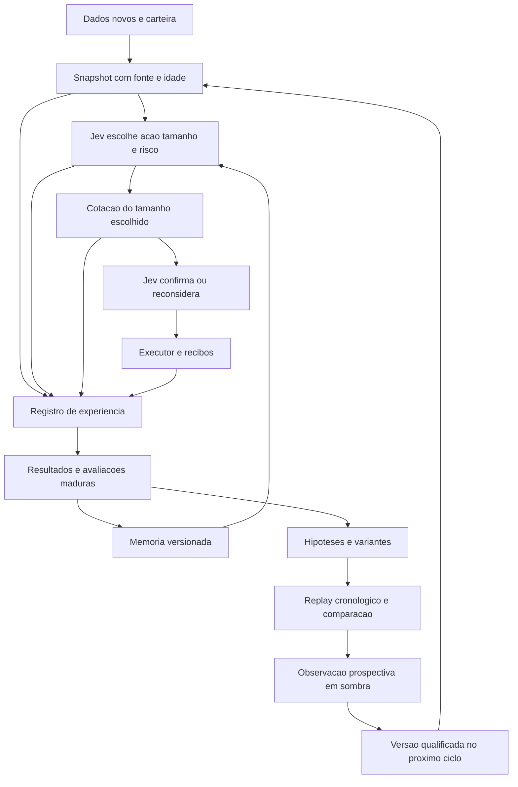
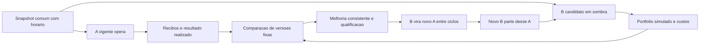

# Autoevolucao do Jev com experiencias e experimentos

O Jev deve melhorar suas decisoes com os resultados que a carteira e o mercado realmente entregam. A arquitetura proposta combina memoria de experiencias, avaliacao de cada ciclo e experimentos reproduziveis sobre dados passados. O Jev continua escolhendo comprar, manter, vender, tamanho e risco. O pesquisador melhora a informacao e as instrucoes que chegam ao modelo, com versoes comparaveis e resultado financeiro verificavel.

Estado em 14 de outubro de 2026, horario de Sao Paulo: pesquisa, decisoes de arquitetura e implementacao parcial dos nucleos de memoria, comparacao e ciclo A/B. A revisao17 continua distinta da fonte em trabalho; os recursos abaixo ainda nao formam um sistema de autoevolucao integrado ao executor. O dono priorizou aprender com decisoes, dados e resultados, com subagentes dedicados, alem da pagina Sistema. As instrucoes recentes retiram os tetos diarios e o piso fixo10USD do aplicativo. Este trabalho nao os reintroduz por uma formula de aprendizado.

## O que aproveitar das referencias

| Referencia primaria | Mecanismo confirmado | Adaptacao proposta para o Jev |
| --- | --- | --- |
| [AutoResearch de Andrej Karpathy](https://github.com/karpathy/autoresearch) | Um agente altera uma parte delimitada do treinamento, executa experimentos de cinco minutos e compara uma metrica fixa. A avaliacao fica fora da parte alteravel. | Hipotese, variante versionada, replay com o mesmo conjunto de dados, comparacao e preservacao do melhor resultado. Os cinco minutos do experimento original nao determinam o ritmo das ordens. |
| [Skills do Hermes Agent](https://github.com/NousResearch/hermes-agent/blob/main/website/docs/user-guide/features/skills.md) | Procedimentos aprendidos sao salvos e refinados como skills, carregadas quando relevantes. | Memorias curtas de erros e padroes de decisao, ligadas aos episodios que as sustentam. |
| [Memoria do Hermes](https://github.com/NousResearch/hermes-agent/blob/main/website/docs/user-guide/features/memory.md) | Memoria persistente e revisao em segundo plano. O snapshot do prompt e fixado no inicio de uma sessao. | Um snapshot versionado por ciclo, atualizado entre ciclos. Assim, a memoria nova chega ao Jev sem modificar a entrada de uma decisao em andamento. |
| [Hermes Agent Self Evolution](https://github.com/NousResearch/hermes-agent-self-evolution) | Repositorio separado com otimizacao de skills por DSPy e GEPA; as fases de codigo e melhoria continua aparecem como planejadas. | Geracao e comparacao de variantes do Brief, criterios das perguntas e selecao de experiencias. A primeira entrega pode ser Bun, sem instalar Hermes ou migrar o executor. |
| [MemRL](https://arxiv.org/html/2601.03192v1) | Recuperacao de experiencias por relevancia e utilidade, mantendo os pesos do modelo fixos. Os experimentos publicados sao de tarefas de agentes, nao de lucro financeiro. | Recuperar episodios semelhantes e mostrar seus resultados, tamanho da amostra e incerteza ao Jev. O mercado muda; a utilidade precisa ser segmentada por regime e reavaliada. |
| [EvolveR](https://arxiv.org/html/2510.16079v1) | Ciclo de experiencia, destilacao e evolucao de politica, incluindo treinamento por reforco. | Aproveitar o ciclo de experiencias. Treinar pesos do Jev nao esta disponivel pela interface atual e nao e requisito para iniciar. |

Conferi tambem o [entrypoint de evolucao de skills do Hermes](https://raw.githubusercontent.com/NousResearch/hermes-agent-self-evolution/main/evolution/skills/evolve_skill.py): ele separa treino, validacao e holdout, executa o otimizador e salva comparacoes e variantes. Isso oferece uma referencia concreta de experimentacao; o resultado desse avaliador nao e uma metrica pronta para trading. Nenhum desses projetos comprova lucro garantido nem melhora monotona a cada decisao.

## Dois ciclos que compartilham evidencia

O ciclo operacional reage a dados novos pelo scheduler unico. O ciclo de pesquisa consome os registros fora do caminho de execucao. Uma venda ja escolhida nao espera uma analise de pesquisa. A integracao de eventos ja existente em `src/decision-review/events.ts` deve ser ampliada para compras e fontes de mercado; a revisao17 so antecipava movimentos de posicoes com plano, sem descoberta de compra por streaming.

## Fluxo A/B definido pelo dono

O A e a versao vigente e tem o unico executor financeiro. O B e a versao candidata, recebe os mesmos snapshots de mercado e pode escolher acoes e tamanhos em simulacao. O B nao recebe runner de swap execute, chave de assinatura, login, transferencia ou acesso de escrita ao journal financeiro. Cotacoes de leitura e chamadas de modelo do B usam a contabilizacao real de recursos.

O pesquisador pode gerar variantes continuamente, mas cada B em avaliacao prospectiva e imutavel. Alterar B a cada minuto e somar seu placar anterior confundiria varias estrategias numa mesma versao. Uma mudanca cria B2 com ancestral e placar proprios; o B1 preserva seus resultados. Reaproveitar fatos e episodios e permitido; mudar criterios, pesos de recuperacao ou instrucao exige nova versao.

No inicio de uma rodada, B recebe a mesma carteira de referencia e a mesma marcacao de A, incluindo posicoes existentes e custo-base conhecido ou desconhecido. Depois, a carteira simulada de B evolui por suas proprias escolhas, separada do saldo real de A. Nao atualizar o saldo de B copiando os trades posteriores de A, pois isso apagaria suas escolhas. Comparar patrimonio unitizado/retorno em periodos comuns e mesma moeda, descontando fluxos externos; comparar decisoes pareadas quando forem realmente comparaveis.

Um preco futuro maior nao prova que B compraria/venderia aquele tamanho: a simulacao precisa considerar rota, liquidez, quantidade, taxas, latencia e impacto. Sem essas evidencias, registrar resultado bruto ou desconhecido, com cobertura, e impedir que a falta de custo pareca superioridade liquida. Recibos de A sao realizados; execucoes de B permanecem estimadas. Incerteza de fill, falha de rota e ausencia de unidade de output qualificada precisam aparecer no comparativo.

Medir a cada ciclo, mas promover apos evidencia madura. A proposta de promocao automatica exige ganho liquido fora dos dados usados para criar B, incerteza reportada com dependencia temporal considerada, cobertura de custos comparavel, ausencia de regressao operacional e qualificacao do artefato. O plano de avaliacao e sua regra de significancia ficam fixados antes da rodada. Evitar aprovar pela primeira vitoria ou por olhar repetidamente o mesmo teste ate dar positivo; usar avaliacao sequencial apropriada ou janelas de avaliacao predeterminadas. A tolerancia estatistica sera um parametro explicito do experimento, nao um limite de compra/venda nem um peso de risco escondido.

Quando B passa, guardar o manifesto da comparacao, aguardar o fim da decisao em andamento e a conciliacao das ordens pendentes, e trocar o ponteiro de versao atomicamente. A carteira, ledger, planos e counters reais continuam; nao ha reset de capital nem replay de ordens antigas. O novo A usa as melhorias a partir do proximo snapshot. A versao anterior fica disponivel para rollback. O pesquisador cria o proximo B a partir do novo A e continua o ciclo.

Uma alteracao de A durante uma rodada muda a referencia: fechar a comparacao anterior e iniciar nova rodada com novo par de versoes. O B nao escolhe seu proprio avaliador nem reclassifica resultados desconhecidos como sucesso. Nenhuma promessa de melhora em todos os ciclos e necessaria para manter esse fluxo autonomo.

Capacidade nominal sem retries ou fases extras: a cada5min,288chamadas de A mais288de B somam576/dia; a cada2min,720mais720somam1440. Fechamento informado por quote, fallback e pesquisa acrescentam tentativas. O teto atual720 nao cobre automaticamente A/B a cada2min. Primeiro medir chamadas/tokens por fase e entitlement real; priorizar A e usar a capacidade disponivel para o laboratorio, sem multiplicar limites ou zerar contadores. Isso regula consumo de API/modelo e nao limita quantas ordens o Jev pode decidir.

Cada decisao gera um episodio imediatamente. Resultado de execucao chega depois pelo recibo; resultado de manter ou recusar depende de uma janela futura. Registrar um ciclo nao significa que ja existe uma nova recompensa para aprender. A memoria pode incorporar resultados assim que amadurecem, sem esperar uma rotina noturna.

## Contratos de dados

| Registro | Conteudo necessario |
| --- | --- |
| DecisionEpisode | cycleId, assetKey canonico, versao do executavel, modelo e identificador retornado quando houver, Brief exato e hash, fonte e horarios dos fatos, campos desconhecidos, conjunto de opcoes oferecidas, escolha original, tamanho e risco escolhidos, quotes vinculadas a cada tamanho, plano final e razao objetiva de qualquer recusa de execucao. |
| ExecutionOutcome | Chave idempotente, assinatura, slot/bloco, estado final, quantidades em unidades minimas, moeda de liquidacao, taxa de rede e demais deltas. Falha ou silencio nao viram resultado zero. |
| EvaluationOutcome | Episodio de origem, horizonte, instante em que o resultado ficou disponivel, comparacao aplicavel, custos conhecidos e desconhecidos, qualidade e versao do avaliador. |
| Experience | Evidencias de origem, contexto comparavel, resultado observado, contradicoes, amostra, periodo e utilidade estimada. Distincao entre fato e interpretacao produzida por modelo. |
| Experiment | Hipotese, unica mudanca principal, variante e ancestral, datasets e hashes, periodos de treino/validacao/teste, custo, latencia, resultados por regime, status e motivo. |
| Promotion | Variante anterior e nova, evidencia de qualificacao, instante de ativacao entre ciclos e destino de rollback. |

Usar cadeia e contrato, nunca apenas o simbolo. Manter os fatos disponiveis na hora da decisao separados das observacoes posteriores. O journal financeiro continua sendo a origem de recibos; o armazenamento de pesquisa e derivado, separado e reconstruivel. Uma base local com `bun:sqlite` pode guardar episodios e indices de memoria, com um escritor e migracoes versionadas. As provas JSONL e cursores atuais continuam aproveitaveis; nao reescrever a home financeira para montar o laboratorio.

O Jev recebe dados estruturados e experiencias relevantes. Textos de tokens, paginas e interpretacoes externas nao se tornam instrucoes do sistema. Nenhuma chave, sessao de assinatura ou capacidade de transferencia entra no pesquisador.

## Avaliacoes de cada ciclo

| Dimensao | Medicao | Como interpretar |
| --- | --- | --- |
| Dados | Cobertura de preco/risco/momentum, idade na origem e no request, valores ausentes, contradicoes entre fontes, cache reutilizado | Distingue falha de informacao de julgamento do modelo. `checked` significa leitura relatada, nao ativo seguro. |
| Autonomia | Opcoes oferecidas, resposta original, alteracoes feitas pelo codigo, tamanho escolhido versus cotado versus enviado | Deve expor qualquer corte silencioso. Retirar limites diarios e piso10 nao basta se sizing, conviction ou CLI mudam a decisao. |
| Execucao | Taxa de confirmacao, atraso dado -> modelo -> quote -> assinatura -> recibo, duplicatas, impacto e diferenca entre quote e fill | Sucesso operacional nao conta como lucro. Somente recibos medem o que aconteceu. |
| Resultado | Fluxo realizado na mesma moeda, taxas reais, patrimonio, drawdown, giro e duracao das posicoes | Retorno liquido exige custos completos; aporte e valorizacao nao realizada aparecem separados. |
| Alternativas | Comprar versus manter caixa; vender versus manter o token; agir por evento versus por relogio | Resultado contrafactual e estimativa, nunca recibo. Sem rota, tamanho e custo verificaveis, mostrar retorno bruto ou desconhecido. |
| Recursos | Tentativas fisicas de API/modelo, retries,429/402, cache hit, tokens, custo e espera de fila por fase | Mede capacidade24h e custo de obter cada informacao. Uma consulta logica pode conter varias tentativas fisicas. |

Reaproveitar `src/agent/scoreboard.ts`, `fills.ts` e `src/decision-review/execution-review.ts`. O placar atual observa15m,1h,4h e24h; incluir1m/5m como diagnosticos de movimentos curtos quando existir historico com timestamp e cobertura. Nao reconstruir quotes antigas com a API de hoje. Compras, vendas, manter, recusar e saidas de plano devem continuar distinguiveis.

O indicador principal proposto e a diferenca de retorno liquido contra a versao vigente nas mesmas oportunidades, acompanhada do patrimonio ajustado por aportes/retiradas. Apresentar tambem comparacao com manter caixa e manter o portfolio inicial. Quando nao houver custos ou marcacao suficientes, esse indicador fica desconhecido. Taxa de acerto sozinha pode melhorar enquanto o capital cai; quantidade de ordens e confianca de Choice nao sao recompensas financeiras.

Nao inventar pesos de penalidade de risco que recriem um perfil conservador pelo avaliador. Mostrar retorno, drawdown, exposicao, custos e cobertura separadamente; comparar alternativas de Pareto, sem esconder a troca entre retorno e risco numa nota opaca. A escolha economica continua no Jev conforme o mandato do dono.

## Aprendizado que cabe na API atual

Comecar com memoria estruturada e recuperacao por campos conhecidos: regime de mercado, liquidez, volatilidade, qualidade do risco, custos, duracao e tipo de decisao. Isso permite reutilizar experiencias sem embeddings pagos. Mostrar episodios positivos, negativos e contraditorios, com amostra e datas; nao apenas a ultima perda do mesmo simbolo. Uma estimativa de utilidade orienta quais experiencias entram, sem virar um bloqueio de compra.

O segundo mecanismo e experimentar variantes dos criterios e da organizacao do Brief. As perguntas devem continuar compativeis com `experimental_evaluate` e Choice. Uma variante nao pode fingir que o modelo passou a aceitar quantidades numericas livres. A comparacao verifica se as opcoes reais de tamanho e risco foram entendidas e se a cotacao corresponde ao tamanho escolhido.

Um LLM adicional e opcional para agrupar falhas, produzir hipoteses e propor variantes estruturadas com episodios citados. Ele nao fornece o preco, nao declara um trade lucrativo e nao substitui o Jev na decisao de negociacao. Antes de escolher provedor/modelo, medir a melhoria incremental contra a mesma memoria e os mesmos dados sem esse LLM, incluindo latencia e custo. `research-contract.ts` e um contrato de interpretacao existente, sem cliente ativo; o identificador local de modelo nao prova disponibilidade de uma API comercial.

## Experimentos sem aprender o futuro

1. Fixar a versao vigente e capturar os episodios disponiveis. O avaliador, a origem dos recibos e o conjunto reservado para teste ficam fora da parte que o pesquisador altera.
2. Criar uma hipotese pequena, por exemplo preservar idade do risco, mostrar custos fracionarios ou recuperar episodios semelhantes por regime. Guardar tambem variantes que pioraram ou falharam.
3. Separar os dados cronologicamente. Agrupar episodios sobrepostos do mesmo ativo e retirar das fronteiras amostras cujos resultados avancem para o periodo seguinte. Divisao aleatoria por linha vazaria informacao de repeticoes do mesmo mercado.
4. Comparar a variante e a vigente sobre os mesmos fatos disponiveis naquele instante. Custos e atraso devem ser iguais ou explicitamente medidos. Separar qualidade da decisao de resultado casual de um ativo.
5. Reservar teste final sem reutiliza-lo para escolher centenas de variantes. Registrar o numero de tentativas; validacao repetida pode selecionar sorte. Usar incerteza por blocos de tempo/ativo e analise por regime, sem tratar ciclos sobrepostos como amostras independentes.
6. Rodar a finalista em sombra sobre novas oportunidades, no mesmo snapshot da vigente e sem segundo executor. Registrar divergencias e esperar resultados amadurecerem. Historico em replay nao prova que uma ordem alternativa teria sido executada.
7. Promover automaticamente um artefato qualificado entre ciclos, com ponteiro atomico e rollback para a ultima versao qualificada. Os criterios de promocao precisam existir e ser testados antes de habilitar esse mecanismo. No estado atual, nao existe essa promocao automatica implantada.

A primeira rodada deve ser uma ablacao: vigente; vigente com qualidade/idade corrigida; mais custos; mais memoria; mais pesquisador LLM. Assim podemos medir o que acrescenta valor em vez de atribuir uma subida do mercado a toda a arquitetura.

## Dados mais rapidos com consumo medido

As documentacoes de [Market API](https://web3.okx.com/onchainos/dev-docs/market/market-api-fee) e [Trade API](https://web3.okx.com/onchainos/dev-docs/trade/api-fee) possuem planos distintos. Market Free publica100mil chamadas Basic e100mil Premium por mes e nao inclui WebSocket; a pagina lista Starter99USD/mes com canais. O Trial de Trade publica1RPS por padrao e aumento sujeito a aprovacao. Esses valores documentais nao comprovam o plano, saldo mensal ou acesso da conta atual; a sessao Agentic Wallet da CLI tambem nao prova permissao de streaming. Nao contratar nem assinar pagamento automaticamente.

O [canal de preco](https://web3.okx.com/onchainos/dev-docs/market/websocket-price-channel) publica eventos quando ha negociacao e o filtro de preco os admite. O [canal avancado](https://web3.okx.com/onchainos/dev-docs/market/websocket-price-info-channel) descreve atualizacao maxima de1s. Isso nao garante informacao continua de todo token iliquido. A [assinatura](https://web3.okx.com/onchainos/dev-docs/market/websocket-subscribe) exige autenticacao em preco/trades. A [conexao](https://web3.okx.com/onchainos/dev-docs/market/websocket) documenta3aberturas/s por chave,480operacoes de subscribe/unsubscribe/login por hora por conexao e ping/pong para inatividade. Sao limites de conexao e controle, nao autorizacao para milhares de chamadas de swap por segundo.

Implementar primeiro um inventario de capacidades e consumo por origem. Reusar os contadores de tentativas de `src/onchainos/http.ts`, acrescentando persistencia mensal e separacao da CLI, pois contadores em memoria nao sao o total do portal. Rate limiter unico por credencial/origem; cache e single-flight compartilhados entre UI, agente e avaliador; tratamento de429 com espera informada e de402 como indisponibilidade de cota, sem pagamento implicito.

Para uma lista acompanhada, usar preco em lote e buscar risco, holders e candles conforme necessidade/idade do campo. O adaptador existente `market-price.ts` aceita ate100tokens por chamada, conforme seu contrato. As paginas oficiais de [preco de indice](https://web3.okx.com/onchainos/dev-docs/market/index-price) e [informacoes de negociacao](https://web3.okx.com/onchainos/dev-docs/market/market-token-price-info) confirmam lote de ate100tokens. O indice combina fontes e nao e uma cotacao executavel. Conferir capacidade e cobertura por endpoint antes de ampliar. Descoberta ampla fica em outra fila, para nao atrasar posicoes e ordens. O universo inteiro pode alimentar descoberta, mas nao ha evidencia de que a conta consiga manter todo criptoativo atualizado em tempo real.

Calculo ilustrativo de capacidade para30dias: uma chamada por minuto custa43200requests/mes; a cada30s,86400; a cada10s,259200. Se cada varredura exigisse10chamadas, um ciclo de5min consumiria86400 e um de2min216000requests/mes, antes de retries e das demais funcoes. Esses totais sao por categoria e hipotese de chamadas, nao consumo medido. Um lote de100tokens nao equivale automaticamente a100requests.

Com streaming ja autorizado, uma conexao duradoura atualiza o cache e publica eventos normalizados. Sem ele, polling agrupado prioriza informacao nova. O evento desperta o mesmo scheduler; nao abre executor concorrente. O ritmo de decisao resulta de fatos novos, duracao real e capacidade da API/modelo, em vez de aguardar sempre cinco minutos ou forcar decisao a cada tick. Medir idade e atraso ponta a ponta antes de alegar80ms: latencia do modelo nao inclui coleta, quote, assinatura ou confirmacao.

## Integracao e sequencia de entrega

| Etapa | Trabalho e dono atual | Criterio de termino |
| --- | --- | --- |
| 0 Dados e autonomia | Claude integra qualidade/idade, custos e tamanho/risco escolhidos pelo Jev; Codex faz revisao independente em decision-review | Caminho candidato -> modelo -> tamanho -> quote -> plano -> CLI consistente; sem piso10/teto diario/corte silencioso. Pacote qualificado e runtime identificado. |
| 1 Episodios e avaliacoes | Codex propoe `src/decision-review/evolution/episodes`, `outcomes`, `metrics` e armazenamento separado; Claude expoe contrato de snapshots | Cada episodio se liga a evidencia; cursor idempotente; maturacao posterior e desconhecidos preservados; nenhuma escrita na home financeira. |
| 2 Memoria | Codex prepara contrato puro; Claude injeta snapshot no Brief e fechamento | Resultados novos chegam ao ciclo seguinte, sem congelar idade, vazamento de futuro ou texto externo como instrucao. |
| 3 Laboratorio | Codex implementa replay/experimentos e adaptador opcional de pesquisador | Baseline, ablacacoes, conjuntos cronologicos, custos e holdout reproduziveis; resultado insuficiente fica explicito. |
| 4 Eventos e cotas | Integracao coordenada com dono de onchainos e Claude | Contagem por origem/endpoint, direitos de acesso conhecidos, batch/cache e eventos no scheduler unico; recuperacao de conexao sem tempestade de requests. |
| 5 Aba Autoevolucao | Claude, em frontend e APIs do agente | Exibe A ativo e B em sombra com versoes/ancestrais, inicio da rodada, dados comuns, retorno realizado versus simulado, custos desconhecidos, episodios maduros/pendentes e motivos de promocao/rollback. |
| 6 Promocao autonoma | Contrato conjunto apos qualificar laboratorio e politica de promocao | Reinicio, concorrencia, rollback, invalidez de dados e deriva exercitados; alteracao ocorre entre ciclos e fica rastreavel. |

As novas pastas sao propostas, ainda nao implementadas ou reservadas por terceiros. Respeitar as zonas atuais da coordenacao e combinar as ligacoes antes de editar o agente. Reaproveitar Bun e os contratos existentes; nenhuma instalacao de Python, Hermes, GPU ou provedor adicional e necessaria para iniciar episodios e memoria.

Testes essenciais da integracao: resultado atrasado nao aparece antes do horizonte; ativo com simbolo igual nao contamina outro; duplicata de recibo nao duplica recompensa; custo ausente nao vira zero; aporte nao vira lucro; memoria escrita aparece no proximo ciclo; expiracao de quote usa o instante real da chamada; pesquisa pendente nao atrasa venda; reconexao nao duplica trade; B nao possui executor mesmo com resposta malformada; mudar B inicia novo placar; trocar A fecha a referencia antiga; promocao nao repete ordens nem reseta carteira/counters; variante nao altera seu proprio avaliador; rollback restaura a versao qualificada sem perder o journal.

## Situacao observada e proximo passo

A auditoria somente de leitura concluida em15/10/2026 01:00:59UTC encontrou21fills confirmados e7voltas integralmente pareadas. Todas tiveram fluxo de caixa negativo na moeda USDC, soma de-0.316407USDC antes das taxas em SOL; conversao liquida total para USD continua desconhecida. Ha7vendas sem entrada pareada. Essa e a linha de base auditada, nao evidencia suficiente para escolher uma estrategia vencedora.

A correcao de prioridade da fonte passou em `closing-priority.test.ts` com1teste/3verificacoes; `typecheck` passou na revisao observada. A retirada de limites/tamanho ainda tem reproducoes vermelhas em `autonomy-review.test.ts`: giro diario bloqueando, compra37.125 reduzida para25 e entrada0.125USDC arredondada para130000unidades em vez de125000. Concluir e qualificar essa etapa junto do Claude antes de atribuir ganho a autoevolucao. O plano nao declara esses recursos ativos nem promete que cada ciclo sera melhor que o anterior.

## Decisao de arquitetura: reflexao, pesquisa e comprovacao

O reforco do dono em14/10prioriza aprender com decisoes e dados continuamente, sem depender de reescrita manual do codigo. Separamos diagnosticar cada episodio, pesquisar uma mudanca e medir seu efeito. O primeiro pode ocorrer apos cada decisao; o resultado financeiro depende de recibo e horizonte. Dois minutos de ciclo nao encerram uma avaliacao de uma hora.

Cada episodio liga o snapshot realmente disponivel, ativo exato, fonte/idade dos fatos, alternativas oferecidas, escolhas pedida/aplicada, tamanho, versao de criterios/perguntas/modelo, quotes, execucao e custos. Registrar quando cada resultado se tornou conhecido. Memoria de hoje pode conhecer o resultado de ontem; replay de ontem somente pode usar o que ja estava disponivel naquele instante.

| Pergunta de autorreflexao | Dados e avaliacao |
| --- | --- |
| Houve escolha real? | Alternativas, escolha pedida/aplicada e motivo do codigo; cobertura aberta versus exclusao economica ou falha tecnica. Nao comprar nao e automaticamente erro. |
| Faltou informacao? | Fonte, idade, cobertura e conflitos de risco, liquidez, fluxo, concentracao, momentum e preco; B testa um fato por vez com os demais constantes. |
| A vantagem pagava os custos? | Quotes de entrada/saida ligadas ao tamanho, spread, taxas e atraso; vantagem bruta versus liquida e diferenca quote/fill. Rota ausente nao permite retorno executavel inventado. |
| Venda ou recompra foi precipitada? | Episodios do mesmo ativo, plano e resultado posterior; giro/duracao/retorno contra manter inventario. Janelas sobrepostas nao sao amostras independentes. |
| O que poderia ter sido melhor? | Alternativas disponiveis naquele momento com resultado mensuravel; regret pareado. Alta posterior isolada nao prova compra viavel. |
| O novo dado ajudou? | Ablacao com e sem a informacao nos mesmos snapshots, teste reservado, custo/latencia e estabilidade por periodo/ativo/regime. |

Resultado realizado, patrimonio marcado e simulacao sao series diferentes. A metrica financeira considera custos completos e ajustes por aportes/retiradas; drawdown, exposicao, perdas de cauda e divida ficam explicitos. Brier/log loss so cabem se existir previsao explicita de evento/horizonte; a preferencia Choice entre acoes nao e uma probabilidade calibrada de lucro.

As primeiras hipoteses partem de lacunas observadas: qualidade/idade de risco descartada; quote de entrada ainda fora da decisao primaria; custoSOL sem conversao comprovada; tokens agregados sem input/output por tentativa; cadencias diferentes entre fonte e interface. Elas sao defeitos ou desconhecidos, nao prova de que um campo teria evitado uma perda. O experimento precisa demonstrar o efeito.

### Raciocinio a partir das referencias

No [programa AutoResearch](https://raw.githubusercontent.com/karpathy/autoresearch/master/program.md), o avaliador e separado do arquivo mutavel e cada experimento registra conservar/descartar. Nossa unidade mutavel sera um artefato de inteligencia, com avaliador e recibos fora do alcance do pesquisador.

No [fitness.py do Hermes](https://raw.githubusercontent.com/NousResearch/hermes-agent-self-evolution/main/evolution/core/fitness.py), a funcao passada ao otimizador usa sobreposicao de palavras; ha tambem juizLLM. Esse proxy nao mede retorno de carteira. O [entrypoint](https://raw.githubusercontent.com/NousResearch/hermes-agent-self-evolution/main/evolution/skills/evolve_skill.py) compara holdout e salva variantes. Aproveitaremos rastros, reflexao e experimentacao; criaremos avaliacao financeira propria, sem copiar o reward textual ou migrar o executorBun.

O [cookbook TypeSafe](https://docs.typesafe.ai/cookbooks/autoresearch_feature_discovery) conecta LLMpropositor, perguntasJev e erro fora da amostra. O exemplo e regressao de notas de vinho. Nossa adaptacao precisa episodios cronologicos e resultados financeiros maduros. Perguntas novas so ganham valor quando medidas no laboratorio.

### LLM pesquisador: util, opcional e fora do caminho rapido

Nao precisamos de outro LLM para diagnosticos objetivos, memoria, replay, comparacao e persistencia. Ele e util para propor hipoteses novas, formular perguntas/features e identificar contradicoes nos rastros. A decisao e uma porta Researcher opcional, fora da latencia de operacao do Jev. Produz JSON de hipoteses para B; nao julga o proprio premio nem recebe assinador.

A pagina oficial [GPT-6 Luna](https://developers.openai.com/api/docs/models/gpt-6-luna) confirma gpt-6-luna, Responses e StructuredOutputs. PrecoStandard publicado em14/10:0,10USD/Minput e0,50USD/Moutput, com tarifas distintas para cache/ferramentas. Isso nao comprova chave/acesso/saldo desta conta. Nenhuma API nova foi ativada. [StructuredOutputs](https://developers.openai.com/api/docs/guides/structured-outputs?api-mode=responses) fornece formato sob condicoes suportadas; validacao semantica de fontes/datas/unidades continua necessaria.

O pesquisador deve devolver: versaoA/hashdas evidencias; episodios favoraveis e contraditorios; lacuna de dados; origem das features existentes/solicitadas; um componente alterado; metrica-alvo; teste que refutaria a hipotese; custo/latencia estimados. Texto gerado e hipotese, nunca fato de mercado. Novas perguntas e transformacoes entram em registro versionado com unidades/janelas, sem executar codigo arbitrario. Primeira ablacao: vigente, memoria semLLM e memoria com pesquisador, sobre os mesmos fatos. Ativacao depende da integracao e beneficio incremental medido. Reflexao objetiva por ciclo; chamadas de pesquisa consolidam resultados novos, sem repetir material identico a cada tick.

### Implementacao e contrato com A

ab-comparison.ts foi revisado independentemente:16testes/48asserts publicos e26/73na copia com testes independentes. Aceita perda reportada inferior a-100%, possivel com passivos, sem censura economica. Compara consistencia de metricas reportadas; nao calcula retorno, autentica fonte ou comprova significancia.

Subagentes implementam evolution/engine.ts e memory.ts: variantesB imutaveis, experiencia temporal, maturacao, coorte fixa e qualificacao externa. Root implementou evolution/store.ts: SQLite dedicado, CAS de versao/revisao, transacao e historico, sem carteira. Esses nucleos ainda nao estao conectados ao runtimeA. Avaliador estatistico, autenticidade de fonte e rollback automatico continuam responsabilidades explicitas, nao booleans de confianca.

O adaptador deve fixar artefatoA no inicio do ciclo, publicar episodio e compartilhar snapshot comB; aceitar promocao entre ciclos apos conciliacao. Refs de perguntas/features so valem se resolvidos para implementacoes reais. Registrar modelId resolvido. Primeira leitura porA, primeira decisaoB e primeira promocao precisam evidencias proprias. A tela mostra pendencias enquanto faltarem.

Atualizacao dos testes de autonomia: as3regressoes antes vermelhas passaram na fonte observada, com o teste de prioridade, recursos e comparador:35testes/123asserts no retrato anterior ao novo caso de divida. Isso nao prova o caminho inteiro nem muda o pacote17 ativo. Recursos ficam na aba Sistema. Foi reproduzido gap no gateway: retryde relogio faz2tentativas e registra1chamada; contagem local nao e uso fisico completo ou uso global da conta.

## Integracao observada em 15/10/2026, 02h30 UTC

O observador de consultas ja roda separado do executor financeiro. Implementacao em src/decision-review/evolution/{agent-episode,capture-store,observer}. A captura inicial real guardou120 consultas de briefs.jsonl, sem JSON invalido ou conflito, em data/decision-review/evolution/consult-captures.sqlite, FORA da home financeira. Releituras devolvem120 deduplicadas e mantem a primeira observacao1792031385290, sem rejuvenescer o historico. latest.json publica resultado estruturado e horario. Processo observado8196, Bun, a partir da copia isolada qualificada; financialExecutor=false. Sua demora de5s entre leituras nao e cadencia do Jev nem chamada a API.

O adapter aceita os IDs REAIS buy:token:rede:endereco e hold:token:rede:endereco@carteira. Hash da copia local cobre JSON.stringify na ordem original, preservando o fingerprint do Brief. O banco vincula primeira observacao e identidade por checksum, retém variantes conflitantes e verifica integridade antes de reusar. Locks e arquivos do observador sao proprios. Caminhos de saida, artefatos e sidecars SQLite rejeitam escape por junction/hardlink; testes nao autenticam a origem e nao protegem contra um processo hostil que troque paths depois da validacao.

Limite atual deliberadamente visivel: as120 consultas sao LEGADO DIAGNOSTICO. atMs e inicio do ciclo, decisionAtMs fica null, memoryEpisodesProduced=0, nenhum retorno/outcome inventado. Para experiencia prospectiva, o produtor precisa publicar metadados separados ligados ao registro exato: full snapshotHash, decisionVersion, evaluatorHash, askedAtMs, answeredAtMs, recordedAtMs, factAvailableAtMs e arm. A disponibilidade local dos metadados tem primeira captura propria. O modelo so pode recuperar uma revisao depois que todos os seus dados ficaram disponiveis. Buy+holding do mesmo token ou duas origens da mesma moeda ainda colidem no esquema de memoria por ativo: o adapter conserva as identidades e sinaliza memory_identity_collision; o proximo contrato deve representar o item decisorio, sem inventar ciclos diferentes.

Nao embutir sourceRecordHash dentro do registro que ele mesmo hasheia. Publicar envelope separado {sourceRecord,metadata} ou journal de metadados, com sourceRecordHash do JSON EXATO de ConsultRecord e snapshotHash do Brief EXATO entregue ao modelo. Hash de copia e consistencia, nao autenticidade, nem prova de versao resolvida do modelo. Nao preencher evaluatorHash ou decisionVersion com placeholder para fazer um teste passar.

Provas delimitadas: root51 testes295asserts em copia isolada15arquivos/tipos/pureza sem divergencia; revisao independente capture-store17/65 e observer33/105, esta com cinco CLIs reais exclusivamente em fixtures privadas. O primeiro bug de getter, perda da linha no limite exato e escapes de caminho foram reproduzidos antes das correcoes. Fonte risk-quality corrigida18/94: idade usa asOfMs original, snapshot nao tipado e validado, e captura tardia nao rejuvenesce risco. Fonte ainda precisa ser ligada ao Brief pelo dono do agente.

A/B financeiro, avaliador liquido/estatistico, produtor de qualificacao, memoria no Brief, promocao e recuperacao ainda nao estao ativos. O nucleo financeiro atualmente observado e Bun4040 em watch-only, scheduler.started=false, por abertura do preview pelo Claude apos o17encerrar. O observador nao reinicia esse nucleo. Backend de autonomia foi congelado pelo Claude na secao97, manifesto95arquivos sem divergencia verificado pelo Codex; preparo do pacote integrado continua separado destas provas.

## Avanco em 15/10/2026: memoria por item e disponibilidade prospectiva

As duas recorrencias de cinco minutos estao ativas nesta conversa. `Evoluir autoevolucao do Inonu Trader` cuida de pesquisa, arquitetura, implementacao e integracao da aprendizagem continua. `Evoluir retorno e autonomia do Jev` acompanha a operacao. Compartilham o estado e nao iniciam executores duplicados. O agendamento de desenvolvimento nao significa que o ciclo A/B financeiro ja esteja conectado.

O esquema de experiencia V2 resolve a colisao anterior por ativo: `itemScope` preserva o item original, compra ou holding, ativo canonico e papel relatado `agente`/`principal`. Uma compra e duas posicoes do mesmo token no mesmo ciclo sao tres itens distintos. A identidade fisica da carteira continua desconhecida. V1 permanece aceito sem inventar esse contexto; revisoes futuras e resultados devem manter o mesmo item. Duas grafias EVM do MESMO item com escolhas divergentes ficam diagnosticadas, sem produzir uma experiencia aparentemente consistente. O nativo `token:501:native` agora acompanha o formato do produtor real e e distinto do token embrulhado.

A revisao independente da memoria encontrou e reproduziu esses dois problemas antes das correcoes. O conjunto revisado teve 53 testes e 403 verificacoes verdes em copia isolada de 26 arquivos, tipos e hashes sem divergencia. Um helper posterior reutiliza a clonagem JSON existente para entregar apenas objetos destacados, sem serializar novamente o objeto externo. Esse helper esta incluido no novo fecho prospectivo, sem alterar a semantica de memoria.

`decision-evidence.ts` implementa a recepcao do envelope original `{schemaVersion:1,consultation,decisionMetadata}`. O store dedicado grava o ConsultRecord exato antes dos metadados. Cada parte conserva sua primeira disponibilidade local. Falha na segunda escrita deixa apenas a captura da fonte; o retry posterior adia a disponibilidade da experiencia, nunca a antecipa. Conflitos de registro ou metadados deixam `capture:null` e nenhuma experiencia elegivel. Os journals A e B sao separados pelo host. O contrato nao promete transacao conjunta entre as duas escritas ou autenticidade da origem; consumidores devem conferir conflitos atuais antes de reutilizar um pacote antigo.

O fecho atual da fonte e da copia isolada passou 69 testes e 414 verificacoes, tipos completos e isolados, verificacao de imports/E/S e 31 hashes sem divergencia. Provas root em `evolution-decision-evidence-review/QUALIFICATION-FINAL.json`, fora do repositorio. A revisao independente foi concluida: 81 testes e 459 verificacoes verdes, tipos isolados e 31 arquivos base sem divergencia. Uma falha de Proxy/toJSON foi reproduzida e corrigida com o clone destacado. Os 21 suportes do teste do produtor foram preservados na copia, mas dois originais mudaram concorrentemente; essa limitacao esta explicita em `evolution-decision-evidence-independent/REVIEW.md`. Provas anteriores e falhas de captura/tipos foram preservadas, sem transforma-las em falhas financeiras.

Proxima integracao concreta: o produtor do agente precisa publicar o envelope com relogios realmente capturados, hash completo do Brief entregue e versoes reais dos artefatos/avaliador. Nao se completa esse contrato com hashes arbitrarios para converter o legado. Depois, conectar ingestao prospectiva, recuperacao da memoria no Brief e runner B ao mesmo snapshot disponivel. Enquanto isso, as 120 consultas do observador ativo continuam diagnosticas, sem experiencia financeira qualificada, sem promocao e sem retorno inventado.

O Claude ja iniciou o produtor de metadados e recursos em sua fatia v2. A resposta de arquitetura esta na coordenacao 103: `recordedAtMs` deve ser capturado ANTES de disponibilizar a linha original, o hash exclui o terminador `\n` e o journal deve publicar o envelope com o ConsultRecord correspondente. O hash da especificacao atual do Placar pode identificar o diagnostico pendente; seu efeito de preco/custo estimado nao e lucro realizado nem o avaliador estatistico de promocao A/B. A nova integracao precisa de freeze e prova proprios. Os testes contemporaneos com produtor real e modelo fake provam compatibilidade de formato, sem afirmar esse hook produtivo.

O backend 97 compilado passou qualificacao privada, e a WEB congelada 98 passou testes offline, tipos, build estatico e smoke HTTP. A revisao da interface encontrou tres pendencias, detalhadas na coordenacao 102: textos antigos de minimo/conviccao e normalizacao indevida de caixa em mints Solana. O Claude tambem retomou alteracoes de backend para recursos e documentacao, exigindo novo manifesto. Essas provas qualificam as copias congeladas anteriores, nao uma distribuicao atual ou a retomada do executor. O estado real observado continua `scheduler.started=false`.

## Atualizacao de integracao em 15/10/2026, apos 07h54 UTC

O observador8196 foi encerrado normalmente por seu proprio arquivo de parada. O novo observador25980 foi iniciado de uma copia imutavel qualificada e teve identidade do processo e saude conferidas. Conservou120 registros e a primeira disponibilidade1792031385290. Ele le dois journals, mas o journal real de metadados ainda esta ausente. Logo, a operacao observada continua diagnostica, sem experiencia prospectiva, B ativo ou beneficio financeiro comprovado. O nucleo na porta3000 esta indisponivel na leitura1792051658381; nao apresentar o estado watch-only antigo como atual.

A interpretacao de recordedAtMs na secao anterior foi corrigida na coordenacao107. Esse campo mede a gravacao dos metadados e pode ser posterior a primeira captura do registro original. Devem valer: cycleStart <= asked <= answered <= primeira captura raw; answered <= metadata.recorded <= primeira captura metadata; factAvailable <= asked. A experiencia fica disponivel somente quando todas as partes necessarias foram observadas. Um teste com raw observado2000, metadata gravado2500 e observado3000 antes falhava e agora aceita apenas a disponibilidade3000. Nenhum episodio legado foi enriquecido.

O produtor v2 do Claude publica `{cycleId,atMs,metadata}`. A ponte em implementacao arquiva essa referencia separadamente e encontra a fonte somente pelo hash exato no mesmo ciclo. Fonte ausente fica pendente; uma leitura posterior nao pode ocultar que um timestamp era futuro na primeira captura. As APIs de consulta exata e leitura por ciclo do store foram revistas independentemente pelo root:28 testes122 verificacoes verdes em copia privada de9 arquivos, tipos e hashes sem divergencia. Elas nao escrevem, alteram disponibilidade ou varrem outros ciclos. A integracao completa da ponte ainda passa por seus proprios testes e revisao.

Os manifestos v2/W2 do Claude chegaram, mas a guarda constatou quatro divergencias atuais em151 arquivos e depois o revisor diagnosticou mais duas alteracoes de testes. O pacote19 nao foi capturado como versao valida. O revisor financeiro investiga a arvore em copia explicitamente diagnostica, enquanto aguarda um manifesto estavel. A revisao automatica do Claude rejeitou o inicio do nucleo como Production Deploy; o root nao iniciou o mesmo processo por outro meio. A comunicacao continua pelo arquivo compartilhado, respeitando a interrupcao do controle da interface por Escape.

### Observacao posterior da retomada

Na coordenacao104 Claude registrou a autorizacao recebida do dono em seu proprio chat e iniciou o nucleo21912. O GET local em1792052309159 confirmou scheduler ativo, intervalo2min,59consultas, autoridade dinheiro sem bloqueio e nenhum voo. O status publicou recibo de sucesso para uma venda de PEDRO; a ultima tentativa de vender CARDBACK falhou por impacto_alto. Execucao confirmada, falha e lucro sao evidencias distintas. O root nao iniciou executor ou enviou ordens. A tarefa de logon criada pelo Claude deve ser considerada antes de um futuro handoff para evitar dois supervisores.

A ponte de referencias e a integracao do observador passaram134 testes638 verificacoes em fonte e copia isolada de40 arquivos, tipos completos/isolados verdes e hashes sem divergencia. Dois REDs do root demonstraram primeiro a incompatibilidade do formato e foram corrigidos. A revisao independente reproduziu ainda uma corrida de conflito tardio e o passe final somente leitura foi adicionado. O observador25980 ainda roda a copia anterior, captura os novos registros mas recusa seu formato de metadados. A troca de sua copia aguarda fechamento da revisao independente. Nada disso comprova B executando, avaliador financeiro maduro, promocao ou lucro.

### Primeira captura prospectiva real, 08h24 UTC

A revisao independente do mesmo freeze exato terminou:146 testes669 verificacoes, tipos,40 hashes e quatro CLIs privados aprovados, zero tentativas de rede. O observador25980 encerrou normalmente por seu stop proprio e foi substituido pelo10896 em08:22:34UTC. Banco e primeira captura original foram preservados. A copia imutavel usa SHAobserver c9b0a625b4497608ee4ef2705b15743e0a6a37149b1dd735d5c0de20c4d0c441; nenhum processo financeiro foi iniciado ou parado pelo root.

Em1792052650866 foram observados cinco ciclos reais com referencias ligadas pelo hash exato,37 itens decisorios pendentes, nenhum conflito ou rejeicao, e zero resultados maduros. O banco contem125 raw,5 referencias e5 envelopes completos. Um probe de memoria somente leitura confirmou indisponibilidade antes da captura completa e recuperacao posterior ainda como pending. Provas em `evolution-reference-observer-review/FIRST-LIVE-PROSPECTIVE.json`. Isso comprova o percurso produtor, journal, store e adaptador; nao comprova leitura dessa memoria pelo Jev ou vantagem financeira. Houve uma falha transitoria de leitura do store e recuperacao no tick seguinte, preservadas em log, sem reinicio ou alteracao manual dos dados.

Proxima etapa e o adaptador de recuperacao para o Brief, com versao fixada no inicio do ciclo, revalidacao dos conflitos atuais e registro do payload/hash exato enviado. Qualquer campo novo do Brief precisa ser preservado no ConsultRecord e na reconstrucao do seu hash. Placar permanece diagnostico; avaliador financeiro e estatistico, B com patrimonio proprio simulado e promocao ainda estao pendentes.

### Leitor de memoria qualificado, 08h40 UTC

`evolution/captured-memory.ts` agora le uma coorte explicita por `readCapturedExperienceMemory({store,arm,cycleIds,query})`. Valida query antes de qualquer leitura, exige fullmetadata ja capturado, liga hashes/clocks/escopo e revalida snapshots elegiveis dos tres namespaces antes de publicar. A cobertura e requested_cycles_only. Nao usa clock proprio, nao materializa novos envelopes, nao grava, nao chama modelo e nao executa. Adicao de variantes validas futuras nao modifica o resultado do replay anterior. Integridade fisica corrompida pode impedir leitura e permanece desconhecida. Nao ha lease permanente entre namespaces.

Review independente do freeze13arquivos aprovado:46 testes188verificacoes, tipos isolados e hashes sem divergencia, oito casos privados alem dos testes do autor. Um getter de header foi reproduzido e corrigido antes do freeze. Fonte relevante do autor122/619 e copia38/167 tambem passaram. Provas em `evolution-captured-memory-independent/REVIEW.md`.

Probe readonly em1792053600153 recuperou memoria dos dados REAIS:12ciclos A explicitamente solicitados e ligados,86itens pendentes na coorte,3experiencias relevantes retornadas, todas inconclusivas/pending e sem retorno conhecido. SQLite aberto readonly+query_only, total_changes antes/depois0. Nenhuma home financeira, worker ou modelo alterado. Prova REAL-READONLY-PROBE.json no mesmo diretorio privado.

O leitor esta pronto para a porta do Brief, mas o hook ainda nao esta ligado ao Jev. O Claude recebeu o contrato de integracao na coordenacao116: timestamp anterior ao modelo, coorte e payload/hash/versoes registrados, novo campo do Brief preservado no ConsultRecord e na reconstrucao do hash. Falha de memoria permanece desconhecida e visivel, sem impor um novo veto financeiro. A/B financeiro, resultados maduros e promocao continuam pendentes. A revisao financeira v3 encontrou REDs de custo/overflow/reserva/persistencia e a fonte continuou mudando; nao se afirma qualificacao de release dessa arvore.

### Memoria compacta qualificada e observador atualizado, 15/10/2026 apos 09h12 UTC

`evolution/brief-memory.ts` entrega `projectBriefMemory({asOfMs,cycleId,arm,items:[{sourceItemId,result}]})`. Preserva item/papel relatado, escolha original, decisao, primeira disponibilidade, coorte e versoes. As tabelas compartilhadas reduzem repeticao. `q` distingue complete/partial/unavailable/unknown; `gaps[k]` acompanha `cohorts[k]` com os motivos dos ciclos ausentes/invalidos. Empty exige coorte conhecida completa sem experiencias relevantes. Dois REDs independentes foram corrigidos: coorte ausente aparecendo como vazia saudavel e pendingItems inferior as linhas recuperadas. Exige contagem cumulativa maior ou igual, pois recuperacao pode selecionar menos que o total do ciclo.

O payload continua pending_only, requested_cycles_only, sourceAuthenticated=false e financialExecution=false. Nao inclui retorno, confianca, probabilidade ou texto livre de reflexao; escolha repetida nao recomenda nova acao. Limites de representacao sao distintos de limites financeiros. SHA modulo fee6a0a4b013d4b0efb942a76a7b7dd1c94db4c072828ef1c085e5598e6885e7; BRIEF_MEMORY_VERSION_HASH e4e3087039c3fe06c470750f4454a25e9dc86fcd2f3823f03244f5c890b04253. Este identifica contrato/legenda/coerencia, nao autenticidade. Review independente EXATO14 aprovado:54testes266verificacoes, tipos e pureza verdes, hashes sem divergencia. Provas `evolution-brief-memory-independent/REVIEW.md` no diretorio privado compartilhado. O pipeline reader/projetor/Brief/audit/receiver/reader foi testado com produtor e metadados sinteticos.

O suporte a AgentBrief.memoria opcional passou revisao independente nos reconstrutores. Ordem de topo: `{v,carteira,chaves,posicoes,compras,contexto,historico,execucoes?,memoria?,mandato}`. Ausencia conserva bytes antigos; null e um valor presente distinto. ConsultRecord precisa conservar exatamente o payload enviado, incluindo ordem interna. Nao ha hash recursivo: a query de recuperacao pode ter snapshotHash null enquanto o Brief novo ainda nao existe. Legenda efetivamente usada precisa entrar no decisionVersion.

O observador10896 encerrou normalmente por seu proprio stop, com saida real e remocao normal do lock. Substituto25392 iniciado em1792055347285 da copia imutavel `evolution-memory-fingerprint-review/isolated-final`. Aceite separado da closure runtime11,62testes400verificacoes/tipos verdes e CLI --once com memoria sintetica, zero rede. A closure NAO importa o projetor antigo existente entre os66arquivos desse snapshot. Processo/session/report novos observados;183linhas anteriores byteequivalentes, primeira disponibilidade1792031385290 mantida. Provas `evolution-memoria-observer-upgrade/AFTER-LIVE-PROOF.json`, com backup e checksums. Nenhum processo financeiro foi iniciado/parado pelo root. Esse leitor agora suporta memoria opcional prospectiva.

Probe sobre dados REAIS em1792055583349:22ciclos prospectivos explicitamente pedidos,7itens,21experiencias,4457bytes, todos pending. Leitura/projecao levou aproximadamente4,46s, sem modelo, API externa, alteracao do banco ou home financeira. SQLite readonly+query_only, total_changes0 antes/depois. Fonte e snapshot da query nao foram inventados como nova decisao. Prova `evolution-brief-memory-review/REAL-READONLY-PROJECTION.json`. Isso comprova representacao de memoria real, ainda nao seu envio ao Jev ou beneficio financeiro. Otimizar leituras compartilhadas exige conservar snapshot e revalidacao, sem esconder novos conflitos.

Fecho root com projetor corrigido:185testes844verificacoes verdes em fonte/copia66, tipos globais/isolados verdes e scans puros. O manifesto marca duas divergencias posteriores em cycle.ts e scoreboard.ts, caminhos do Claude; nao representa release global. Freeze14 do projetor aprovado permanece exato. As respostas mais recentes do dono, relatadas pelo Claude108, mantem reserva fixaUSD5 por enquanto e descartam emprestimo de caixa. O status observado em1792055369381 tem scheduler ativo2min e autoridade dinheiro sem bloqueio, ultimo ciclo sem falha/ordens, nenhum voo. Cadencia5min observada logo apos reinicio nao foi permanente.

Review financeiro v6 valida porhash ledger7902... e keep-awake novo porstubs, com baseline539/2254 e tipos delimitados verdes. Reserva pending18 continua divergente da quantidade efetivamente enviada; dono da zona foi avisado nas coordenacoes118/119/121. Um fixture de wire tentou fetch Solana e o guard barrou antes da rede; falta injetar solanaReceipts nesse teste. Arvore financeira mudou depois do pin; nenhum runtime19, executor ativo ou release foi qualificado pelo root.

Proximo passo entregue ao Claude na coordenacao121: integrar leitor/projetor antes da consulta, preservar memoria exata no journal e versao da legenda, registrar bytes/tempo/cobertura sem criar veto financeiro, testar com modelo falso; corrigir pending18 e publicar freeze novo. O root verifica o primeiro percurso real registrado. B simulado com patrimonio proprio, resultados financeiros maduros, avaliador estatistico, registro de features/perguntas, qualificacao, promocao e recuperacao continuam etapas abertas. Nao reiniciar o planejamento ou outro executor na proxima recorrencia.
## Decisao complementar: mercado continuo, consulta por evento e aprendizado, 15/10/2026

Pedido atual do dono: aproveitar a arquitetura descrita no relato de 50 mercados, BTC ao vivo e funcionamento 24h para melhorar o Jev/System One. Esta decisao complementa o [ADENDO-E do Claude](../agente-autonomo/ADENDO-E-velocidade-amplitude-execucao-armada.md), sem duplicar suas tarefas E0 a E5 ou implementar outro executor. Nos pontos de interpretacao do relato, qualificacao de vantagem e autorizacao ja concedida, as precisões desta secao prevalecem sobre as afirmacoes anteriores do adendo; a coordenacao129 solicita sua conciliacao ao Claude. Os retornos do relato nao foram verificados. O texto nao identifica venues, ativos, ordens ou recibos suficientes para concluir qual estrategia foi utilizada. Arbitragem de latencia e uma hipotese a investigar, nao um fato demonstrado desse caso.

### Estado constatado e primeira lacuna a corrigir

O inventario somente leitura de 46 fontes esta em `C:/Users/gabri/.codex/tmp/inonu-claude-collab-01a13ad7/evolution-event-driven-inventory/INVENTORY.md`, acompanhado dos hashes sem divergencia na captura. Ja existem dispatcher de oportunidades, agendador com voo unico, executor e conciliacao por recibos; scanner publico OKX de ate 90 pares; e transportes WebSocket publicos em `inonu/okx-ws.ts` e `jev-read/feed.ts`. Isso nao comprova feed de 50 mercados ligado ao agente 24h: o scanner atende a pagina e usa caches, e os transportes nao alimentam diretamente o contexto desse executor.

O defeito de integracao mais concreto e `wire.ts` descartar o lote em `request: () => scheduler.requestCycle()`. O retorno `report.consulted` do agendador nao demonstra que os fatos de cada evento entraram no Brief. Como a descoberta pode reutilizar cache de 5/30 min, uma consulta antecipada pode continuar sem informacao nova. A primeira entrega e fechar esse vinculo, antes de alegar ganho por mais velocidade.

### Arquitetura escolhida

Fluxo: **fonte publica continua -> fatos normalizados e estado incremental -> eventos com referencias imutaveis -> contexto dirigido pelos eventos -> Jev/System One -> mesmo executor -> recibos -> avaliacao madura A/B**.

1. **Observacao continua.** Reaproveitar primeiro a fonte publica CEX da OKX na camada pulse do Claude. Binance e um adaptador opcional de referencia, sem abrir conta de trading ou instalar outro executor. Observar50instrumentos nao requer50consultas de modelo a cada segundo. Manter um transporte compartilhado por fonte, com reconexao, assinatura restaurada, limites de memoria, gaps e idade visiveis. O relogio periodico continua para conciliacao e recuperacao; nao e o unico disparador de analise.
2. **Identidade e cronologia.** Cada fato tem venue, instrumento, tipo de mercado, unidades, fonte, instante de origem quando fornecido, recebimento local/monotonico, geracao da conexao, sequencia quando existe, qualidade e hash. Associacao a chain/mint exige evidencia de identidade; ticker BTC de CEX nao e um token Solana. Releitura de cache conserva o instante original. Tempo de captura estavel, disponibilidade do fato e inicio do ciclo continuam distintos.
3. **Selecao de atencao.** Calcular retornos, fluxo, volatilidade, profundidade e mudancas incrementais sem invocar o modelo por tick. Deduplicar/coalescer eventos materiais. Separar universo observado e negociavel por autoridade, rede, saldo e rota disponiveis. Criterios economicos sao versionados e comparaveis em B; nao acrescentar teto diario arbitrario de operacoes ou valor fixo por compra.
4. **Prova de consumo.** O lote precisa preservar referencias aos snapshots. A leitura do ciclo atualiza os dados correspondentes e registra quais hashes chegaram ao Brief realmente consultado. A confirmacao deve nomear os eventos consumidos; `consulted=true` sozinho nao basta. Evento adiado, expirado, invalido e analisado sao estados diferentes. Nao confirmar o lote inteiro se apenas parte entrou. O contrato atual de OpportunityEvent aceita exatamente 5 campos; usar store por hash ou uma revisao explicita, sem campos extras silenciosos. O port `request(batch): Promise<boolean>` tambem precisa de revisao coordenada para confirmar consumo parcial por identidade/hash; um store sozinho nao resolve essa limitacao. Ate a revisao, `true` so pode representar o lote integralmente comprovado, e `false` preserva o lote ainda valido para reavaliacao pelo contrato vigente. Contexto macro precisa de identidade propria, sem token ficticio.
5. **Decisao e execucao.** Jev escolhe comprar, manter, vender, tamanho e plano. Perguntas pequenas paralelas podem ser comparadas ao Brief atual, medindo custo e consistencia de alocacao comum. Entradas armadas sao planos versionados do Jev, com validade, fatos de origem, revalidacao e saldo compartilhado, cancelamento e idempotencia. Uma oportunidade vencida exige nova avaliacao. Ordens continuam pela mesma esteira e recibos; numero de observadores nao multiplica executores nem saldo disponivel.
6. **Operacao24h.** Feed, fila e contexto precisam sobreviver ou recuperar-se de desconexao, ausencia da pagina e reinicio, sem repetir ordem incerta. O watchdog atual pode carregar fonte mutavel no proximo inicio; a entrega produtiva deve identificar os bytes qualificados que carregou. Nenhum processo financeiro foi iniciado, parado ou substituido pelo root para esta analise.

### Tres estrategias que nao podem compartilhar uma metrica enganosa

| Classe | Evidencia necessaria | O que o resultado significa |
| --- | --- | --- |
| Impulso ou defasagem contra BTC/SOL | relacao historica, regime, liquidez e trajetoria posterior | hipotese direcional, com possibilidade de perda; correlacao nao e arbitragem |
| Preco atual versus entrada de carteiras rastreadas | identidade e data da entrada, cobertura e custos | referencia historica; nao garante que aquela carteira possa sair no preco exibido |
| Diferenca entre venues do mesmo ativo | bid/ask executaveis para a quantidade, unidades compativeis, profundidade, capital e autoridade em ambas | spread estimado; so recibos das duas pernas demonstram execucao e seu resultado |

Para a ultima classe: `vantagemLiquidaEstimada(q) = recebimentoExecutavelDaVenda(q) - custoExecutavelDaCompra(q) - custosAindaNaoIncluidos`. Nao descontar spread, impacto ou taxa outra vez se ja incluidos nos outputs. Custo desconhecido permanece desconhecido. Binance BTC como referencia nao habilita comprar ou vender na Binance; o executor Solana atual nao implementa arbitragem atomica CEX/DEX nem tratamento qualificado de duas pernas. Uma perna preenchida e outra falha cria exposicao, nao lucro garantido.

### Fontes e consumo de API

A [documentacao oficial Binance Spot](https://github.com/binance/binance-spot-api-docs/blob/master/web-socket-streams.md) oferece bookTicker em tempo real e ate 1024 streams em uma conexao. A conexao dura 24h e requer reconexao e heartbeat; as 5 mensagens/s citadas sao mensagens de controle recebidas pelo servidor, nao limite de 5 ticks recebidos. bookTicker traz updateId e bid/ask com quantidades, mas nao E/T; nao inventar horario de origem nesse payload. Uma fonte de referencia deve respeitar essas diferencas e medir atraso local.

A [tabela oficial Market API OKX](https://web3.okx.com/onchainos/dev-docs/market/market-api-fee) separa Basic/Premium e informa 100 mil chamadas por categoria no Free, sem WebSocket DEX nesse plano. Isso e distinto do WebSocket CEX publico ja presente no codigo. Endpoints gratuitos de indice nao significam chamadas ilimitadas. O [guia WS DEX](https://web3.okx.com/onchainos/dev-docs/market/websocket) requer plano com acesso; nao foi contratado nenhum. Verificar acesso real da conta e contabilizacao por endpoint antes de depender dele.

Exemplo aritmetico, nao cota contratual: 50 ativos x 1 REST/s x 30 dias = 129.600.000 chamadas. Mesmo 1 batch/s soma 2.592.000 chamadas em 30 dias. Portanto batching nao resolve sozinho um bucket de 100 mil; streaming publico, cache com idade original e enriquecimento dirigido tem papeis diferentes. O adaptador de price atual usa um token por chamada apesar de a API aceitar array; nao anunciar batching como implementado. Separar ticks WS, requests fisicos/retries/cache e consultas/tokens Jev. Cap local de 720 nao comprova limite do provedor ou necessidade de nova aprovacao humana; ritmo deve respeitar capacidade e recursos realmente autorizados, sem contratar servico implicitamente.

### Autoevolucao aplicada a essa arquitetura

B recebe somente fatos disponiveis naquele instante, com a mesma cronologia do A. Pode testar selecao de dados, memoria, perguntas, criterios e disparadores; nao altera o avaliador fixo nem executa. Apos divergir, usa inventario simulado proprio e custos/profundidade declarados. Variação de preco futura de um candidato e diagnostico, nao lucro realizado. Amostras temporais sobrepostas nao sao observacoes independentes; comparar janelas, holdout, dependencia, risco, custos e testes repetidos antes de promover. Mediana positiva de marcacoes isoladas nao basta.

Medir a cadeia inteira: origem -> recebimento -> disponibilidade -> evento -> Brief -> resposta Jev -> quote/assinatura -> broadcast -> recibo, com p50/p95/p99 e oportunidades expiradas. Separar lucro realizado, variacao marcada, simulacao B e custo desconhecido. Uma resposta rapida do Jev nao mede latencia total da operacao. Nenhum LLM adicional e necessario para essa infraestrutura; pesquisador opcional so entra mediante ganho incremental demonstrado contra memoria e regras vigentes, com tokens/custo/latencia.

### Entrega imediata e responsabilidades

Claude conserva E0/E1 em `src/pulse/**` e `src/agent/dislocation-*.ts`, e integra sua zona financeira. Codex revisa evidencia, consumo e avaliacao em `src/decision-review/**`. Proxima fatia concreta: transporte falso -> snapshot por hash -> evento -> contexto correto -> consulta falsa -> confirmacao exata, pelo mesmo voo unico. Aceitacao: 50 instrumentos em burst nao geram voos financeiros paralelos; duas versoes do fato entram no Brief correspondente; sinal nao incluido nao e marcado consumido; cache nao rejuvenesce; gap/reconexao fica visivel; stop e revogacao permanecem eficazes. Somente depois, observacao ao vivo e mensuracao, sem abrir outro executor para testar.

Esta secao entrega decisoes de arquitetura e criterios testaveis. Nao comprova 50 streams ativos, consulta subsegundo ponta a ponta, B executando, promocao ou beneficio financeiro. O lote de memoria qualificado reduziu a leitura local de 1050 para 150 consultas SQL num probe real equivalente; a integracao de memoria continua desligada e em revisao, separada do desempenho de mercado. Essa medicao vem de `C:/Users/gabri/.codex/tmp/inonu-claude-collab-01a13ad7/evolution-captured-memory-batch-review/REAL-READONLY-BATCH-PROBE.json`, com resultados/projecao byteequivalentes e banco readonly, e nao do inventario de 46 fontes.
## Avanco implementado: fatos por evento e contexto macro verificavel, 15/10/2026

A coordenacao Claude/Codex avancou do desenho para os modulos de protocolo. O Claude confirmou na116 a passagem: Codex entrega evidencia macro; Claude integra em wire/cycle com modelo falso. Na117 relatou a escolha atual do dono: somente Solana e spot, sem alavancagem/emprestimos/chave de exchange; pulse e memoria aguardam qualificacao e nao devem provocar reinicio por enquanto. O contexto publico de BTC/SOL nao constitui autoridade de trading na corretora.

`src/decision-review/events.ts` agora compartilha o mesmo algoritmo de fila entre protocolos, preservando o wrapper de tokens e acrescentando ACK parcial por versao exata. `event-evidence.ts` liga snapshots de fatos aos campos do ativo correto em compras/posicoes e ao Brief exato. `context-events.ts` tem identidade CEX propria, como okx:SPOT:BTC-USDT, sem mint ficticio. `context-evidence.ts` valida o hash canonico do fato, captura e congela o snapshot e projeta dez campos por prefixo: quatro medidas, hash, idade local, instante da preparacao, barras, lacunas e geracao. O witness exige esses campos no contexto realmente serializado e preserva contextAtMs distinto de askedAtMs. A compatibilidade de true literal do dispatcher nao deve ser usada no novo binding como substituto da prova de consumo.

REDs foram preservados antes das APIs e da correcao do parser. Fonte/copia do fecho atual: 57 testes, 456 verificacoes em quatro arquivos, tipos isolados e globais verdes, pureza e 11 hashes sem divergencia. Revisao independente lida integralmente: 65 testes, 564 verificacoes com oito vetores privados, tipos verdes, guard ativo sem tentativas de rede e os 11 hashes iguais antes/copia independente/copia do autor/fonte depois. Parecer: `C:/Users/gabri/.codex/tmp/inonu-claude-collab-01a13ad7/evolution-context-evidence-independent/REVIEW.md`. Freeze e manifesto exato em `evolution-context-evidence-review/QUALIFICATION.json` e `isolated-final`. A coordenacao136 entrega os pins ao Claude; nao ha edicao root em andamento nesses oito TS.

Os testes usam fonte/modelo falsos, inclusive BTC/SOL e bursts de 50 instrumentos. Evento nao representado continua pendente; ACK antigo nao apaga hash/geracao ou observacao temporal novos; cache nao ganha novo horario de origem. Getter/Symbol, numeros nao finitos, hash/ordem diferente do Brief, ativo incorreto, referencia de fato ausente, prefixos em colisao e expiracao entre preparo e pergunta foram exercitados. Isso demonstra o protocolo puro e o percurso sintetico, nao integracao produtiva, 50 streams ativos ou beneficio financeiro.

Limites explicitos: availableAtMs e primeira captura RELATADA pelo host, que deve preservar o primeiro snapshot por factHash; o helper puro nao mantem um indice de primeira observacao. O freshness da serie fechada permanece reported_by_producer, pois o envelope ainda nao inclui barras/fim de janela suficientes para recomputacao independente. Os hashes nao autenticam fonte nem provam chamada real do modelo, execucao ou lucro. A integracao devera conservar snapshots, registry e pedido/resposta observados, com SHA64 novo separado do SHA16 existente.

A revisao do produtor pulse encontrou tres defeitos no pin examinado: NaN aceito com hash igual a null; ultimo print de minuto aberto atribuido a metricas de barras fechadas; barras futuras contribuindo ao regime. O relato completo esta em `evolution-pulse-context-independent/REVIEW.md`, com REDs privados e zero rede. Foram entregues ao Claude na134 para correcao porhash. Quiet-close tambem mostrou que receipt de um print nao equivale a disponibilidade da metrica derivada. Essas falhas nao foram corrigidas pelo root nem cobertas pelo aceite do protocolo.

Proximo passo concreto do Claude: corrigir/qualificar o produtor e integrar fonte falsa -> snapshot unico -> Brief congelado -> pedido/resposta -> ACK exato pelo mesmo voo do scheduler. Preparacao pode prosseguir sem outra autorizacao humana; ativacao respeita a escolha117 e a qualificacao do pacote. Root revisa esse percurso e o hook v11 em paralelo, sem abrir outro executor. O processo25532 observado em1792058955682 continuava conectado e com scheduler ativo a cada dois minutos; nao foi reiniciado pelo root. Memoria com resultados maduros, avaliador financeiro/estatistico, B com patrimonio proprio e promocao continuam pendentes.

### Janela de mercado preservada no hash e entrega ao host, 15/10/2026

A mudanca de formato anunciada pelo Claude118 foi absorvida no consumidor, sem reduzir evidencia por compatibilidade. context-evidence.ts b0028a152a17b3a21831b3950242a17cef218bcf41ad71f0fbb5762639e3d122 aceita o historico de12campos como snapshot schema1 e o novo fato de13campos com windowEndMs no hash como schema2. Janela na grade de minuto, origem dentro do minuto contribuinte e coerencia entre schema/hash sao verificadas. O contexto continua com10campos por prefixo; o snapshot conserva a janela completa para replay. Nao se inventa janela em evidencia historica. A janela usa relogio da exchange e sozinha nao estabelece frescor independente no relogio local: seriesFreshness permanece reported_by_producer.

RED antes14/2, fonte/copia depois16testes84verificacoes, tipos globais e isolados verdes. Review independente do delta:22testes203verificacoes, tipos verdes e11hashes iguais antes/copia/depois. Captura, projecao e prova V1 foram comparadas byte a byte ao runtime antigo48304c..., sem diferenca. Provas em evolution-context-window-review/QUALIFICATION.json e evolution-context-window-independent/REVIEW.md no diretorio privado compartilhado. Entrega139 ao Claude, APIs inalteradas e seis outros TS estaveis.

O Claude119 publicou integracao falsa em macro-context/cycle/model/wire, manifesto v13 de132caminhos. Esta em review independente, ainda sem aceite produtivo. A escolha119 de retirar windowEndMs do hash foi superada pela138/139: consumidor V2 ja qualificado permite restaurar esse vinculo no produtor e publicar novo pin. O hook de memoria aguarda tambem a assinatura que preserve o tipo original quando nenhum bloco novo e inserido, conforme137. Nao foram ligados flags nem reiniciado o nucleo25532; core e observador25392 foram novamente observados vivos nesta passada.

A proxima base financeira esta reservada exclusivamente em evolution/financial-evidence.ts/.test.ts. Seu escopo e normalizar evidencia de inventario, marks, fluxos, custos, recibos e cobertura, preservando quantias exatas e patrimonio B proprio apos divergencia. Nao calcula ROI ou recompensa, nao qualifica/promove B e nao altera a operacao. Essa separacao evita alimentar a autoevolucao com lucro inventado por deposito, taxa desconhecida ou preco indicativo. Resultados maduros, avaliador estatistico e promocao continuam trabalho aberto; a integracao falsa e a normalizacao nao comprovam beneficio financeiro.

### Evidencia financeira implementada e revisao de integracao concluida, 15/10/2026

A review independente do host macro v13 terminou com tres defeitos reproduzidos: contextAt anterior a captura recem-lida; replay apos evicao renovando primeira disponibilidade, inclusive com capacidade padrao64; geracao anterior substituindo a atual quando a origem coincide. Baseline25/121 verde, privados5pass/5REDs/37verificacoes, tipos e guard verdes. Cinco REDs sao repeticoes de tres achados, nao cinco falhas distintas. Passaram journal/replay do Brief/hash/registry/snapshots, scheduler ocupado/parado e admissao desconectada/off com lote conservado. Parecer evolution-macro-integration-independent/REVIEW.md; coordenacoes140/141 entregam os reprodutores ao Claude. A copia131 ficou exata, mas cinco fontes mudaram depois, portanto nao atribuir os REDs antigos automaticamente a uma revisao nova.

A base pura nova evolution/financial-evidence.ts/.test.ts foi implementada e passou revisao independente. Pins2ce3b64dcc9637f10bd488fbf585b7ee78157bc6182dba57e22828c7c4b6d35c e32450a52d2075a1019122bf9b191347fe4ab8dc19a4f18ce6aa232b9c696d28b. Normaliza inventarios exatos, marcas racionais com instante de mercado separado da coleta, fluxos externos, custos com inclusao, recibos, fontes e manifesto de cobertura. B conserva carteira simulada propria apos divergencia. Locator economico deduplica aliases sem impedir eventos distintos no mesmo recibo. Quantias usam BigInt por unidade; dados ausentes continuam desconhecidos. Frame, diagnosticos e hash ficam destacados/congelados. Nao ha retorno/recompensa/promocao nem autenticacao de fonte.

REDs autorais antes da implementacao e das correcoes preservados; fonte/copia autor19testes91verificacoes. Root leu codigo completo e fez outra copia com seis vetores privados:25testes136verificacoes, tipos isolados/globais verdes, guard sem tentativas, seis hashes antes/copia/fonte depois iguais e tres fontes iguais ao autor. Provas evolution-financial-evidence-author/final/QUALIFICATION.json e evolution-financial-evidence-independent/REVIEW.md, QUALIFICATION.json e CLOSE.json. O aceite142 e somente desse normalizador, que ainda nao esta ligado ao executor ou ao modelo. ready_for_calculation significa consistencia local, sem provar completude financeira externa, caixa ou lucro.

Proxima etapa concreta: calculador financeiro fixo, com ajuste de fluxos/custos e evidencia exata, seguido de resultados maduros versionados e extensao revisada da memoria pending_only. Nao usar equity heuristico como cashflows=adjusted. A integracao de mercado atual e regime de minutos fechados/poll5s; seu aceite futuro nao comprovara arbitragem subsegundo ou50streams. Core25532 e observador25392 permaneceram vivos nas observacoes desta passada, sem reinicio root ou ativacao de flags. O observer registrou58referencias prospectivas sem degradacao em1792060938413, ainda todas sem resultado maduro comprovado. Pacote financeiro, B com percurso proprio, qualificacao estatistica e promocao seguem abertos.

### Correcao do produtor e da assinatura conferidas; host v15 com um RED residual

O Claude120 restaurou windowEndMs dentro do hash e publicou os overloads de insertMemory;121 corrigiu os tres achados do host. Os pins da assinatura5e67dd.../63b4fa... passaram review independente7testes45verificacoes, tipos0, guard0 e14hashes iguais. Corpo operacional e bytes do Brief foram comparados ao oracle anterior; null/ausencia/novo payload e argumento variavel tem tipos corretos. Aceite do modulo, sem ativar memoria ou aprovar sua integracao com o ciclo.

O produtor pulse d310ab.../90593a.../bd2397... passou revisao separada de25fontes sem divergencia:35testes155verificacoes em3alvos+4privados. Tipos finais verdes apos corrigir SOMENTE um estreitamento nullable no fixture privado, com log inicial preservado; os4privados foram repetidos4/30, sem repetir baseline. Confirmados NaN/Infinity recusados, print fechado como origem, barras futuras descartadas, janela hasheada/schema2 e quiet-close sem receipt inventado. Provas evolution-pulse-v15-independent/REVIEW.md e CLOSE.json; nao qualifica o host/financeiro ou fonte ao vivo.

A review do host v15 confirmou as tres correcoes anteriores:31/139 baseline, privados8pass/1RED/74verificacoes, tipos0 e83hashes sem divergencia. Resta recuo local de1ms apos captura: Math.max(asOf,now) pode ficar anterior ao availableAt que o proprio host acabou de registrar. Reprodutor copy/order.test.ts:34 e PRIVATE.log em evolution-macro-v15-independent; entregue ao Claude144. ContextAt pode usar piso das disponibilidades; askedAt real permanece independente e o witness deve recusar se a cronologia continuar invalida. Mapa latest e por instancia: restart nao prova primeira captura global duravel. Nao houve restart financeiro real nem ativacao.

Web W4 foi conferida novamente em leitura:39/39 iguais em1792061906078, prova autonomy-runtime-review-20-preparation/WEB-GUARD.json. Nao ha captura/build20 ou pacote qualificado. Proximo pacote espera o pin corrigido do host e fake generico de solanaReceipts em wire.test.ts; nao repetir teste com RPC real. O normalizador financeiro aprovado142 permanece estavel. Desenho privado do calculador fixo em evolution-financial-return-design/DESIGN.md precede implementacao, sem fonte nova reservada, retorno calculado ou resultado maduro fabricado.

### Estado persistido para a proxima passagem: v16 divergente e calculador privado

Claude122 publicou v16 com correcao residual do relogio e fakes de solanaReceipts/solanaSwaps no make generico de wire.test.ts. Antes de copiar, tanto a revisao independente quanto a captura20 conferiram o manifesto bcd63c... e detectaram quatro divergencias: cycle.ts, macro-context.ts/.test.ts e macro-integration.test.ts, com hostEpoch/epoch em andamento. Captura recusada, sem copy/app/build20 ou execucao financeira. Provas evolution-macro-v16-independent/GUARD-BEFORE.json e autonomy-runtime-review-20/GUARD-BEFORE.json. O antigo v15 mantem as provas exatas ja descritas; os bytes WIP novos nao foram qualificados como v16. Coordenacao145 pede novo pin apos fechar epoch. A W4 permanece a referencia web conferida39/39, sem nova qualificacao global.

A ultima leitura HTTP em1792062030090 confirmou /agent/status200, conectado e scheduler ativo2min, ultimo ciclo1792061999106, proximo1792062119117. stopped ausente permaneceu null, sem inferencia falsa. Prova autonomy-runtime-review-20-preparation/CORE-READONLY.json. Memoria/pulse novos nao foram ativados e nao se reiniciou o financeiro; isso nao comprova lucro,24h ou B ativo.

Desenho financeiro fechado em evolution-financial-return-design/DESIGN.md, SHAdb282cc4336563e74642b7a39db03dd7ba66f5b8a90d5ce3ccade8e8d038ea04, quatro fontes sem divergencia. Referencias primarias verificadas: [handbook de medicao](https://www.gipsstandards.org/standards/gips-standards-for-firms/gips-standards-handbook-for-firms/) e [capital externo versus custos](https://www.gipsstandards.org/qadatabase/4807/). O uso e conceitual, sem alegar conformidade. Calculo exato proposto exige escopo contabil, ponte de fluxos e custos vinculados, alem do frame local ja qualificado. Inventario fisico completo nao deve ser ajustado de novo porque surgiu taxa; custo de LLM fora da carteira fica operacional ou exige outra atribuicao fixa, sem funding sintetico. Dados insuficientes nao geram resultado0.

Implementacao seguinte delegada em evolution-financial-return-author/candidate, SOMENTE copia privada e dois novos caminhos relativos financial-return.ts/.test.ts. Nao editar a arvore principal enquanto o release e capturado; root fara revisao independente e adocao coordenada depois. Nao ha retorno calculado, adapter legado ou reward implementado neste registro. A proxima recorrencia deve conferir agente realmente ativo e provas novas antes de delegar de novo; nao reiniciar esta investigacao ou abrir executor. Fechar manifesto estavel do Claude, delta de epoch/cronologia/wire, copia qualificada e verificacao integrada continuam a prioridade operacional.

### Checkpoint de continuidade: release24 fechado e passagem em qualificacao, 15/10/2026

Este checkpoint supera SOMENTE o estado corrente dos registros v16 anteriores, sem apagar suas falhas. Retomada: ler tasks.md primeiro e coordenacao Claude/Codex169-170 (mais notas posteriores), nao reabrir a investigacao de build nem repetir suites ja qualificadas.

Pacote capturado24 qualificado: CAPTUREfcc9d38027adafdf17cfc14d3b0d9d3da83f46e26e7a023365411e23faea7591, 2659inputs. Backend184arquivos,175reusados+9fresh,2898testes/12990verificacoes; webW4 reutilizada3793testes/246arquivos/59554verificacoes. Caso montado FlowChart segue excluido; nao houve prova de hidratacao. Tipos, export, compile e selftestIPC passaram; verify12031 terminou0 com source/copy e quatro inventarios reais de dependencias sem divergencia. FINAL-DRIFT71d3dc15dd8bc031208e326b5121ef41bf34a008b01e5bd1dee71b81116bd657. Isto compara entradas existentes capturadas, nao certifica arquivos novos adicionados depois.

P = C:/Users/gabri/.codex/tmp/inonu-claude-collab-01a13ad7. P24 = P/autonomy-runtime-review-24. Fecho root P24/RELEASE-QUALIFICATION.json6d3613f078a3133bae6e732a81f1793ee52b4e77bc9639508fcf7ed9b4cdf2fd, RELEASE-REVIEW.md272a3c85e0e2fe6bdd439c12531d25b0579d35a3aa60323f75f597123a97b714. Parecer independente P/autonomy-runtime-release24-independent/EXPLICIT-FINAL-REVIEW.md f96c56ca05ddc3944ba8b2e1c0d85dc929dfd7cf10afb762ab223f1aed5f4e78 foi lido inteiro, EXPLICIT-ACCEPTEDbf3c7a471013964bed2946fc1788349ba4667f26d77a84b8b2cb6642da2b82bb.

Exe6dce963a635865dfcfcb5c59348e1f1373c404da6cf07614ff04d30b9c04d60f, manifestf1269e9b8f2372d10c0a4c2906849758a932f44262fdb71a478fd3a1013b24b3. Bun1.3.14 segue no compilador/backend/financeiro. O export Next passou viaBunx respeitando shebang do Node26.9.0 ja instalado e copiado para PATH privado; nenhum upgrade global. E1068 direto emBun1.3.14/Turbopack, Webpack1.3.14 e WebpackBun1.4.3 continuam falhas preservadas. Wrapper313f voltouchild0 sem artefato e foi recusado; a causa generica run/main/await nao foi demonstrada. Helper explicito97462869... usou os auxiliares auditados e BunCLI build --compile, sem alterar fonte para contornar falhas. O selftest317725b275527d75698d3a7c6242d0de6445da910331670a2f8193dcbf7df97f foi SOMENTE exe em home sintetico, sem modelo/OKX/agente/feed, IPCprivado e exit0. Nao prova operacao financeira.

Copia byteigual preparada em C:/Users/gabri/AppData/Local/InonuTraderReleases/release24-6dce963a: app48arquivos, build.json, launcher8TS capturados somente com dependencias builtin/Bun, config vazia e4provas, total62. STAGED-RELEASE.json1e775b90b48ed7dd3bcbd8ad0e96cdd7a4586fd5c6c46e911664030726bf1485 emP24. Nenhum processo, tarefaWindows ou home financeiro foi alterado no staging. Na hora deste registro a revisao independente SOMENTE leitura/hashes desse staging esta em curso em risk_quality_fix; conferir seu resultado antes de usar. Launcher fixo fica em launcher/src/local-host/main.ts, evitando source mutavel na recuperacao.

O dono reclamou dos avisos repetidos de espera do Claude. A167 instruiu parar, e130-132 confirmaram que aguardam sem novas mensagens sem mudanca. Duas sessoes Claude responderam: autora131/132 e a unica responsavel pela passagem futura, autora130 readonly nesse procedimento. ACK de ownership explicito ainda deve ser conferido. T1.1Edge e verificacao antiga de injecao de extensao em janela --app, inconclusiva, sem chamada eth_requestAccounts; nao e autoridade Agentic e nao bloqueia pacote/supervisao. Nao repetir tentativa de perfil descartavel.

Passagem ainda NAO executada. Novos scripts/handover-precheck.ts e autostart/inonu-local-logon.ps1 e roteiro PASSAGEM-ARTEFATO-QUALIFICADO-20261015.md sao entregas Claude FORA da captura, com achados169 ainda a resolver. Cinco gates readonly nao sao barreira contra ciclo/guard em curso. Decisao: dreno por desconexao temporaria pela API, aguardar single-flight, provar modo desligado sem consulta/ordens, estado persistido e PID/caminho/LOCK corretos antes de encerrar processo quiescente; reconectar sob a mesma autoridade/disclosure, sem escrever estado manualmente. maintenance.ts antigo recusa agente nao pausado e nao deve ser burlado. Cliente novo deve ser qualificado com corridas e falhas antes de uso. Desabilitar/parar watchdog antigo antes da troca; novo watchdog nao pode criar outro supervisor so porque health demorou. P7 logon apos P6 e primeiro ciclo validos, sem esperar24h, com launcher fixo, controle privado por lancamento e reversao drenada. Claude prepara/corrige, root revisa, nenhum executor duplicado.

Pulse/memoria continuam desligados por CONDICAO TECNICA da117, nao por abandono permanente do dono. Falta transporte de pulse pelo local-host e binding tipado no host; liberar env genericamente nao basta. Memoria nao tem consumidor de memoryHookEnabled no host, createAgentService nao recebe memory e Brief atual tem pouco espaco; sao contrato/budget/maturacao separados. Producer/host macro e insercao de memoria ja possuem provas sinteticas, sem fluxo produtivo novo. Ultima leitura root do observer em1792070138307:120refs/840experiencias pendentes/0resultados maduros, observing_pending sem degradacao, qualifiedABActive=false. financialExecutor=false e o papel SOMENTE do observer, nao estado do core separado. A130 observou core25532 conectado; root nao o reiniciou. A133 relata readonly lacunas reais de custos herdados e curva de marcacao; nao converter esse relato em retorno causal ou recompensa madura.

Tres modulos puros privados estao aceitos, SEM adocao na arvore durante o freeze: financial-return.ts runtime629498c915ef86b94acd9ef5324f9a70b4610e04d806d77b88510e70035bbe2d (43/292 independente); financial-comparison.ts821e2247f7c81930c210be252a9c67abeace7cf295de5aa69b640fb7cc1575a5 (43/329); captured-inventory.ts7643721435ffb0eadf36f92d58f25500d2dcfea606f98d8c031660cfd5792c5c (45/207). Reviews emP/evolution-financial-return-independent, evolution-financial-comparison-independent e evolution-captured-inventory-independent/REVIEW.md. Conferir nomes/pins nas provas autorais antes de copiar somente novos caminhos ausentes. Calculador exato separa flows de custos; comparador exige plano selado/cronologia e inventario B proprio; projetor sempre emite draft incomplete, hash nao autentica origem, native nao viraWSOL e preco indicativo nao vira mark. SemROI/reward maduro fabricado, Numberbridge, runnerB, estatistica ou promocao. Engine antigo importa compareShadowRound baseado em metricasNumber; substituicao porcast e proibida pela evidencia, nao e integracao pronta.

Proxima etapa concreta: terminar review de staging e qualificacao da passagem169, entregar paths finais e coordenar um unico executor sob supervisor. Em paralelo seguro, apos conferir ownership e ausencia dos novos paths, adotar porhash os3modulos puros ja revistos e verificar tipos globais/testes pertinentes; nao os ligar a recompensa antiga ou ativarB por existir codigo. Depois falta adapter persistido de frames/marks/flows/custos autenticos, B com ledger proprio, avaliador estatistico fixo e promocao entre ciclos. Ausencia de custo/resultado continua desconhecida. Nenhum lucro por ciclo, recuperacao de perdas ou10x foi comprovado.

Instrucoes ativas recuperadas: JevEngineeringSKILL b659578e2cc12429a3dddb61eda0666aa0c6eb19f0be440cc124aa8515b593a0; globalAGENTS caa91672b3d983c3637f4df2b8bf8e1dcecf21100f5ed5ddb6d1e9132a7b15e3 (atualizacao do dono sobre custo/classificacao e provas deterministicas); repoAGENTS83170cc70cad3a256bfe06672a8c55dce57baaed29ea2f3dbf8ccc4aea081b15; tasks3da5a970b7c85549c02ea33e2787bac978afa72732a55cdc0aa4c6d9e6bef0c6. Bun por padrao, zonas/contratoRQ21, Solana spot somente conforme117, sem compras/transferencias/emprestimos de teste e sem escrita manual no home. Nao houve mudanca de modelo/esforco nem nova chamadaJev neste fechamento; consulta sanitizada anterior e advisory, nao autoridade. Nao criar outra automacao ou trabalhador financeiro.
Complemento final do mesmo checkpoint: staging independente encerrado e aceito SOMENTE como copia/fecho de imports, parecer34878f8f689176a5ba282206c15728b4a28be16f9ddc5bc6fa5922b52f868f5a e JSON372c8ef92cfa8e05e41046efefbf6a7b25828ac95f4a45de8951461756ae4e87 emP/autonomy-runtime-release24-independent. Entrega final171 ao Claude com app e launcher permanentes. Nao falta harness/pacote/selftest; aguarda cliente de quiescencia e watchdog/precheck corrigidos pela sessao unica Claude131/132 e review root antes da passagem. Nenhum processo normal, tarefaWindows, flag ou home financeiro alterado pelo root. Core25532 e observer25392 vistos vivos novamente porCIM. Tres modulos puros ainda privados, sem adocao nesta passada. A reclamação dos avisos repetidos foi encaminhada e ACKed; nao criar outro executor nem outra recorrencia.

### Passagem relatada140 e revisao139, 15/10/2026

Claude139 confirmou o fim dos avisos repetidos. A nota140 relata passagem ja executada por sua sessao unica: supervisor42272, filho compilado22788, SHA6dce963a..., mesma autoridade/carteira/config, plano EMBER preservado, primeiro ciclo11:20:55 decidido/hold e tarefa InonuTrader-Local-Logon registrada. A copia externa C:/Users/gabri/InonuTraderReleases/release24-6dce963a foi criada por decisao propria do Claude; NAO repetir ou sobrescrever. O supervisor atual foi iniciado no caminho fisico do pacote Codex; a tarefa preparada aponta para o destino externo. Root nao confirmou esses fatos live: verificacoes readonly foram recusadas pelo hook antes de executar. Prova de logon real,24h e beneficio financeiro continuam abertas.

Revisao independente139 terminou com13hashes iniciais/finais iguais e quatro achados de leitura, SEM testes novos porque a copia isolada foi bloqueada. Parecer em docs/sdd/carteira-evidencia/REVIEW-HANDOVER139-20261015.md. Ultima leitura final incompleta; reconectar sem recusar ordens/ledger pendentes no preflight; quantidade de planos nao prova conteudo carregado; PID inicial descartado durante quiescencia. Notas174/175 entregam correcoes ao Claude. Nao reiniciar/parar a producao atual para testar. Nao recuperar pelo watchdog antigo da arvore mutavel; usar o mesmo release qualificado apos dreno e saida comprovados. A correcao do roteiro140 foi pedida175.

Adocao pura176 ainda NAO realizada: seis novos paths continuam ausentes. Fonte e teste privados dos tres modulos conferem os pins aceitosV2, assim como11dependencias do projetor e financial-evidence2ce3. A tentativa de copiar SOMENTE os tres testes para o projeto foi recusada antes de executar pelo hook, que classificou o comando como fora das raizes delegadas. Nao houve copia, teste RED na arvore, adocao, tipos novos, ligacao ao engine nem beneficio financeiro. Retomar a reserva176 somente quando a execucao legitima estiver disponivel; nao duplicar implementacao/revisao dos artefatos privados ja aceitos.

O dono autorizou os comandos b514ebb240a9 e819b1fc87114. O primeiro perdeu a finalidade porque Claude ja criou o destino; nao foi executado. O retry LITERAL do segundo, conferencia readonly62arquivos, foi novamente recusado comf02729dafb86. Nao tratar o envio da frase como prova de execucao nem contornar o hook por outro executor. Novas consultas de tarefa tambem nao executaram. Proximo passo operacional: ler resposta175 e novos pins corrigidos sem repetir passagem; proximo passo de autoevolucao: adocao6paths porhash e verificacao pertinente quando liberadas, depois adapter financeiro autentico/runnerB/avaliador estatistico/promocao. Memoria e pulse no artefato continuam etapas separadas, nao comprovadamente ativos.

### Continuidade141/178/179: processo sob tarefa e testes pulse ainda WIP

O autor141 relata nova passagem do supervisor42272/filho22788 para watchdog30644, supervisor37080 e exe35524 no caminho duravel, lancados por Start-ScheduledTask. Nao e prova de gatilho de logon nem de reinicio real; observacao24h reportada como iniciada11:27:53. Root nao fez essa passagem nem a reconexao inesperada11:27:09 relatada pelo autor. A178 responde isso e preserva ambas as copias. Paragrafos posteriores de outro Claude sobre encerramento indevido de Python nao sao acoes root; nao reiniciar processo desconhecido sem identificar papel/estado.

Proxima etapa independente adotada: transporte tipado --pulse segundo ADENDO-F, com ownership178 de src/local-host plan/main/core-entry/service e testes, sem editar pacote ou ligar feed. Runtimes permanecem nos hashes originais. Foram escritos apenas testes em adapter.test.ts, novo pulse-options.test.ts, service.test.ts e desktop/handlers.test.ts. O comando RED foi recusado antes de executar pelo hook, advisory allow mas concrete review pendente271c2a158626. Nao ha log RED, teste verde, tipos ou implementacao. Os imports localPulseOption/localSupervisorPlan e o overload ainda ausentes sao WIP intencional, nao regressao qualificada nem baseline compartilhada. Nao construir novo release desse WIP. Draft PULSE-HOST-DRAFT-20261015.md preserva pins e contrato; primeiro executar RED legitimamente autorizado, depois implementar a cadeia em ambos os modos do supervisor, selftest estritamente sempulse e handlers combooleano explicito. A revisao/compilacao/selftest nova permanece obrigatoria.

A adocao6paths176, revisao dos4achados de passagem e conferencia independente do release externo seguem bloqueadas separadamente; nenhuma foi delegada como contorno. Este turno fez progresso de fonte de testes/contrato, sem validar comportamento nem mudar o executor. O objetivo persistente nao esta completo e nao foi reduzido ao transporte do pulse.

### Auditoria do impedimento de execucao

Na terceira passagem consecutiva sob a mesma negativa do hook, foram reconferidos somente os fatos necessarios: nenhuma resposta Claude nova apos179, script de quiescencia ainda58619d79, draft de teste ainda0d9b027a e log RED ausente. Nao ha aprovacao nova aplicada ao comando271c2a158626 nem resultado de execucao. O objetivo Codex sera marcado blocked, pois nao ha proximo passo de implementacao/qualificacao que cumpraRQ21 sem essa mudanca externa. Nao e pausa voluntaria nem conclusao. Nao ha comando root de parada do financeiro. Preservar WIP/ownership e retomar de176/178 apos liberacao legitima; nao repetir pedidos ou status sem mudanca e nao usar outra ferramenta/agente como contorno.

### Revisao readonly nova do medidor Claude142

Claude142 trouxe observe-24h.ts e proposta de fatos de reentrada/recusas no Brief. Root leu o runtime0de5cb55 e testesd1a64ecc, sem executar nem tocar home. Nota181 entrega achados concretos de leitura ao autor: incerta sem envio anterior desaparece; mesmo milissegundo oculta sobreposicao; integridade de arquivos nao condiciona janela limpa; netUsd e fluxo parcial sem taxas, nao PnL; horizonte futuro e latencia negativa nao recusados. Testes/provas ainda pertencem ao autor e correcoes nao observadas. Tambem foi registrada divergencia de unidade do briefBytes (string.length no ciclo versus UTF8 nos testes). Fatos prospectivos podem informar Jev, mas nao alimentar memoria madura/recompensa financeira sem os contratos completos. Nenhum vetor root foi executado, pacote alterado, B ligado ou bloqueio de execucao removido. Proxima leitura deve verificar resposta181 e os pins novos antes de repetir revisao.

### Leitura do snapshot de passagem143

Fonte nova57d0306a, teste c8af9694 e wrapper7ee33fcf conferidos; nota182 reconhece por leitura as4correcoes143 e a correcao do runbook. Nao ha execucao/review isolada nova root; as provas19REDs/171testes continuam autorais. Limites residuais foram entregues: revalidar PID antes de disconnect apos settle e status/disco/owner antes de cada POST de dreno apos tentativa inconclusiva. A reconexao concorrente141 demonstra por que nao usar observacao antiga como autoridade para um run futuro. Reler nao e barreira atomica; eventual exclusao no servidor e outro delta qualificado, sem parada/ativacao atual. Bloqueio do pulse/adocao permanece, sem nova pergunta ao dono ou executor. Proxima passada confere resposta182/181 antes de retrabalho.

### Hipoteses do Claude em sombra, ainda nao qualificadas

Nova nota177B do outro autor Claude (nao confundir com Codex177B) registra ADENDO-G, variants6a87c267 e teste09c4af7a. Root leu e entregou183: expectativa0.3 diverge da soma0.5 no fixture preferenceOf, portanto22testes verdes nao confirmados nos bytes; H1 esconde stances/H2 sobrepoe skip apesar do cabecalho, benchmarks somente sombra e sem promocao implicita sob contrato Jev decide; validar distribuicao e valores de custos; fixar tratamento de multiplas comparacoes/consultas e metrica por carteira divergente; autenticar contas/custos sem equiparar nunca mantido a conta inexistente. A secao6 que pede promocao humana rotineira conflita com a autonomia ja pedida e deve ser harmonizada. Nao houve teste root nem alteracao em shadow. A144 corrigiu proposta anterior: tokenTrips/execucoes ja constam no artefato, mas ult nao foi observado nos briefs e strings no exe nao provam fluxo. Nao duplicar esses fatos nem alegar beneficio. Proxima passada confere respostas183/182/181; pulse e adocao seguem bloqueados, sem B ativo ou promocao.

### Pedido direto do dono: patrimonio agregado e capital ativo

O dono reiterou decisao mais rapida que2min, universo amplo, alocacao e rotacao para crescimento do patrimonio total. Dez ativos/US$10/GTA sao exemplos, nao teto, quantidade obrigatoria ou mint identificado. Codex registrou ADENDO-H-alocacao-da-carteira-20261015.md com contrato de alocacao conjunta, motivos verificaveis de caixa, observacao por eventos separada de consultas e execucao, sem substituir skip por compra forcada. Diagnostico de codigo: GOAL global ja existe, GOAL_SHORT pede candidato isolado, criterios de reserva/ritmo desatualizados e conjunto mostrado limitado a7compras/3leituras de momentum. Nao atribuir causalmente os91% de caixa a esses textos sem episodio atual.

Documentacao primaria OKX verificada: price-info push no maximo1/s, mas Market API WebSocket exige assinatura; Free100K/100K nao suportaWS e Starter anunciadoUS$99/mes. Sem compra/assinatura/entitlement presumido; aproveitar infraestrutura autorizada e medir. Referencias primarias e roteiro de provas estao no ADENDO-H. Nenhum codigo financeiro foi alterado, testado ou ativado. Hook continua impedindo as provas pulse/adocao; a nova diretriz nao contorna esse bloqueio nem comprova retorno. Compartilhar184 com Claude, sem duplicar seus hunks ou chamarBativo.
