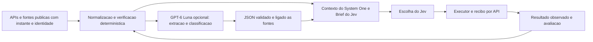

# GPT-6 Luna como evidencia complementar

O dono corrigiu o alvo para GPT-6 Luna e explicitou: usar somente se melhorar inteligencia/dados/decisoes do Jev, sem chat ou geracao de texto na interface. Esta investigacao e proposta de avaliacao, sem chave configurada, chamada paga, recurso contratado ou mudanca da autoridade financeira.

## Viabilidade confirmada na documentacao oficial

O ID e gpt-6-luna. Responses API suporta function calling, Structured Outputs e pesquisa web. Esses recursos permitem devolver campos tipados e consultar fontes. Eles nao demonstram precisao financeira ou rentabilidade. [Modelo](https://developers.openai.com/api/docs/models/gpt-6-luna).

Structured Outputs restringe a forma ao JSON Schema. A verificacao factual continua sendo do sistema: schema valido nao prova que um numero existe na fonte. Respostas recusadas/incompletas precisam de tratamento explicito. [Contrato estruturado](https://developers.openai.com/api/docs/guides/structured-outputs?api-mode=responses).

Preco standard para prompts curtos: US$0.10/milhao de entrada eUS$0.50/milhao de saida. Web search custaUS$10/1000 chamadas, mais tokens de conteudo. Acesso da conta, limites e custo de uso real ainda nao foram testados. [Precos](https://developers.openai.com/api/docs/pricing), [Pesquisa](https://developers.openai.com/api/docs/guides/tools-web-search).

Exemplo calculado, nao contratado: 24 analises/dia com3000 tokens de entrada e1000 de saida custariam cerca deUS$0.0192/dia em tokens. Uma busca por analise adicionariaUS$0.24/dia, alem dos tokens da busca, levando o exemplo a pelo menosUS$0.2592/dia. Uma analise em todo ciclo de5min teria288 chamadas: US$0.2304/dia em tokens no mesmo exemplo eUS$2.88 em288 buscas. Cadencia de enriquecimento nao precisa ser a cadencia de decisao.

## Papel que acrescentaria informacao

Proposta: o Luna classifica eventos publicados, pesquisa emissor/bridge/mint de candidatos, identifica divergencias entre fontes e sinaliza informacao faltante que muda a viabilidade. A camada retorna codigos, identidades, referencia de fonte, instante e estado de verificacao; inferencias ficam separadas de observacoes. Sem narracao na pagina. Fonte nao verificada nao pode preencher liquidez, quantidade, saldo, taxa, recibo ou probabilidade de lucro como se fossem fatos.

Saldo, assinatura e resultado da ordem devem vir da API/rede e de codigo verificavel. Um LLM nao e necessario para decidir se uma transacao identificada foi confirmada. Essa conciliacao e independente da pesquisa e deve continuar mesmo quando o Luna esta indisponivel.

Dados publicos de mercado bastam para a pesquisa inicial; nao enviar chaves, sessoes, historico privado ou carteira completa para uma nova API. Jev conserva a escolha financeira e usa alternativas realmente viaveis. O contrato atual MarketContext so tem campos macro e s1_*, portanto um contexto por ativo exige extensao tipada de AgentBrief pelo dono, e nao apenas anexar texto livre ao prompt.

## Dados alinhados antes de outro modelo

1. Identidade por rede/mint/contrato, nunca ticker. A NEAR na Solana observada nao esta provada como ativo nativo NEAR.
2. Instante da fonte e coleta separados; dados vencidos ficam indisponiveis. Atualizar dados de entrada acionaveis antes de aumentar consultas.
3. Unidades, decimais e quantidade inteira exatos. Ausencia e null, nunca zero; conflito entre fontes fica registrado.
4. Brief/version/hash/mandato, escolha bruta, regra aplicada e escolha final por ciclo.
5. Codigo que fechou uma compra separado do skip escolhido pelo Jev. Contar amostras independentes e janelas encerradas.
6. Ordem enviada, falha pre-envio, pendente, recibo confirmado e declaracao humana separados. Cotacao estimada, fill observado e custo de aquisicao nao sao intercambiaveis.
7. System One lendo e gravando no mesmo home real, com contexto atual; nao copiar saida antiga ou sintetica como evidencia real.

## Como decidir se vale a pena

Preparar dois fluxos de sombra/replay: Jev com dados normalizados existentes, e Jev com os mesmos dados mais a evidencia do Luna disponivel naquele instante. Mesmo universo, capital, tamanho, custos e regra de execucao. Separar desenvolvimento de uma janela posterior de avaliacao; impedir informacao futura e contagem duplicada da mesma aposta.

Medir: campos faltantes/resolvidos com prova, conflitos/identidades corrigidos, alternativas realmente disponiveis, custo e latencia adicionais, falhas, retorno liquido, drawdown e resultado contra manter em caixa e contra a configuracao sem Luna. Recusas do codigo e consultas repetidas sem dados novos nao provam inteligencia do modelo. Cotacoes ou fills ausentes nao podem ser preenchidos retrospectivamente com preco medio.

Resultado atual: **viavel tecnicamente, beneficio economico ainda nao demonstrado**. Primeiro corrigir conciliacao, tamanho/custo das compras, proveniencia/frescor e S1; fazer experimento desligado da execucao financeira. Se nao houver melhoria observada suficiente para pagar custo/atraso, descartar camada. Nao introduzir um segundo modelo como condicao para o agente existente continuar funcionando. Ativacao paga e credencial ficam para o momento em que houver configuracao concreta, custo e resultado de avaliacao.
