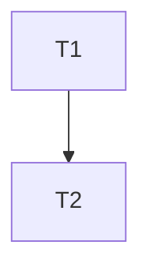

# Spec: <nome da feature>

Status: rascunho | aprovada | em implementação | concluída
Dono: <quem aprova>

## Contexto

<Problema, quem sente, o que acontece hoje.>

## Metas

- <resultado observável 1>
- <resultado observável 2>

## Não metas

- <o que esta feature não resolve>

## Critérios de aceitação

- [ ] <critério testável 1, com o comando que prova>
- [ ] <critério testável 2>

## Restrições

- Sem recursos pagos. Sem dinheiro real. Sem segredos em arquivos.
- <limites técnicos ou de risco>

## Plano de tasks (grafo quando houver três ou mais passos dependentes)

| Task | Depende de | Critério de done | Comando de verify |
|---|---|---|---|
| T1 | - | <critério> | `bun run typecheck` |
| T2 | T1 | <critério> | `bun test <arquivo>` |

Grafo em Mermaid, quando houver dependência ou paralelismo:

## Perguntas em aberto

- <pergunta> (levar ao Jev antes de implementar, conforme docs/conventions.md)

## Status

- Fase atual: <spec | plan | tasks | implement | verify>
- Aprovado em: <data>
