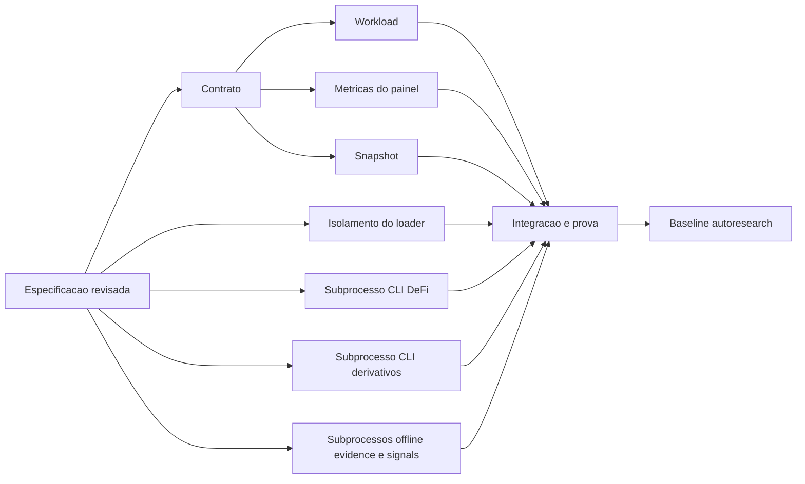

# Tarefas e dependencias

Navegacao: [[inteligencia-e-resultados]] e [[laboratorio-e-paper]]. [Especificacao](spec.md), [plano](plan.md) e [estado](status.md).

| ID | Entrega | Depende de | Prova |
| --- | --- | --- | --- |
| S | Especificacao e plano revisados | inventarios | revisao tecnica independente |
| C | Contratos e entrypoint | S | comando canonico |
| W | Workload lab e stress de carteira | S, C contrato | workload executado, dados point-in-time |
| P | Inventario do painel e fraquezas | S, C contrato | relatorio de cada metrica com disponibilidade |
| E | Snapshot sanitizado e hashes de capturas e journals no home real do runtime | S, C contrato | congelador offline read-only, projecao agregada sem dados sensiveis |
| GS | Isolar ambiente do loader nos testes de settings | diagnostico das falhas registradas | loader real com fixture falsa e testes de roundtrip/clear |
| GC | Migrar subprocessos dos testes do CLI DeFi ao padrao assincrono | diagnostico das falhas registradas | CLI real, mesmos asserts e limite de 45 s |
| GD | Migrar subprocessos dos testes do CLI de derivativos ao padrao assincrono | nova falha observada no gate global | CLI real, mesmos asserts e limites de 45 s por filho e 120 s por teste |
| GE | Concluir o corte assincrono dos wrappers offline de evidence e signals | causa Windows reproduzida e correlacionada no global | mesmos 34 subprocessos, asserts, ambiente, limite de 45 s por filho e 120 s por teste |
| V | Integracao e verificacao | W, P, E, GS, GC, GD, GE | duas execucoes identicas, revisao e todos os comandos obrigatorios verdes |
| I | Inicializacao da baseline | V | init_experiment somente depois do gate |

As verificacoes sao executadas apos a integracao; os agentes nao rodam build, lint, formatacao ou testes no meio das edicoes. Falhas anteriores conhecidas devem ser registradas, mas nao dispensam o gate de commit verde. Reparos de isolamento dos testes preservam credenciais, autenticacao e risco de producao. Nenhum ciclo de otimizacao pode substituir essa verificacao.
