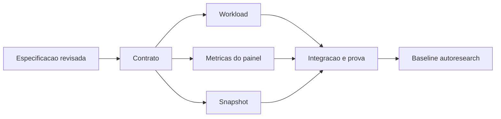

# Tarefas e dependencias

Navegacao: [[inteligencia-e-resultados]] e [[laboratorio-e-paper]]. [Especificacao](spec.md), [plano](plan.md) e [estado](status.md).

| ID | Entrega | Depende de | Prova |
| --- | --- | --- | --- |
| S | Especificacao e plano revisados | inventarios | revisao tecnica independente |
| C | Contratos e entrypoint | S | comando canonico |
| W | Workload lab e stress de carteira | S, C contrato | workload executado, dados point-in-time |
| P | Inventario do painel e fraquezas | S, C contrato | relatorio de cada metrica com disponibilidade |
| E | Snapshot sanitizado e hashes de capturas e journals no home real do runtime | S, C contrato | congelador offline read-only, projecao agregada sem dados sensiveis |
| V | Integracao e verificacao | W, P, E | duas execucoes identicas, testes pertinentes, revisao |
| I | Inicializacao da baseline | V | init_experiment |

As verificacoes sao executadas uma vez apos a integracao; os agentes nao rodam build, lint, formatacao ou testes no meio das edicoes. Falhas anteriores conhecidas da suite completa devem ser identificadas como baseline, sem correcoes de credenciais ou escopo paralelo.
