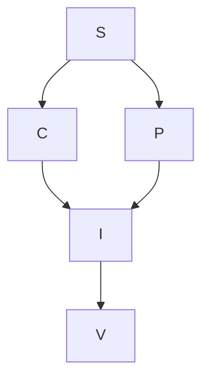

# Tasks: autoresearch real online

| Task | Depende de | Criterio de done | Verify |
|---|---|---|---|
| S | - | Fontes passivas mapeadas, spec/plan revisados e contrato compartilhado fixado sem nova autorizacao financeira | revisao independente e prova GET online sanitizada |
| C | S | Coletor consulta runtime e provedor real, valida proveniencia/frescor e falha sem fallback | smoke real do comando canonico apos integracao |
| P | S | Projetor usa apenas evidencias observadas, preserva desconhecidos e cobre o inventario inteiro do painel | gates integrados e inspecao do REPORT real |
| I | C, P | CLI canonico online, caminho sintetico removido, consumidores/documentacao migrados | `bash autoresearch.sh` com observacoes reais |
| V | I | Smoke real online, revisao de seguranca/escopo e gates obrigatorios aprovados | `bun run typecheck`, `bun run test`, `bun run test:lab` |

## Regras de execucao

- C e P sao fatias paralelas com ownership separado; o integrador fixa a interface antes de ambas.
- Nao executar a campanha antiga sintetica/offline. Testes unitarios do projeto verificam contratos isolados e nao sao evidencia financeira da pesquisa.
- Nao usar `/agent/status`, iniciar modelo/executor, escrever journals ou mudar config de producao.
- Ordens incertas nao sao encerradas pelo pesquisador. Lacunas financeiras impedem promocao, nao a exibicao honesta da evidencia disponivel.

## Encerramento

S, C, P, I e V concluidos. Duas observacoes reais consecutivas no avaliador final, revisao independente sem achados e sequencia obrigatoria com exit 0 estao registradas em [status.md](status.md), incluindo falhas anteriores e limites da evidencia. Isso encerra a mudanca de fonte do autoresearch, nao qualifica retorno financeiro nem ativa o processo instalado.
