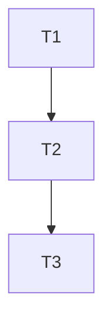

# Tasks: Grafo documental do cerebro v2

## Grafo

| Task | Depende de | Criterio de done | Comando de verify |
|---|---|---|---|
| T1. Mutar e materializar | - | `add-node`, `link` e `retract` acrescentam eventos append-only e materializam o derivado; retract preserva o evento anterior. | `bun --no-env-file test scripts/cerebro.test.ts` |
| T2. Verificar integridade | T1 | `verify` confere chain de eventos, retract, derivado contra recomputacao e hashes de v1. | `bun --no-env-file test scripts/cerebro.test.ts` |
| T3. Exportar compacto | T2 | `export` chama `exportCompact`, le apenas log/derivado e retorna `DecisionSpec` de ate 300 caracteres filtrado por `parseSpec`, sem reescrever o derivado. | `bun --no-env-file test scripts/cerebro.test.ts` |

## Limites

- Implementar somente o contrato aprovado. Encaminhar cada decisao de design pendente ao JEV; nao inventar sintaxe, esquema ou limites de exportacao alem do limite de 300 caracteres e do filtro de segredo/endereco em `parseSpec`.
- Nao fazer chamada paga ao JEV. Sem operacao live ou alteracao de risco.
