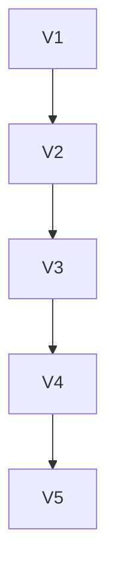

# Tarefas

| ID | Tarefa | Depende de | Prova | Estado |
| --- | --- | --- | --- | --- |
| V1 | Build estatico de fontes atuais | nada | saida real, hashes e fontes preservadas | feito: Next exit 0, 46 arquivos; declaracoes geradas restauradas e typecheck web exit 0 |
| V2 | Core com perfil novo e origem unica | V1 | health e handlers reais; agendador desligado | feito: launcher e handlers reais em 47321; perfil novo sem CLI, carteira ou credenciais; scheduler.started=false |
| V3 | GETs e navegador | V2 | respostas, tela e ausencias verificadas | feito: sete GETs 200, console 404 e duas recusas 403; IAB com tela inicial e configuracoes; zero avisos/erros capturados |
| V4 | Encerramento e integridade | V3 | PID/porta encerrados e fontes identicas | feito: filho exit 0, porta e PIDs liberados; 2536 arquivos identicos; apenas quatro arquivos de fluxo publico no perfil novo |
| V5 | Revisao e recibo | V4 | evidencia, grafo e PR atualizados | revisao local e registro concluidos; publicacao conferida no checkpoint e no PR 5 |

