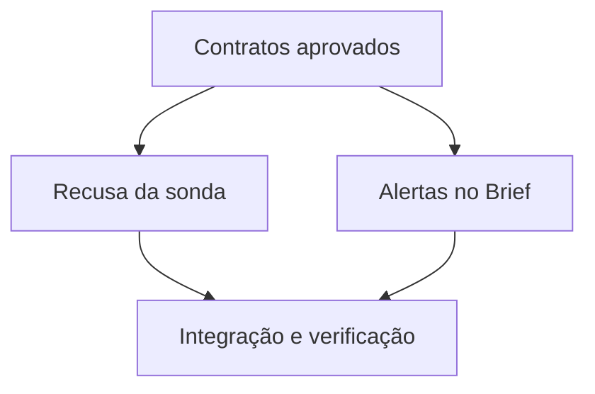

# Tasks: evidência executável no Brief do JEV

| Task | Depende de | Critério de done | Verify |
|---|---|---|---|
| T1: preservar recusa da sonda | Contratos da spec | Gas station explícita fecha compras; Brief e relatório preservam a causa, inclusive com quatro marcas anteriores; desconhecido não fecha, TTL e recuperação preservados | Replay offline e regressões em entry-cost, cycle e wire |
| T2: serializar alertas de posição | Contratos da spec | Brief contém alertas existentes sem exceder o teto ou alterar dados privados | Replay do Brief e regressões de modelo |
| T3: integrar e verificar | T1, T2 | Caminhos exercitados, gates obrigatórios passam, evidência registrada | `bun run typecheck && bun run test && bun run test:lab` |

- [x] T1
- [x] T2
- [x] T3
