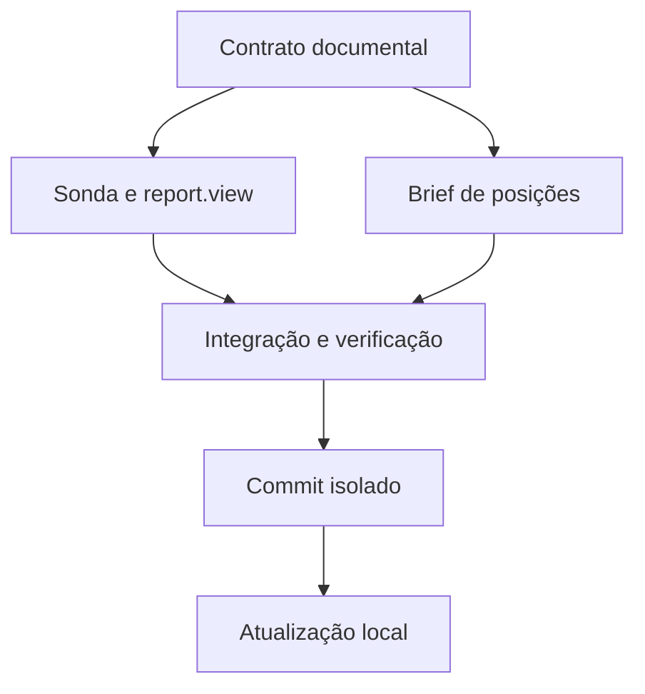

# Tasks: evidência executável no Brief do JEV

| ID | Entrega | Depende de | Critério de done | Verify |
|---|---|---|---|---|
| S | Contrato documental e fronteira | decisão do usuário | Escopo isolado, não metas, critérios e limites registrados | Revisão da spec e do plan |
| P | Port da sonda e `report.view` | S | Recusa, falha e desconhecido usam TTL de 60 s; impacto numérico finito usa TTL de 5 min; recuperação, causa e marca preservadas com limite de quatro; triggers existentes intactos | Testes focados de entry probe, adapter, cycle e `report.view`; smoke offline sem ordens |
| B | Brief de posições | S | `posicoes.t` omitido quando vazio; alertas e códigos existentes preservados quando presentes; legenda `posicoes.g` preservada | Testes focados do serializer e smoke consumidor do Brief |
| V | Integração, verificação e qualificação do artefato | P, B | Testes, smokes, gates e selftest passam; revisão concluída e evidências registradas | `bun run typecheck`, `bun run test`, `bun run test:lab`, build, selftest e smokes especificados no plan |
| C | Commit isolado | V | Commit contém somente a fatia autorizada e preserva estado/gates | Revisão do diff staged e identificação do commit |
| U | Atualização local | C | Software local atualizado apenas após confirmar alvo e estado; sem operações financeiras ou mudança de configuração vedada | Evidência de versão/estado local e health após atualização; não inferir hash do health |

- [x] S
- [x] P
- [x] B
- [x] V
- [ ] C
- [ ] U

O checklist registra a preparação anterior ao commit. O `delivery-receipt.json` externo, junto ao artefato qualificado, registra o identificador do commit criado posteriormente e o estado efetivo da atualização.
