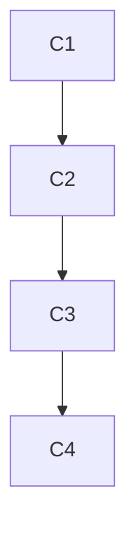

# Tarefas

| ID | Tarefa | Depende de | Prova | Estado |
| --- | --- | --- | --- | --- |
| C1 | Revisar os 17 casos e consumidores | nada | 1798 fontes parseadas, zero falhas, consumidor real preservado | feito; recibo local export-consumer-review-20261018/result.json |
| C2 | Coorte e substituicao literal | C1 | ancora unica, hashes e inversao exata | feito: 16 marcadores em 14 arquivos; inversao reproduz os bytes originais |
| C3 | Checks obrigatorios | C2 | tipos/core/lab/web e hashes | feito: tipos core/web exit 0; core 8544 pass (2 skip), lab 650 pass e web 3821 pass; zero falhas e hashes intactos |
| C4 | Revisao e publicacao | C3 | diff, cerebro, PR e checkpoint | revisao e registro locais; publicacao no PR 5 e conferencia do remoto registradas no checkpoint |

