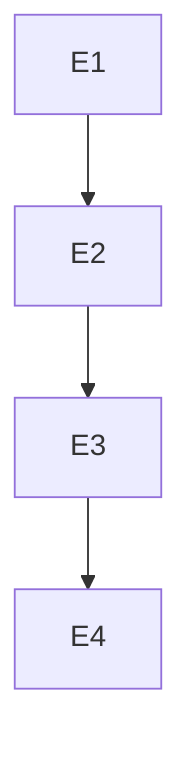

# Tarefas

| ID | Tarefa | Depende de | Prova | Estado |
| --- | --- | --- | --- | --- |
| E1 | Coorte e consumidores atuais | nada | 1798 fontes, 133 simbolos selecionados e exclusoes justificadas | feito; cohort.json registrado |
| E2 | Substituicoes literais | E1 | somente export removido em 68 arquivos | feito; 133 palavras removidas e conteudo transpilado nao exportado igual |
| E3 | Verificacao completa e superficie web | E2 | tipos/core/lab/web e hashes | feito: tipos core/web; 8544 core (2 skip), 650 lab e 3821 web sem falhas; hashes inalterados |
| E4 | Revisao, grafo e publicacao | E3 | diff exato, grafo valido, PR atualizado | revisao concluida, inversao reproduz hashes originais e grafo seq 1090 valido; publicacao preparada |

