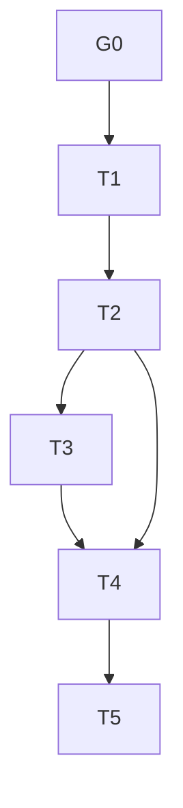

# Tasks: Proveniência do timestamp `price-info`

Estado: G0-T5 concluídas. Aggregate final de três comandos exit 0 cobriu os cinco caminhos root/web requeridos; duas skips root de receipt-safety não são qualificação live. Resultados detalhados em `status.md`. Não é autorização de migração ou D2.

| Task | Critério de done | Verificação |
|---|---|---|
| G0 - Aprovação de escopo | Concluída: Main autorizou extensão pública opcional no Brief V1; não autoriza migração, D2 ou mudança de proprietário. |
| T1 - Transportar evidência local | Concluída: `HoldingFacts` recebe metadado opcional somente de observação `price-info`; sem timestamp observado normalizado é false, timestamp numérico é true, ausência de observação não define propriedade; candidates preservam o opcional e `ag` não muda. | Reader → candidates com NOW fixo; facts `true`/`false`; `ag=2` em ambos, uma chamada cada a price-info/risk; sem rede/modelo |
| T2 - Projetar Brief | Concluída: holding projeta `pt:0|1` conhecido; desconhecido/legado omitido; legenda `price-info timestamp:1 reported/0 missing; omit=unknown; freshness unverified` declara timestamp reportado/ausente, desconhecido omitido e frescor não verificado. | Legenda final: 77 B UTF-8; JSON entry 94 B; 8 `pt`=56 B; extensão=150 B. O bound calculado anterior de 11.888 B é histórico (legenda `ag` antiga, sem campos concorrentes) e não representa payload/fixture atual. Smoke throwaway atual: fixture completa 11.989 B (8 holdings pt=1, 7 buys, 32 context keys); fixture mista 11.948 B, com mesmos limites e `holding.h=0.1`, `buy.h=5000`, `pt=1/0/omit`. Ambos abaixo da referência 12.000 B; não é guarda/truncamento runtime. |
| T3 - Persistir sem migração | Concluída: Brief exato continua V1 e hash genérico inclui `pt`; registros antigos sem o campo não são reescritos. Nenhuma alteração em `audit.ts`, `agent-episode.ts`, `briefVersion` ou journal. | `auditConsult` matched para `onConsult` real; suite auditoria legado 17 pass/63 expects |
| T4 - Review backend e HUD | Concluída: allowlists aceitam somente 0/1; HUD mostra significado sem inferir idade; ausência legacy e enum inválido ficam omitidos; `ag` e idades conservam semântica. | Guarda material `pt` estável/transição; Chromium com parser, componente e CSS reais |
| T5 - Gates gerais | Concluída: aggregate final de três comandos cobriu todos os caminhos root/web exigidos; dois skips de receipt-safety não qualificam live. | `typecheck:all` exit 0; `test:lab` 647 pass/0 fail; `test:all` root 7.882 pass/2 skip/0 fail, web 3.825 pass/0 fail; logs e escopo em `../status.md` |

## Critérios transversais

- Nenhuma nova API/rede/provider/modelo/chamada, segredo, wallet/CLI, operação, dado privado/D2 ou dependência.
- O par de reprodução deve manter fixos data UTC, Book, todas as flags, gateway/cache, outros campos DTO, planos e signal; única diferença de origem é `tsMs`.
- `pt` não deriva de `atMs`, cache age, `seenAt`, `ag` ou relógio local; não é fonte de idade. `ag` composto e idades `mo.ag`/`tm.ag` conservam semântica/cálculo e não são removidos/alterados por esta frente.
- Entrada antiga sem `pt` é desconhecida, não 0. Persistir sempre o Brief exato que foi enviado.
- Verificação não deve usar `process.execPath` no Eval (o executável seria `omp.exe`); a reprodução observada nesta investigação usou `bun` real.
- Não editar nem chamar os helpers `scripts/look-staleness.ts` e `scripts/brief-freshness.ts`; o segundo acessa rede pública e não é prova desta distinção.
