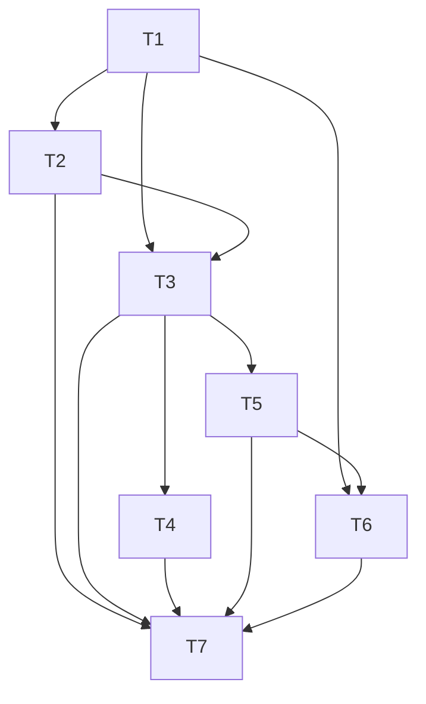

# Spec: Inteligência e revisão dos ciclos JEV

Status: aprovado pelo diretor para implementação; não é aprovação/retorno do JEV
Dono: Jev / diretor do projeto

## Contexto

O foco é o modelo configurado no agente ativo: `src/agent/model.ts` monta o Brief e o envia a Jev por `experimental_evaluate`; `src/agent/live.ts` pode fornecer ao agente uma leitura separada de System One, que entra apenas como contexto do Brief do agente. Isso não significa que o agente envie seu Brief ao subsistema independente `src/system-one`. O caminho standalone de System One fica fora do escopo desta feature. O agente também registra decisões/ciclos, mas a revisão por ciclo ainda precisa de projeção útil na análise e no HUD ativos. A interface é AgentView/HUD, não Deck/Mesa legado. Alterações preexistentes devem ser preservadas e integradas em ponto estável.

O Brief tem orçamento de referência de 12.000 bytes, verificado nos testes (`src/agent/model.ts:21-22`); o produtor não trunca a projeção em runtime. `boundedContext` rejeita o contexto todo acima de 32 chaves (`src/agent/model.ts:120-132`). Preservar esse comportamento. Não aumentar dados privados de carteira enviados: D2 de `docs/sdd/carteira-evidencia/tasks.md` segue gate próprio. Usar fatos públicos/derivados já autorizados e projeções existentes. Extensões calculadas de projeções/API/Brief podem ser opcionais e compatíveis com consumidores antigos que não tenham o campo; não mudar schema persistido nem criar duplicação de journal.
## Metas

- Corrigir gaps demonstrados de proveniência/frescor/unidades/ausências no contexto do agente, dentro dos contratos e orçamento existentes; não introduzir consultas adicionais.
- Reduzir duplicação/espera comprovadas nos caminhos existentes sem aumentar polling nem contornar quotas.
- Fazer a revisão por ciclo em `buildAnalysis` usando hash/contexto congelado, escolha solicitada e aplicada, etapas observáveis, achados determinísticos acionáveis e resultado disponível. Achados incluem stale/ausência, custo desconhecido, divergência solicitado/aplicado, ordem incerta e resultado ainda não medido, ancorados nos dados daquele ciclo. Não chamar LLM por review, não autoajustar risco/retries/policy, nem usar fatos posteriores como input retroativo.
- Apresentar contexto e revisão por ciclo no HUD ativo sem ação decorrente de carregar status.
- Validar antes/depois em cenários locais temporários paper/readonly; esta sessão não inicia observação contínua ou live.

## Não metas

- Aumentar frequência de consulta, criar fetches ou adotar endpoints catalogados sem necessidade demonstrada e fonte oficial validada.
- Aumentar dados privados da carteira enviados ao Jev, habilitar revisão de carteira ou ultrapassar o gate D2/autorização para chamada paga.
- Mudar `Market.init()`, autenticação/credenciais, limites de risco, schema persistido/journal ou migrá-los. Extensões calculadas opcionais com compatibilidade para campo ausente não são migração de persistência.
- Iniciar live/autonomia, assinar/transmitir ordens, ou tratar broadcast como confirmação de execução.
- Criar subsistema paralelo à análise existente ou alterar o System One standalone.

## Critérios de aceitação

- [x] Inventário de APIs e funcionalidades existentes/planejadas, incluindo OKX Wallet, OnchainOS e Agentic Wallet, com contratos e estado atual separados de pesquisa/documentação; pesquisa oficial citada em `research.md`.
- [x] Brief preserva limite de 12.000 bytes, formato/unidades, schema e projeção atual de carteira; chaves omitidas/desconhecidas permanecem explícitas e não são interpretadas como zero. Preservado o contrato all-or-nothing de `boundedContext` acima de 32 chaves ou entrada inválida; limite máximo provado sem relaxar guard.
- [x] Nenhuma chamada de dados adicionada para atender enriquecimento; contagem não excede baseline; cadências existentes não aumentam. Sem rate limit inferido: respeitados contratos explícitos e pesquisa oficial.
- [x] Registro/review identifica ciclo, hash do Brief congelado e apenas proveniência efetivamente registrada; solicitado vs aplicado, gates/etapas e ordem/resultados somente com vínculo inequívoco `cycleId`/`candidateId`/order key. Achados determinísticos ancorados no ciclo; nenhum dado `unknown` cru. Broadcast/sombra/aplicada não tratados como execução; fatos posteriores só como resultado, nunca input retroativo. Sem LLM extra/policy autoajuste; retenção limitada à evidência real.
- [x] UI exercitada com proveniência/frescor/unidades/desconhecidos e revisão por ciclo sem iniciar ações. Prova Chromium usa AgentView/HUD/CSS reais em harness Next temporário, não aplicação completa deployed; sem autonomia/login/carteira/execução no harness.
- [x] Smokes integrados somente em home temporária isolada com executor paper; nenhum journal foi escrito. Captura histórica sanitizada read-only em DataHome é separada e documentada, não smoke nem T13. Nenhum segredo em logs ou respostas.
- [x] Aggregate final sequencial: `typecheck:all`, `test:lab`, `test:all` exit 0. Esses três comandos executaram os cinco caminhos root/web requeridos, não cinco comandos standalone. Saídas e os dois skips root de receipt-safety (não qualificam live) em `status.md`; inspeção de UI real de componentes também documentada.

## Restrições

- Sem assinatura/transmissão/ordens reais; sem iniciar live ou autonomia da sessão conectada.
- Sem alteração em `Market.init()`, auth/credenciais, risco, schema ou journal/migração.
- Sem leitura de `.env` ou segredos. Smokes desta implementação usam apenas home temporária isolada. A captura histórica sanitizada de registros em DataHome resolvido sob `INONU_HOME` está descrita em `observations.md`; foi read-only e não é smoke desta implementação nem avaliação T13. T13 continua autorizada, mas não iniciada.
- Preservar alterações alheias e scripts de benchmark/autoresearch. Não modificar testes/fixtures/assets de verificação para passar.
- `AgentView.tsx`, `HudGate.tsx`, `HudView.tsx`, `hud.css` e `hud.test.ts` têm alterações alheias observadas previamente. Não há owner identificado além desse levantamento; o diretor autorizou integração mínima após reler e confirmar estabilidade do trecho. Preservar as alterações alheias; preferir módulo novo e import/render pontual, sem editar estilos/handlers/readOnly/testes.

## Plano de tasks (grafo quando houver três ou mais passos dependentes)

| Task | Depende de | Critério de done | Comando de verify |
|---|---|---|---|
| T1 Inventário, ownership e baseline seguro | - | Paths/símbolos, contratos, funcionalidades existentes/planejadas, zonas/sessões e baseline readonly/paper descritos | leitura instrumentada em home temporária; sem chamadas live |
| T2 Pesquisa oficial e SDD | T1 | contratos oficiais/API quotas documentados com fontes e incertezas, sem limites inferidos | revisão de `research.md` e citações |
| T3 Brief/contexto do agente ativo | T1,T2 | evidência/frescor/unidade/ausência em fatos já lidos, sem dados de carteira adicionais; preserva contexto all-or-nothing e orçamento | cenários temporários válidos/inválidos/stale + Brief máximo |
| T4 Eficiência sem polling maior | T1,T2,T3 | duplicação/cópia/serialização comprovadamente reduzida, cadências/quotas mantidas | cenário instrumentado compara chamadas/bytes e latência |
| T5 Revisão por ciclo | T1,T3 | relação input -> decisão -> gates -> execução -> resultado sem hindsight | cenário paper cobre falha, incerta, broadcast, fill/settlement |
| T6 HUD ativo | T1,T3,T5 | visualização de evidência/review, nenhuma ação decorrente do status; alterações alheias preservadas | UI real local em browser e checks web |
| T7 Integração e gates finais | T2-T6 | smokes isolados, riscos/limitações visíveis, documentação pós-smoke atualizada | gates raiz/web e smokes temporários |

## Perguntas em aberto

- Pesquisa oficial e catálogo foram confirmados para rotas relevantes; limites CLI/Basic/Premium não publicados nas páginas revisadas. Nenhuma consulta adicional ou quota numérica por inferência.
- D2 permanece pendente para qualquer alteração de carteira que vá ao JEV; esta spec não autoriza tal alteração.
## Status

- Fase atual: T1–T12 concluídas nos escopos descritos; T15 implementada e com prova focada/read-only sintética registrada. Aggregate final sequencial `typecheck:all`, `test:lab`, `test:all` exit 0; três comandos cobriram os cinco caminhos root/web. As duas skips root receipt-safety não qualificam live; detalhes e monitoramento limitado em `status.md`. T13 está autorizada, não iniciada; T14 mantém seu estado concorrente.
- Aprovação T8: 2026-10-16 (diretor).
- Atualização pós-smoke: reader → candidates → Brief/hash e prova enum backend→HUD foram exercitados; os números/limite calculado de 11.888 B são históricos, anteriores à legenda `ag` atual e a campos concorrentes. Fixture completa atual medida em 11.989 B (8 holdings `pt=1`, 7 buys, 32 context keys) e mista em 11.948 B; 12.000 B é orçamento de referência/teste, não guarda/truncamento runtime. Ver `proveniencia-price-info/status.md` e `observations.md`.

## Addendum T8+: admissão por envio físico no gateway OnchainOS

Estado deste addendum: T8 aprovada pelo diretor em 2026-10-16 e implementada; T1-T7 permanecem concluídas e T9 foi concluída em rodada histórica. `pt` autorizada e implementada separadamente; migração e D2 permanecem fora de escopo.

### Contexto e evidência

O client DEX serializa chamadas e define `minIntervalMs=1100`, mas a espera atual acontece uma vez antes de `send()`. O retry 50102 reside dentro de `sendBeforeDeadline`, portanto pode invocar `fetch` novamente antes do intervalo. No probe throwaway com Bun, gateway/client/createBudget reais, clock e fetch sintéticos, uma resposta 50102 levou a dois fetches separados por 17 ms. O gateway só registrava o resultado após `client.call`: com cap local Basic=1, um único call gerou dois fetches e `used=2, cap=1`. Três chamadas simultâneas idênticas coalesceram e compartilharam resultado (uma líder enviada, duas followers não enviadas). A evidência mede apenas esta política local; não demonstra violação de quota oficial.

`budget_exhausted` e `pace_limited` já são razões locais permitidas pelo contrato do gateway. Os caps permanecem configurações locais; não se infere nem altera limite de fornecedor.

### Metas

- Admitir e registrar sincronicamente cada invocação física de `fetch`, inclusive o retry existente, no ponto de dispatch.
- Fazer todo dispatch respeitar o `minIntervalMs` existente, sem alterar assinatura HMAC, aprendizado do relógio, cooldowns, tier block ou número máximo de retries.
- Executar admissão apenas na líder após cache/coalescing: followers de chamada compartilhada recebem o resultado sem reserva/recusa/cobrança próprios.
- Preservar cache gratuito, stale fallback e a separação entre `sent` e um envio que não ocorreu.

### Não metas

- Não modificar limites/caps configurados, quotas oficiais, persistência v1 de uso, schema/journal, autenticação, credenciais, política de retry, cache TTL, polling ou scheduler.
- Não mudar transport V5 público, Agentic CLI, `Market.init()`, D2, reservas de carteira, `pt` ou qualquer autorização protegida.
- Não adicionar retries nem fazer API/ambiente/chaves reais, CLI, serviço ou home operacional.

### Critérios de aceitação T8+

- `OnchainClient.call` tem API obrigatória, sem overload/compatibilidade opcional: `call(request, tier, admitDispatch: () => DispatchAdmission)`, com `DispatchAdmission = { ok: true } | { ok: false; reason: "budget_exhausted" | "pace_limited" }`. Callback síncrono invocado imediatamente antes de cada `fetch`; aceitação contabiliza exatamente uma invocação física. Recusa antes da primeira chamada retorna motivo local com `sent:false`; recusa do retry após uma primeira chamada mantém `sent:true`.
- `createOnchainGateway` remove o reserve externo a `cache.coalesce`. Dentro da líder coalescida e antes de `client.call`, o reserve atual permanece como preflight síncrono não consumidor: recusa cap/pacing sem esperar a fila/intervalo, sem registrar uso. O callback de dispatch revalida imediatamente antes de cada `fetch` físico e registra uma unidade somente quando admite. A reserva/registro de followers não ocorre; `budget_exhausted`/`pace_limited` permanecem razões locais existentes, inclusive stale fallback; cap zero não envia.
- O retry mantém o único retry 50102 e só é tentado se a resposta ensinar offset conforme o critério existente. A espera antes do retry usa o intervalo desde o último fetch; permanece dentro do deadline já iniciado por `send()`, compartilha o AbortSignal existente e verifica abort/deadline depois da espera e antes da callback obrigatória, que então segue sincronamente à invocação de fetch, sem `await` intermediário. Não altera a espera inicial, que continua fora do deadline de fetch. Cap 1 + relógio requer retry: um fetch apenas, `used=1`, motivo local de orçamento; cap 2: dois fetches, `used=2`, espaçados; nenhum fetch após timeout/abort durante a espera do retry.
- Três chamadas simultâneas da mesma chave, com cap 1 e fetch líder suspenso, compartilham a resposta: somente líder é enviada/registrada; followers tardios ainda entram no coalesce depois do consumo do cap e não são recusadas. Cache hit não consulta admissão nem conta. A concorrência de outra chave continua serializada; preflight e callback de fetch revalidam no ponto aplicável.
- 429 continua a abrir cooldown global existente; 402 continua a bloquear apenas o tier existente; fila, timeout, status do client e cache/stale seguem contratos atuais.
- `ClientResult` não expõe contagem de dispatches; produção, testes e callsites usam a admissão junto ao envio físico. Todos os `OnchainClient.call` callsites passam o callback obrigatório; nenhuma assinatura de `createOnchainClient` em server/desktop/cloud precisa mudar.
- Provas temporárias usam Bun com gateway/client/createBudget reais, diretório temporário exclusivo, clock/fetch sintéticos, cleanup; não acessar estado real. Verificações permanentes cobrem `src/onchain-read/client.test.ts`, `gateway.test.ts`, `probe.test.ts` e implementações fake de client de `f2-routes.test.ts`/`routes/wallet-gateway.test.ts`. Os gates finais serão executados uma vez pelo integrador após a conclusão de todas as fatias de implementação.

### Gate

A correção T8 foi aprovada pelo diretor técnico sem nova autorização de credenciais/auth/billing/schema; implementação e verificação focada foram concluídas. T9 concluída; aggregate final posterior exit 0 (três comandos para cinco caminhos root/web), com duas skips receipt-safety sem qualificação live. A proposta `pt` foi autorizada pelo Main e implementada separadamente; migração e D2 permanecem fora de escopo.

## Addendum T11: agrupamento privado de fills (aprovado tecnicamente pelo diretor)

### Contexto e evidência

O perfil sintético isolado de `buildAnalysis` observou 211.687 ms medianos para 10.000 fills de um mesmo símbolo, contra 6.122 ms com 100 símbolos distribuídos. A implementação copia o array acumulado a cada fill e depois copia o grupo antes de ordená-lo. Esse perfil justifica somente a redução dessas cópias em `src/agent/analysis.ts`.

### Critérios de aceitação

- Criar cada array de símbolo uma única vez, acrescentar fills com `push` e ordenar in-place somente o array privado do grupo. Não alterar validação, semântica de ordem temporal, lógica de round-trips, fees, paginação, Maps de scoreboard, cálculos diários, entrada ou outros trechos.
- Para saídas compiladas antes/depois com as mesmas flags Bun, comparar JSON byte-a-byte em todas as páginas (120 briefs × 15 candidatos; páginas 1–10) e nas fixtures determinísticas de 26/1.000/5.000/10.000 fills, com símbolo único/distribuído, ordem embaralhada, timestamps iguais, vendas parciais, `tokenMinor` desconhecido e estados de entrada incompletos.
- As comparações devem preservar todos os campos de saída — inclusive ciclos/revisões, ordem de trips e seus valores/horários, contagem de fills, fees e `unmatchedSells` — e comprovar que entradas congeladas ou verificadas antes/depois não foram mutadas.
- Perfil pareado com warm-up e mediana de nove execuções, usando as versões compiladas na mesma execução e fixtures equivalentes. Reportar somente medições observadas; dados sintéticos não alegam latência financeira, JEV ou produção.
- Sem alteração de API, chamadas externas, cadência, retry, auth/credenciais, dinheiro, persistência/journals, ou comportamento de paginação. Sem teste permanente incidental de implementação/performance; os testes existentes de análise cobrem contratos semânticos.

### Gate

Implementação autorizada pelo diretor técnico para exatamente a otimização de agrupamento/ordenação privada. Smoke comparativo, teste existente de análise e typecheck focado concluídos; os cinco gates globais atuais estão em execução pelo integrador.

## Addendum T13: autorização limitada para avaliação retrospectiva local

O usuário autorizou explicitamente uma avaliação retrospectiva dos ciclos já registrados. Esta autorização é estrita e não amplia as autorizações anteriores.

### Escopo e limites

- A avaliação poderá ler somente os arquivos locais já existentes `answers.jsonl` e `prices.jsonl` e os segmentos rotacionados desses mesmos dois journals reconhecidos pelo helper existente `journalSegments`. Não procurar nem ler qualquer outro journal, arquivo de carteira, segredo ou dado operacional.
- A leitura deve ser exclusivamente read-only e toda saída deve ser sanitizada: relatar apenas contagens/métricas agregadas e incerteza. Não expor decisões brutas, conteúdo de respostas, dados de carteira, identificadores sensíveis ou registros individuais.
- Não chamar APIs, modelos ou rede; não reiniciar serviços; não escrever/alterar journals ou schema; não alterar comportamento de trades, execução ou risco.
- A única computação permitida é o avaliador determinístico de outcomes que já exista, e somente se puder ser usado sem violar qualquer limite acima. Não criar, modificar ou executar outro script/ferramenta para a avaliação.
- Parar sem prosseguir se qualquer um dos dois arquivos-base estiver ausente/ilegível, ou se algum segmento identificado por `journalSegments` estiver ausente, ilegível ou instável durante a leitura, ou se a ferramenta/procedimento puder produzir efeitos colaterais. Não tentar recuperar, copiar, reparar ou estabilizar os arquivos por escrita.
- Esta autorização não afirma rentabilidade nem autoriza operação live/autônoma. Registrar resultados somente como agregados observados, com limitações e incerteza explícitas.

### Critério de aceitação

- Qualquer avaliação futura usa somente os dois journals autorizados e os respectivos segmentos rotacionados reconhecidos por `journalSegments`, além do avaliador existente, sob leitura sem efeitos colaterais; para diante de qualquer condição de parada; e divulga somente agregados sanitizados. A alteração desta spec registra a autorização, mas não executa leitura ou avaliação.
## Addendum T14: qualidade e frescor dos dados de carteira e feeds

### Escopo e limites

- Melhorar somente os dados dinâmicos já consumidos pelo estado da carteira gerida, pelo HUD e pelos feeds OnchainOS que alimentam candidatos, fatos e avaliação de risco. Este addendum não declara que todo valor constante ou toda integração do repositório foi auditada.
- A tela continua usando o polling de status existente; não adicionar leituras de carteira, aumentar a cadência de leitura, expor novos dados privados ao JEV, chamar APIs/modelos pagos, alterar autenticação, risco, live, persistência ou schema.
- O status do patrimônio deve carregar valor, qualidade e horário coerentes. Resultado de leitura antiga/abortada não pode substituir snapshot posterior nem induzir decisão; falha preserva somente dados verificáveis e os identifica como parciais/desatualizados ou indisponíveis, sem inventar saldo.
- Posições da carteira gerida não podem ser removidas por limite de exibição devido a posições watch-only. Campos externos inválidos não podem virar confiança/fato implícito: identidade incompatível rejeita a observação, medida opcional inválida fica desconhecida e registro sem campos indispensáveis não entra na análise.
- Sinais e tokens de fonte obsoleta não pontuam nem viram fatos para decisão; sinais normalizados em uma requisição retêm timestamps de `nowMs` até `nowMs - 6 horas` inclusive e descartam os anteriores e futuros. A mesma janela é revalidada ao servir valores já normalizados do cache em cada leitura, sem despacho adicional, alteração de TTL/cadência ou mutação da entrada; normalização direta/interna sem horário de requisição mantém a semântica atual; outras fontes frescas continuam disponíveis. Deduplicação usa identidade canônica consistente com o construtor de candidatos, preservando a sensibilidade a caixa de identificadores não-EVM.

### Critérios de aceitação

- Testes cobrem timeout e ordenação de leituras de patrimônio, saldo sem preço verificável, limite de posições, falha/estagnação do polling do HUD e preservação visual do último valor com indicação de idade/qualidade.
- Testes de parser/gateway cobrem unidade e faixa de medidas, timestamp/identidade incompatíveis, candles/linhas incoerentes e exclusão de sinal/token desatualizado da influência decisória.
- Todo cache hit ou fallback servido para `/onchain/signals` revalida os registros normalizados com a janela temporal da requisição, incluindo o limite inclusivo de seis horas; a projeção não altera a entrada/TTL nem provoca despacho ou consumo adicional do orçamento.
- A deadline de requests Onchain e Signals deve ser aplicada por relógio monotônico e revalidada após transportes, leituras de body e parsing assíncronos, antes de aceitar resposta ou admitir cache. Uma resposta que só retorna após expiração, inclusive quando transporte síncrono bloqueia o event loop e atrasa timers, não pode virar sucesso nem cache; os limites configurados não aumentam.
- Testes sintéticos controlam a expiração sem depender de cap de tempo absoluto: no Signals, remover apenas a asserção elapsed `<250 ms` e manter verificações funcionais de rejeição, abort e chamadas; no gateway, provar resposta expirada não admitida/cacheada, semântica compartilhada de cache/budget preservada e request subsequente com deadline default que despacha de novo e obtém dado novo. As alterações T8 `DispatchAdmission` já existentes devem ser preservadas.
- Prova visual usa apenas resposta sintética local; prova backend usa fixtures/sources sintéticos, sem consultar wallet, credenciais, rede, serviço JEV ou core operacional.
- Smokes e os cinco gates globais registram somente resultados realmente observados. Nenhum dado sintético é descrito como saldo real, cotação atual ou decisão de produção.

### Gate

Implementação inicial e gaps/falhas observados estão documentados em `status.md`/`observations.md`. T14 permanece aberta até concluir os critérios de deadline deste addendum e obter verde nos cinco gates globais atuais; smoke sintético ou resultado histórico não substitui esses critérios.
## Addendum T15: prioridade de leituras existentes no limite do leitor

### Contexto

Uma observação read-only de ciclo mostrou que a seleção atual pode gastar o limite do reader com posições watch-only de maior valor, deixando de ler uma posição já gerida. No caso observado, a leitura de book → ciclo → `onBook` → status deixou o saldo de uma posição gerida sem preço verificável (`usd=null`) apesar de leituras para 20 posições watch-only; isso caracteriza qualidade insuficiente da entrada, não defeito de quote/abort. A alteração deve reordenar a seleção das leituras existentes antes do limite, não criar novas leituras.

### Escopo e contrato

- Para o conjunto de posições já elegíveis, manter exatamente as mesmas regras de elegibilidade, filtros e `max` vigente. Não alterar limites de risco, regras native/dust, dados externos, endpoint ou admissão.
- Ordenar a prioridade em grupos: posições com plano elegível primeiro; depois posições já geridas; depois demais posições; dentro de cada prioridade, USD decrescente. Preservar critérios determinísticos existentes para desempate, sem inventar uma nova classe de elegibilidade.
- Aplicar a prioridade antes do limite. Para o mesmo book, planos e `max`, o número de posições selecionadas deve ser menor ou igual ao selecionado pelo algoritmo anterior; não adotar “managed first” de forma que aumente esse número.
- Reutilizar apenas as leituras que já ocorreriam: nenhuma nova chamada por posição, endpoint, ciclo de polling, frequência ou alteração de admissão/transporte. O número físico observado pode variar com a composição do cache; não prometer igualdade com uma baseline geral de cache frio ou zero.
- T3/T4 proíbem novas consultas/cadência maior. T15 é exceção semântica somente para reordenar as leituras existentes sob o mesmo teto e critérios de admissão; não é quota, frequência, ou autorização de consultas adicionais.
- Sem alteração de auth, risco, schema/journal, execução, live ou projeção privada. Escopo de implementação previsto: `src/agent/live.ts` e `src/agent/live.test.ts`; validar e preservar T14, sem modificar sua lógica de qualidade/frescor ou feeds.

### Critérios de aceitação

- Regressão de serviço cobre posição watch-only de USD alto e posição gerida elegível em concorrência pelo limite: a posição gerida é lida primeiro e pode obter facts/price; a contagem total selecionada não excede o algoritmo anterior para a mesma entrada.
- Cobrir posições planejadas acima de `max`: as planejadas elegíveis precedem managed e demais; além do limite, nenhuma posição recebe leitura.
- Cobrir posições managed elegíveis preferidas sobre watch-only não planejadas quando não há prioridade de plano.
- Um controle determinístico de input e cache permite medir o número de leituras antes/depois (incluindo cenário fresh controlado, 40 antes/40 depois); registrar qualquer diferença física com a composição do cache, sem transformar 40 em garantia global.
- Preservar exatamente os limites de elegibilidade/max e admissão, e demonstrar que nenhuma chamada/endpoint por posição foi adicionada.
- Verificação foca testes comportamentais do reader/serviço; smoke read-only com dados sintéticos; T14 e gates globais permanecem verificados pelo integrador. Nenhuma consulta a carteira, core operacional, serviço, rede, CLI, modelo, executor ou `.env`.
## Addendum T17: admissão do fallback de formato do modelo

### Contexto e limites

- O adaptador atual `createJevAgentModel` faz no máximo dois `evaluate`: tentativa com facets e fallback sem facets somente após erro 400/413/422; o SDK recebe `maxRetries: 0`. A admissão local atual do ciclo começa uma consulta antes do primeiro envio e registra eventual chamada física adicional depois da resposta, permitindo exceder um cap local já configurado.
- T17 move a admissão do fallback para antes da segunda invocação física, usando exclusivamente os limites locais já configurados no budget. Isso não infere quota oficial do fornecedor nem muda valores de limite.
- Não alterar API/credenciais/auth, risco, cadência, retries existentes, schema/journals/estado de uso v1, execução/live, CLI, resposta persistida, ou dados enviados. Token allowance continua baseado na estimativa configurada; não é hard cap de tokens faturados.
- T13 autorizada, não iniciada; T14 continua concorrente; T16 permanece concluída e não será reaberta.

### Contrato e aceitação

- `AgentModel.choose` exige `admitFallback: () => void` síncrono em todos os callers. No fallback 400/413/422 elegível, o adaptador observa abort antes da callback; callback deve admitir antes da segunda avaliação. Abort/callback que falha não inicia segundo evaluate. 429 e demais erros não fazem fallback; SDK `maxRetries: 0` permanece.
- O ciclo já admitiu a consulta primária. Ao callback, inicia/persiste a segunda admissão antes de encerrar a primária sem usage; somente então troca o ticket ativo. Falha de persistência não chama evaluate 2. Primário e ticket atual são finalizados exatamente uma vez, sucesso/error com uso da última resposta disponível. Contagem física 2 só quando a segunda avaliação começa.
- Remover contagem pós-fato `countExtra` do ciclo e contrato de budget após migrar todos usos. Remover helpers/error tagging somente se todos consumidores forem migrados. Preservar `physicalRequests` da resposta bem-sucedida e metadado de consulta.
- Regressão de consumidor com `runCycle`, adapter e budget reais, evaluate sintético: cap de consultas 1 bloqueia fallback; cap 2 permite; token estimate de uma consulta bloqueia segunda; persistência falha antes da segunda; abort entre 400 e fallback; 429 e pré-abort permanecem sem retry. Sem provider real, wallet, rede ou efeitos operacionais.
- Provas/smokes sintéticos identificam estimate e usage como valores artificiais, não `runCycle` ou tokens cobrados, salvo quando caminho runCycle for realmente executado. Nenhuma quota oficial é alegada.
- Smoke standalone e regressões focadas exercitados; gates finais sequenciais concluídos exit 0 em três comandos agregados, cobrindo os cinco caminhos root/web/lab. Evidência T17, contagens, skips, warning web, monitoramento limitado a 1.730 arquivos e limites de interpretação em `status.md`/`observations.md`. Nenhuma quota oficial, faturamento, PnL, live ou deploy inferido.
## Addendum T18: leitura dinâmica, frescor e tratamento de dados do agente

### Objetivo

O pedido do usuário é tornar mais atuais e confiáveis os dados que chegam ao painel e ao agente, com foco no Patrimônio Gerido e em entradas externas. O usuário escolheu uma nova leitura independente de carteira a cada 30 segundos, sabendo que cada atualização usa as credenciais existentes e pode consumir chamadas do fornecedor; a cota exata da rota não está documentada neste repositório.

### Escopo e limites

- Auditar dados externos que realmente alimentam o agente ativo, consumidores de fonte JEV montados e telas montadas na rota principal; o catálogo de integrações não significa que toda rota esteja em uso. Inventariar/explicitar essa distinção e não passar fontes inativas ao modelo por conveniência.
- Fazer a leitura periódica read-only do mesmo reader já usado pelo ciclo, no máximo uma leitura bem-sucedida por carteira/endereço a cada 30 segundos, sem depender do polling de status do browser. Reutilizar a validação de identidade, normalização do Book, facts verificáveis e `verifyBook`; status HTTP apenas publica o snapshot mais novo.
- A atualização de status nunca inicia ciclo, consulta ao modelo, decisão, ordem ou efeito de execução. Não muda os limites de risco, elegibilidade, autorização, autenticação, credenciais, provedores, endpoints ou schema/journal. Não fazer chamadas reais durante implementação/prova; usar somente fixtures.
- Leitura que falha mantém o último snapshot comprovado, marcado como desatualizado com horário da última observação e da tentativa; não substituir falha por zero. Datas do Book são horários locais de observação, não timestamps de cotação do fornecedor.
- Dados de gateway marcados `meta.stale` não viram fatos atuais nem evidência positiva nos consumidores ativos: holdings do agente, descoberta/ecossistema e consultas onchain de token/carteira. Isso inclui `price-info`, `token-risk`, sinais, hot-tokens, clusters, pools e métricas associadas; preservar origem/idade/stale para auditoria. Resultado desconhecido continua desconhecido.
- Varredura ecológica retida após falha mantém seu horário original e estado `stale`; seus candidatos não podem virar compras/ofertas de risco nem ser registrados como preços observados no horário atual. Sem varredura utilizável, estado é indisponível, não lista vazia tratada como observação fresca.
- Valores derivados de `EMPTY_ANALYSIS` são placeholders internos, não observações. Métricas analíticas devem aparecer como indisponíveis enquanto a análise não tiver sido carregada, sem alterar campos cujo valor venha de fonte independente.
- Constantes de segurança, tetos, limites e políticas são regras deliberadas, não dados de mercado estáticos; preservá-los. Não converter catálogo de API inativa ou fixture de teste em dado de produção.
- A cadência de 30 s é decisão explícita do usuário para este leitor, não prova de quota do provedor nem autorização para novos fornecedores, endpoints ou chamadas de mercado sem cache.

### Critérios de aceitação

- Patrimônio exibido é refrescado pelo backend sem depender de visitas/polling do browser; uma atualização não altera o caminho de decisão nem promove valor não verificado.
- Resultado concluído tarde por uma leitura anterior, mesmo da mesma carteira, não pode sobrescrever snapshot observado depois.
- A falha de leitura conserva o último snapshot com `stale` e horário correto; ausência de dado continua nula/indisponível, nunca zero inventado.
- `meta.stale` é excluído de facts/evidências por todos os consumidores ativos cobertos (holdings, fontes do agente, descoberta e consultas onchain); observações frescas permanecem elegíveis e o dado stale conserva proveniência sem ser tratado como atual.
- Varredura stale pode ser conservada para diagnóstico, mas não alimenta Brief de compra, `openByRisk` nem journal de preços; idade/estado são explícitos e os resultados continuam desconhecidos.
- HUD ativa não apresenta gasto zero quando `/agent/analysis` está ausente/falha; estado de carregamento/indisponível é distinguível de valor numérico zero.
- Testes e smoke usam APIs/relógio/credenciais sintéticos, cobrem cadence/cache/ordenação/falha e nunca acessam conta, rede ou modelo reais.
- Inventário/documentação diferenciam fontes ativas, rotas de catálogo e regras estáticas; limites e incertezas sobre quota ficam explícitos.

### Gate

Executar prova comportamental e smoke da rota afetada; o integrador executa os cinco gates definidos em `AGENTS.md` e registra apenas saídas atuais em `status.md`.
## Addendum T19: não projetar leituras System One sintéticas no contexto do agente

### Decisão e escopo

- Por decisão explícita do usuário, nenhuma propriedade `s1_*` do agente é projetada de uma leitura System One cujo `brief.market.source` ou `brief.wallet.source` seja exatamente `"synthetic"`: escolha, regime e idade ficam nulos no contexto composto. O filtro acontece somente ao compor `MarketContext` em `src/agent/live.ts`; não altera a execução nem os dados do System One standalone.
- Fontes declaradas não sintéticas, incluindo `okx_public_v5`, e leituras sem campo `source` conservam o comportamento atual. A regra de freshness é mantida para fontes elegíveis; fallback, TTL, candles, OI, contexto de mercado, valuation, gates, risco e cadências não são alterados.
- O contexto continua limitado aos códigos existentes. Não há API, schema/journal, credenciais ou operação financeira nova; nenhuma outra fonte de entrada é afetada.
- Cadências atuais são preservadas conforme escolha do usuário: hot tokens em 5 min e leituras de posição nas classes atuais de 2/10/60 min. Permanecem desvios explícitos de AUT-22 pendentes de medição de quota efetiva; esta decisão não as altera nem afirma que sejam seguras por quota.

### Critérios de aceitação

- Fixture sintética fresca não projeta qualquer campo `s1_*`; fixture pública declarada e fixture sem source conservam todos os valores antes projetados.
- Testes comportamentais são locais, determinísticos, com relógio e fontes fake; não executam ingestão runtime real.
- A implementação não valida ingestão real do arquivo `system-one/latest.json`; essa ingestão não foi verificada nesta alteração.

## Addendum T20: funding limitado ao intervalo de barras em `scanLiquidation`

### Contexto e escopo

`scanLiquidation` expõe `fundingPaid` como o funding pago até a primeira barra que liquidou a posição ou, sem liquidação, até a última barra varrida. A soma não deve incluir settlement posterior ao fim das barras observadas. A correção é do avaliador offline e de seu contrato exportado; não altera estratégia, risco, execução nem a fórmula dos outcomes canônicos.

### Critérios de aceitação

- Sem liquidação, `fundingPaid` inclui settlement com `settleMs <= endMs` da última barra e exclui settlement posterior.
- Regressão determinística com uma barra terminando em 10 e settlements em 5, 10 e 15 verifica inclusão dos pagamentos 0.01 e 0.005 até o limite e exclusão dos 0.02 posteriores.
- Preservar ordenação, validação, teste de liquidação, formato de retorno e limite inclusivo no fim de cada barra.
- Nenhuma alegação de melhora financeira: `computeOutcome` já restringe funding à janela de holding e não consome `fundingPaid` de varredura sem liquidação.

## Addendum T21: preservar os intervalos temporais na inferência HAC

### Contexto e escopo

As entradas de política mantêm um slot por época, onde `null` representa resultado incompleto. A inferência Newey-West usa somente retornos utilizáveis, mas precisa preservar o índice original da época para não tratar retornos separados por épocas incompletas como adjacentes. Isso alcança médias por política, contribuições por modalidade e diferenças pareadas, que alimentam os relatórios e a sinalização do laboratório.

### Critérios de aceitação

- A média, o desvio-padrão, a contagem de incompletos, o lag configurado, o esquema do relatório e a regra de completude permanecem inalterados; p, t, intervalo e os consumidores downstream da LRV refletem a estimativa gap-aware.
- A autocovariância HAC considera cada par de observações pela distância entre seus índices originais de época; `null` não é zero e não encurta a distância.
- Série sem lacunas conserva os resultados atuais. Contribuição de modalidade mantém zero observado quando a decisão completa escolheu outra modalidade; resultado incompleto permanece ausente.
- Diferenças pareadas mantêm o índice original e ficam ausentes se uma das políticas não tiver resultado completo naquele epoch.
- Testes determinísticos com lacunas verificam a fórmula HAC por distância de época em policy, modalidade e comparação pareada, preservando o caso denso.
- A LRV gap-aware alimenta os consumidores offline já existentes de Sharpe, limites de carteira e gate do laboratório sem alterar suas fórmulas, schema ou limites operacionais. Nada aqui muda a política de execução live.
- Escopo não cobre a curva observada nem o bootstrap de alavancagem. A omissão de outcomes pode ser informativa; esta correção não elimina viés de seleção e não prova vantagem ou retorno financeiro.
