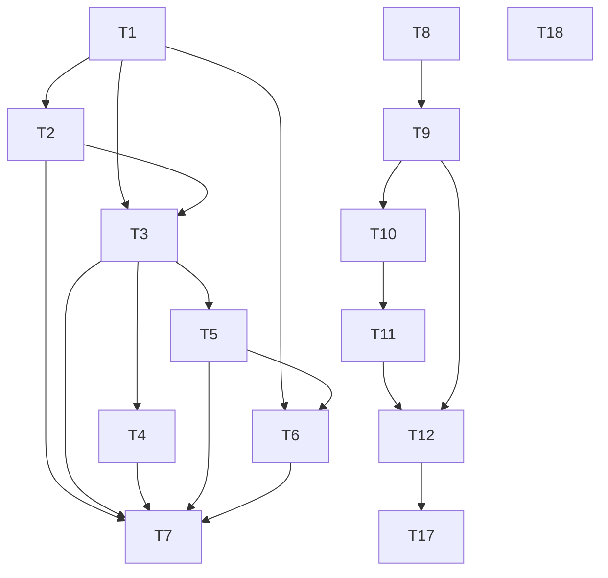

# Tasks: Inteligência e revisão dos ciclos JEV

Estado: T1–T12 concluídas nos escopos descritos; T15 implementada, T16 corrigida, T17 e T18 concluídas nos respectivos limites. Aggregate mais recente (2026-10-17T02:20:06.029Z–02:26:55.612Z): `typecheck:all` exit 0; `test:lab` 647/0; `test:all` exit 1, root 7.938 pass/2 skips/0 fail, web 3.738 pass/1 fail. Falha web ocorreu antes do mount do FlowChart no bootstrap DevTools; não é falha PnL nem causa histórica demonstrada. T14 ABERTA.

| ID | Tarefa | Critério de done | Verificação | Estado |
|---|---|---|---|---|
| T1 | Baseline throwaway readonly/paper e inventário do contexto ativo, APIs e zonas | Contratos runtime e de `ENDPOINTS` distinguem uso por agente, catálogo e planos; baseline e limites sem acesso à sessão/journal do usuário | cenário temporário antes da edição; leitura de código | Concluída |
| T2 | Fechar referências oficiais e partes pendentes do inventário | fontes/citações, tier/limite/unknown; nenhuma quota inferida ou fetch habilitada | revisão de `research.md`/`inventory.md` | Concluída |
| T3 | Corrigir gaps comprovados no Brief do agente ativo | provenance/frescor/unidade/ausência para fatos já lidos; `boundedContext` all-or-nothing até 32 entradas; orçamento de referência de 12.000 bytes verificado nos testes (produtor sem truncamento runtime); D2 preservado | cenários temporários com casos válidos/invalid/stale e maior Brief | Concluída |
| T4 | Reduzir duplicação/espera comprovada | chamadas/cadência sem aumento; mesma evidência não processada redundantemente; comparar bytes/latência antes/depois | cenário local instrumentado | Concluída |
| T5 | Revisão determinística por ciclo dentro de `buildAnalysis` | hash/contexto congelado separado de resultados posteriores; requested/applied, stages, achados acionáveis, ordem incerta/resultado não medido; identidade por cycleId/candidateId/order key; retenção limitada ao input disponível | cenário temporário cobrindo ausente, stale, divergente, incerta, resultado desconhecido/medido | Concluída |
| T6 | Renderizar review por ciclo na HUD ativa | componente isolado, ponto de integração mínimo; payload allowlist sanitizado/bounded; sem live/ação, sem mexer em estilo/handlers/readOnly/testes alheios | browser UI local com resposta nova e compatibilidade core antigo | Concluída |
| T7 | Cenários integrados, gates e documentação final pós-smoke | before/after isolados e 5 gates executados pelo integrador; saídas/códigos observados; changelog/docs atualizados | Cache real vs factory legado, endpoint/parser em dez páginas de journal, HUD integrada e cinco gates; concluída | Concluída |
| T8 | Admissão por envio físico no gateway OnchainOS, intervalo também no retry | API obrigatória do callback, preflight não consumidor pós-coalesce, dispatch recordado por fetch, contagem exata, `sent` correto, 1 retry no máximo e followers/cache preservados; sem mudança de auth/caps/schema | `bun test src/onchain-read` + smoke Bun real com createClient/gateway/budget e diretório temporário; cap 0/1/2, pacing, timeout, cooldown, coalescing/cache | Concluída |
| T9 | Gates finais e fechamento T8+ pelo integrador | Os cinco caminhos de verificação obrigatórios concluem; status registra apenas evidência observada | Aggregate sequencial: `typecheck:all`, `test:lab`, `test:all` (este inclui root/web); cobertura e saídas em `status.md` | Concluída; aggregate exit 0, 2 skips root (receipt-safety; não qualificam live) |
| T10 | Medir overhead de `buildAnalysis` | Paginação executa review apenas nos 12 ciclos selecionados; perfil sintético identifica custo superlinear de agrupamento same-symbol sem mutar entrada | Smoke Bun local de paginação e perfis com fills sintéticos; evidência registrada em `status.md` | Concluída |
| T11 | Reduzir cópias de agrupamento e ordenação de fills | Um array privado por símbolo, `push` e sort in-place; preserva JSON exato, ordem de trips, fees, entradas e paginação; nenhum outro comportamento/API muda | Comparação de bundles before/after em fixtures determinísticas documentadas na spec/plan | Concluída |
| T12 | Verificação focada e handoff de gates | Smoke comparativo e imutabilidade concluídos; testes existentes de análise/typecheck focado passam; integrador fecha aggregate global após T15 | Smoke compilado; `bun --no-env-file test src/agent/analysis.test.ts`; typecheck focado; aggregate final em `status.md` | Concluída no escopo; aggregate global posterior exit 0 |
| T13 | Avaliação retrospectiva local limitada, autorizada pelo usuário | Ler somente `answers.jsonl`/`prices.jsonl` locais existentes e segmentos rotacionados desses journals reconhecidos por `journalSegments`, read-only; usar apenas o avaliador determinístico existente se não tiver efeitos colaterais; parar por ausência/ilegibilidade/instabilidade ou efeito colateral; saída agregada/sanitizada | Verificar o procedimento; não executar script nem acessar journals antes de cumprir o pré-requisito de segurança | Autorizada, mas bloqueada no pré-requisito do avaliador; nenhum conteúdo de journal lido |
| T14 | Qualidade e frescor dos dados de carteira e feeds | Snapshots de patrimônio preservam qualidade/observação; timeout/falha não confirma saldo sem evidência; feeds inválidos ou obsoletos não influenciam decisão; polling e limites protegidos mantidos | Testes de comportamento, smoke visual com payload sintético e cinco gates globais pelo integrador | ABERTA; aggregate mais recente não verde |
| T15 | Subtask de prioridade de leitura existente sob o limite do reader | Preservar elegibilidade, filtros, `max` e admissão; ordenar plano elegível → managed → watch/USD; para entrada fixa selected count ≤ algoritmo anterior; nenhuma chamada/endpoint/frequência extra; preservar T14 | Regressão comportamental em `src/agent/live.test.ts`, smoke sintético read-only e aggregate global | Implementada; smoke/focused e aggregate final verificados |
| T16 | Clarificar semântica de `historico` frente a execuções incertas | Distinguir placar de decisões/movimento do token de recibos/PnL; preservar métricas, fluxo e orçamento do Brief | Smokes throwaway pré/pós do `agentBrief` e `createJevAgentModel` com evaluate fake, settlement sintético de 5 amostras, fixture máxima; `bun --no-env-file test src/agent/model.test.ts` | Concluída |
| T17 | Admissão síncrona do fallback de formato do modelo no budget local existente | Cada segunda avaliação 400/413/422 é admitida antes do dispatch; cap 1/token estimate bloqueiam, cap 2 admite; falha de persistência/abort não envia fallback; finaliza tickets uma vez; 429 sem retry; API `countExtra` e consumidores obsoletos removidos; T13/T14/T16 preservados | Regressão consumer em `cycle.test.ts`, smoke standalone em `observations.md`, testes focados e gates globais agregados documentados em `status.md` | Concluída; gates exit 0; T13/T14 preservadas |
| T18 | Qualidade e frescor dos dados do agente e HUD | Refresh read-only a cada 30 s pelo reader compartilhado; falha/abort/late/config preserva snapshot e observação; stale/unavailable não vira fato, candidatura, risco, Brief ou preço atual; HUD não converte análise ausente em zero. | Smokes sintéticos de carteira, produtores/ecossistema e HUD; regressões focadas; gates atuais e limitações documentados em `status.md`; histórico anterior preservado. | Concluída no escopo; `typecheck:all`, `test:lab` e suíte root passaram; `test:all` teve falhas root e não alcançou web nas rodadas finais; escopo e limitações em `status.md` |
| T20 | Corrigir o limite temporal do funding em `scanLiquidation` | Para resultado sem liquidação, `fundingPaid` termina no fim da última barra, incluindo settlement exatamente no limite e excluindo o posterior; sem alterar outcome canônico | Regressão sintética, smoke e gates root concluídos: typecheck exit 0, test 7.941 pass/2 skip/0 fail, test:lab 648 pass/0 fail | Concluída no escopo |
| T21 | Preservar posições de época na inferência HAC | Retornos ausentes não aproximam artificialmente os pares temporais em média policy, modalidade ou diferença pareada; fórmula densa e schema preservados | Oracle sintético esparso/denso, integração offline e gates root | Concluída no escopo: typecheck, test e test:lab exit 0 |

## Limites específicos de T15

- Escopo exclusivo previsto: subtask de prioridade de leitura em `src/agent/live.ts` e `src/agent/live.test.ts`; T14 cobre qualidade/frescor mais amplos e permanece trabalho concorrente sem owner/reserva registrada aqui. Preservar alterações de T14 e integrar sem sobrescrevê-las.
- Prioridade é somente reordenação de leituras já elegíveis antes do `max`: planos elegíveis primeiro, posições já geridas em seguida e demais por último; dentro de cada grupo, USD decrescente. Manter desempates determinísticos existentes.
- Para o mesmo book, planos e `max`, a quantidade selecionada não pode crescer sobre o algoritmo anterior; não implementar managed-first que aumente a contagem.
- T3/T4 proíbem novas consultas/cadência aumentada. T15 abre exceção estritamente semântica para repriorizar leituras existentes sob o mesmo teto e admissão; não é quota/frequência maior. Não alegar igualdade geral de número físico de chamadas: cache mix pode variar.
- Testar planned acima do max, managed elegível contra watch-only USD alto, e preferência managed sobre watch-only sem plano. Medir 40 antes/depois somente em cenário fresh controlado comparável; tratar como resultado local, não garantia global.
- O smoke sintético anterior à priorização observou 30 posições watch-only de USD 10.000 competindo com AAA gerida (2,5 a US$ 4, total US$ 10); AAA ficou com `usd=null`, apesar de 20 leituras `price-info` e 20 de risk em watch-only. Isso motivou prioridade de seleção e não era bug de quote/abort.
- Smoke atual `runNow → cycle → onBook/status`: os mesmos 30 watch-only e AAA gerida resultaram em AAA `usd=10`, `quality=current`, `managedOk=true`, `unpriced(managed)=0`; `agentUsd` passou de 1.000 para 1.010 e total do snapshot de 201.000 para 191.010 com 24 linhas. O total caiu porque uma watch de US$ 10.000 perdeu slot para AAA; isso não é perda/redução de carteira.
- Foram selecionadas 20 posições (AAA + 19 watch), com 20 `price-info` e 20 risk: 40 chamadas ao gateway fake. Zero chamadas externas/modelo offline, API real, CLI, env ou executor; smoke sintético, sem resultado financeiro, helper removido. Elegibilidade/max/admissão/cadência e endpoints mantidos.
- Testes focados reportados: `live.test.ts` 61 pass/0 fail/171 expects; expansão `bun --no-env-file test src/agent src/onchain-read web/src/lib/hud/hud.test.ts` teve 1813 pass/0 fail/8909 expects, 78 arquivos, 35.12 s. Não substituem os follow-ups globais atuais.
- Caso boundary com planos >`max`: todos os planos continuam incluídos, como no algoritmo anterior que já os mantinha; a nova prioridade reserva esses slots e não lê watch extra nesse caso. Isso não é alegação de melhoria em retenção de planos.
- Medição fresh comparável antes/depois de 40/40 não foi reportada nesta evidência; não a inferir a partir das 40 chamadas do smoke de status.
- Nenhuma nova chamada por posição, endpoint, alteração de admissão/transporte, live ou leitura de home operacional. Evidências e alterações de T14 permanecem próprias e devem ser preservadas. Fechamento da consolidação global após a prova T15 e os cinco gates executados pelo integrador.
## Limites específicos de T13

- A autorização é restrita a `answers.jsonl` e `prices.jsonl` existentes e aos segmentos rotacionados desses mesmos journals reconhecidos pelo helper `journalSegments`; nenhum outro journal/arquivo, dado de carteira, segredo ou arquivo operacional pode ser lido.
- Não chamar APIs, modelos ou rede, reiniciar serviços, escrever journals/schema, alterar execução/comportamento de trades ou risco, nem criar/modificar/rodar ferramenta alternativa. A única computação permitida é o avaliador determinístico de outcomes já existente, condicionado a satisfazer integralmente estes limites.
- Parar sem tentar recuperar, reparar, copiar ou estabilizar os arquivos se algum arquivo-base estiver ausente/ilegível, se algum segmento identificado por `journalSegments` estiver ausente/ilegível/instável, ou se qualquer ferramenta/procedimento puder produzir efeitos colaterais.
- Divulgar somente contagens/métricas agregadas e incerteza; nunca decisões brutas, conteúdo de respostas ou dados de carteira. Não alegar rentabilidade.
- Esta atualização dos documentos não acessou journals nem executou script ou avaliação.

## Gates e limites

- O gate D2 de `docs/sdd/carteira-evidencia/tasks.md` continua próprio. Nenhum aumento de dados privados da carteira ao JEV; não fazer consulta nova paga de carteira.
- `runCycle`/smokes e servidor jamais apontados à home/sessão do usuário. Usar temp home + executor paper isolado.
- Não tocar `Market.init()`, credenciais/auth, risco, schema, journals/migração, live, dependências de produção ou ativos de verificação.
- Manter alterações e benchmark/autoresearch preexistentes. Antes de integrar HUD, revalidar processo/worktree/owner e reler os arquivos; integração mínima nos pontos estáveis, sem substituir mudanças alheias.
- Nenhum teste isolado de wiring/source incidental. Cenários temporários devem provar comportamento observável.
- `web/src/lib/hud/cycle-review-render.test.tsx` foi removido por conter somente asserts de texto de apresentação; não foi substituído por teste equivalente. G4/G5 finais foram executados novamente após a remoção, com logs sanitizados referenciados em `status.md` e `observations.md`.
- Smoke throwaway do componente real confirmou a apresentação de ordem `executada` com `resolvida_pelo_usuario` como motivo local e `fills=[]`, sem alegação de recibo on-chain. Evidência em `observations.md`; log preservado em Temp.
- Se limites/cotas oficiais não forem conhecidos, reportar desconhecido; não codificar valores por estimativa documental.

Correção temporal feita após uma rodada de gates em que `test:all` falhou; essa falha e seus logs estão preservados em `status.md`. A rodada sequencial posterior passou os cinco gates e concluiu T9. Não reclassificar a falha histórica como resultado atual.

## Addendum: `price-info` timestamp presence

- G0–T4 do trabalho filho [proveniência `price-info`](proveniencia-price-info/tasks.md) concluídas; autorização explícita do Main para `pt` opcional no Brief V1, sem permissão para migração ou D2.
- Smokes focados reais concluídos: reader → candidates → Brief/hash (último smoke ainda usava legenda de 69 B; só o tamanho de Brief foi inferido +8 B após correção), `onConsult`/`auditConsult`, guarda material, orçamento de 8 holdings/7 compras/32 context keys válidas, allowlist review e browser Chromium do HUD real. Referência rica 11.720 B + delta exato 168 B (150 B: legenda JSON+8 `pt`, 18 B pela 32ª context key)=11.888 B, abaixo de 12.000.
- O filho mantém T5 — gates globais — sob responsabilidade do integrador; smokes focados não são substitutos.

## Addendum T14: qualidade e frescor de dados

- Escopo: estado da carteira gerida e feeds OnchainOS já consumidos pela decisão e pelo HUD; não equivale a auditoria de todos os valores estáticos ou de todas as APIs do repositório.
- Preservar a cadência existente de leitura de carteira/status, sem consultas extras, mudanças de risco/auth/live/schema, envio de novos dados privados ao JEV ou serviços pagos.
- Snapshot abortado, atrasado ou sem suporte verificável não atualiza indevidamente o patrimônio. Posições geridas permanecem visíveis dentro do limite; falhas e dados parciais são explicitamente representados.
- Validar identidade e faixa/unidade de dados externos antes de admiti-los. Medidas opcionais inválidas ficam desconhecidas; payload obrigatório inválido ou identidade conflitante é rejeitado; feeds obsoletos não pontuam nem viram fatos. Para `/onchain/signals` request-scoped, timestamps em `nowMs` e até `nowMs - 6 horas` inclusive são retidos; os mais antigos e os futuros são descartados, inclusive ao servir dados normalizados do cache em cada leitura, sem novo dispatch, mudança de TTL/cadência ou alteração da normalização direta/interna sem horário de requisição.
- Concluir com prova sintética observável, suíte e gates; registrar apenas evidência exercitada. Sem resultados financeiros ou de produção derivados de fixtures.
- Provas sintéticas do AgentView/hook, source→candidate/Brief, parser/timing e consumidores estão em `observations.md`; focused de parser/feed, CLI, consumidores, deadline e mounted v5 são provas sintéticas, não produção. Aggregate imediatamente anterior ao patch monotônico: 2026-10-17T01:41:06.220Z–01:52:29.577Z, `typecheck:all`/`test:lab` exit 0, `test:all` exit 1 na root (7.931 pass/2 skips/2 fails), sem web. Signals perdeu cap elapsed `<250 ms` depois de passar rejection por deadline; checks posteriores não alcançados. Gateway `Expected true / Received false` com mapping ambíguo; não inferir cache leak ou causa. Escopo 1.729 paths e `hud.test.ts` removido vs baseline 1.730; delta 0 só no escopo. Detalhes abaixo e em `status.md`/`observations.md`.
- Follow-up de deadline implementado nos cinco arquivos Onchain/Signals, preservando T8 `DispatchAdmission`, limites, retry e auth. Focused Bun 1.3.14 exit 0 (85/0/336, 3 arquivos); smoke fake passou e mostrou expirada não cacheada, dispatch novo com dado Base e Signals abortado após deadline. Evidências e ausência de causalidade histórica em `observations.md`. Aggregate posterior consta na linha seguinte; T14 continua OPEN.
- Aggregate final após deadline: `typecheck:all` exit 0; `test:lab` 647/0; `test:all` exit 1, root 7.938/2/0, web 3.738/1. Falha web de bootstrap Edge/DevTools antes do mount do FlowChart; não classificar como assertion PnL ou causa histórica. Preflight 1.729 vs baseline 1.730, apenas HUD test removido, hash delta zero no escopo. Proveniência da mudança de branch noutra worktree desconhecida; status targeted selecionado vazio. T14 aberta; nenhuma rerun.
- Validação posterior de cache: sinais normalizados servidos do cache são revalidados por janela de request sem mutação/dispatch/budget extra; focused 228 pass/0 fail e smokes sintéticos registrados em `observations.md`. A rodada atual passou os cinco gates; os anteriores `test:all` não verdes permanecem históricos. T14 concluída neste escopo.

## T16: gates finais (2026-10-16)

- Cinco gates concluídos exit 0 após a correção da legenda; evidência e janela sem mudanças de fonte documentadas em `status.md` e `observations.md`. T13 e T14 preservadas.

## T18: limites de implementação

- Intervalo de 30 s autorizado pelo usuário para a leitura de carteira já existente. Não implica quota oficial, novo fornecedor/endpoint, nem aumento das consultas do JEV/modelo.
- Owner da integração deverá preservar a forma existente de status e os diffs locais; o caminho de refresh apenas publica livro validado, sem acionar ciclo ou execução.
- Fechar T18 somente após smoke da rota real com fixtures e cinco gates atuais; atualizar `status.md` com horários/saídas observados, não reutilizar resultados históricos.

## T20: limite temporal de funding no scan de liquidação

- Escopo: `src/lab/outcomes.ts` e `src/lab/outcomes.test.ts`, ambos limpos no status direcionado antes da edição.
- Comportamento requerido: pagamentos já acumulados até `bar.endMs` permanecem, inclusive na igualdade; se não houver liquidação, settlements depois da última barra não entram em `ScanResult.fundingPaid`.
- Prova: caso sintético com uma barra `endMs=10` e settlements `5/0.01`, `10/0.005` e `15/0.02`; testar `liquidated=false`, `atMs=null` e `fundingPaid=0.015`. Manter os testes existentes de liquidação e boundary.
- Verificação: `bun --no-env-file test src/lab/outcomes.test.ts`, smoke sintético após a correção e gates `bun run typecheck`, `bun run test`, `bun run test:lab`.
- Limite da afirmação: a execução padrão de `computeOutcome` já filtra payments pela janela e não usa `fundingPaid` quando não liquida. A mudança corrige o contrato do helper exportado; não prova retorno financeiro nem melhoria de política.
- Estado: concluída no escopo. `bun run typecheck` exit 0; `bun run test` 7.941 pass/2 skip/0 fail; `bun run test:lab` 648 pass/0 fail. Sem testes web, chamadas externas, API, wallet, journal, modelo ou operação.

## T21: preservar posições temporais na inferência

- Escopo: Newey-West/HAC dos retornos por política, contribuição por modalidade e diferenças pareadas; apenas laboratório offline.
- Preservar slots de epochs ausentes até a covariância; a média continua calculada apenas sobre os resultados utilizáveis. Pares HAC devem respeitar distância original em epochs.
- Reprodução pré-correção confirmou a divergência: em 16 epochs com 8 retornos intercalados, t gap-aware esperado `0.6279858256`, obtido após compactação `0.7200823`. O primeiro foco falhou em seis assertions como esperado antes de aplicar a mudança; após implementação, o foco final e as regressões sparse/dense passaram (evidências em `observations.md`).
- Não tocar curvas de capital ou bootstrap de alavancagem, nem afirmar que esta tarefa resolve viés por outcomes ausentes. Nenhuma leitura operacional ou chamada externa.
- Estado: concluída neste escopo. Inferência gap-aware somente no laboratório; a LRV corrigida alimenta Sharpe, limites offline e sinalização/gate existentes, sem alterar fórmulas, schema, curva observada, bootstrap ou política live. Gates root verdes; nenhum ganho financeiro inferido.
