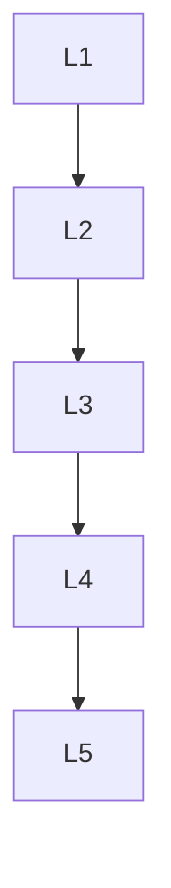

# Tarefas

| ID | Tarefa | Depende de | Prova | Estado |
| --- | --- | --- | --- | --- |
| L1 | Documentos atuais e links conciliados | nada | equivalencia do anexo e destinos existentes | feito: anexos atuais e equivalencia integral nas duas terminacoes |
| L2 | Regressoes LF/CRLF e marcador ausente | L1 | runner falha antes da correcao | feito: 1 pass, 4 fail com o extrator defeituoso; red.log |
| L3 | Extrator corrigido e dois consumidores | L2 | regressao e suites de pureza passam | feito: 43 pass, 0 fail; focused.log |
| L4 | Definition of done e escopo | L3 | tipos, core, lab, diff, documentos legados intactos | feito: tipos exit 0; core 8544 pass / 2 skip / 0 fail; lab 650 pass / 0 fail |
| L5 | Revisao e recibo documental | L4 | PR atualizado, grafo append-only valido | revisao e recibo concluidos: seq 1086, historico intacto; publicacao no PR 5 preparada |

