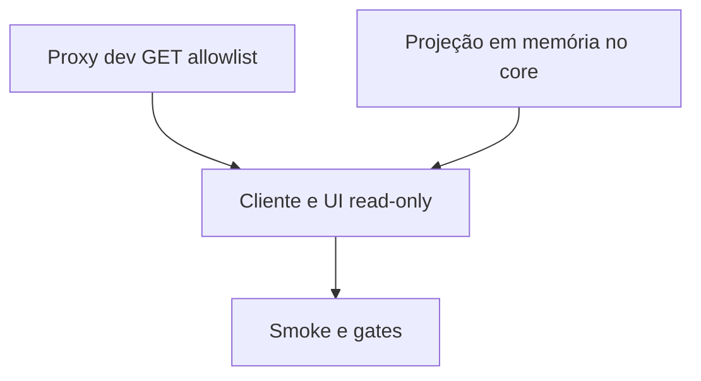

# Spec: Painel dev somente leitura para o core local

Status: aprovada pelo dono para implementar proxy dev somente leitura
Dono: usuário

## Contexto

O core existente continua ativo na porta 3000, conectado e em modo `dinheiro`. A interface Next dev na porta 3001 lê `NEXT_PUBLIC_API_URL=http://127.0.0.1:3000`, mas o core iniciado pela entry de produção rejeita a origem 3001. Reiniciar esse core agora interromperia o agente, que reporta uma ordem em voo sem referência. O dono escolheu o proxy dev somente leitura para acompanhar o estado sem reiniciar o agente.

## Metas

- Mostrar no painel dev o status seguro em cache (sem renovar a carteira) e a análise do agente por meio de rota same-origin no Next, consultando somente `GET /agent/dev-status` e `GET /agent/analysis` do core fixo em `http://127.0.0.1:3000`.
- Restringir a rota a `NODE_ENV=development`, host loopback e paths/query estritamente permitidos; recusar `Sec-Fetch-Site` diferente de `same-origin` quando presente e qualquer `Origin` externa; encaminhar somente GET sem cabeçalhos, cookies, credenciais ou corpo fornecidos pelo browser.
- Tornar o painel explicitamente somente leitura: não conectar wallet, não instalar/login/poll, não desconectar nem resolver ordens, automática ou manualmente.
- Preservar hot reload no endereço `http://127.0.0.1:3001` sem alterar nem reiniciar o core ativo.

## Não metas

- Não encaminhar `/agent/ledger`, configurações, wallet, OnchainOS, `/system-one`, nem qualquer outra rota.
- Não tocar, assinar, enviar, resolver ou cancelar ordens; não alterar credenciais, risco, carteira ou `data/`.
- Não abrir o painel dev para a LAN nem habilitar CORS no core ativo.
- Não transformar o proxy em API de produção ou proxy genérico.

## Critérios de aceitação

- [ ] O navegador em `127.0.0.1:3001` carrega e atualiza o status em cache e a análise via GET same-origin; sem snapshot, exibe desconhecido/indisponível, nunca inventa zero.
- [ ] Apenas `GET /agent/dev-status` e `GET /agent/analysis` são encaminhados ao upstream fixo; path, query, host não-loopback, `Sec-Fetch-Site` diferente de `same-origin`, origem externa, método de escrita e produção são recusados sem chamada upstream; status não encaminha ao `GET /agent/status`.
- [ ] A projeção `/agent/dev-status` usa apenas snapshots em memória, relógio e metadados de frescor; não chama `status()`, `walletView()`, CLI, providers, leitura de carteira, ledger nem arquivos.
- [ ] Chamadas upstream não carregam cookies, authorization, `x-inonu-intent`, corpo ou headers arbitrários; resposta não fica em cache.
- [ ] A interface informa modo dev somente leitura, não chama extensão OKX nem endpoints de escrita ao conectar, ao entrar em estado de login aguardado ou ao acionar controles; a navegação de configurações não abre a tela operacional e visitas diretas a `/configuracoes` não renderizam `SettingsView` nem iniciam OnchainOS, testes de APIs ou chamadas de credenciais.
- [ ] Smoke visual usa respostas sintéticas interceptadas antes da navegação e falha diante de qualquer tentativa de escrita, chamada direta ao core fora do proxy ou origem externa; testes do core provam que o status em cache não aciona providers.
- [ ] `bun run typecheck`, `bun run test`, `bun run test:lab`, `bun run typecheck:all`, `bun run test:all` passam; export estático não contém o proxy.

## Restrições

- Sem recursos pagos, chamadas autenticadas, dinheiro real, segredos, novas dependências ou mudança de comportamento do agente ativo.
- A rota nova é uma leitura estritamente em memória; `/agent/status` permanece inalterada e não é usada pelo painel dev.
- O proxy só usa origem upstream `http://127.0.0.1:3000`, fixa; origem aceita já configurada pelo core.
- Bind do Next dev em `127.0.0.1` no script padrão; handler aceita Host loopback esperado, rejeita `Sec-Fetch-Site` diferente de `same-origin` quando presente e rejeita Origin externa quando presente.
- Nunca encaminhar `/agent/ledger`: contém identificadores e dados financeiros desnecessários para o painel.

## Plano de tasks

| Task | Depende de | Critério de done | Comando de verify |
|---|---|---|---|
| T1 | - | Proxy dev permite somente GET `/agent/dev-status` e `/agent/analysis`, com query limitada e testes de fronteira | `bun --cwd web test --parallel=1 --timeout 15000 ./src/lib/dev-agent-proxy.test.ts` |
| T2 | - | Novo método de serviço e rota devolvem uma projeção mínima do estado e do livro em cache; teste prova ausência de CLI/provider/refresh | `bun test src/agent/http.test.ts src/agent/wire.test.ts` |
| T3 | T1, T2 | Cliente e painel dev mostram status e análise em leitura somente, com estados desconhecidos explícitos | `bun test web/src/lib/agent/agent.test.ts` |
| T4 | T1, T2, T3 | Smoke visual com fixture sintética e interceptação, export estático e gates raiz/web passam | `bun run typecheck && bun run test && bun run test:lab && bun run typecheck:all && bun run test:all` |

## Perguntas em aberto

- Nenhuma. O dono escolheu expressamente o proxy dev somente leitura; rotas e limites foram definidos pela restrição de não tocar no core ativo.

## Status

- Fase atual: plan (correção de segurança do contrato de status)
- Aprovado em: 2026-10-16, dono escolheu o painel dev somente leitura; a implementação deve usar projeção em cache, não o status operacional
