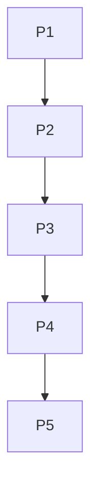

# Tasks

Sessao 01a14c84, claim 75b3a341-205b-43b3-ac7f-add4972e6559. Zonas: src/prob/**, scripts/prob-cycle*.ts, esta pasta e registro append-only do cerebro.

| Task | Depende de | Done e verify | Estado |
| --- | --- | --- | --- |
| P1 | nenhuma | spec e plano com recomendacao Jev registrada | feito |
| P2 | P1 | importacao delimitada; falhas sinteticas reproduzidas | feito |
| P3 | P2 | correcoes; 146 testes da biblioteca e CLI aprovados | feito |
| P4 | P3 | tipos, core e lab aprovados; diff e revisao documentados | feito |
| P5 | P4 | commit, PR e integracao verificadas pelas refs e arvore | pendente |

Fora desta fatia: dinheiro/live/risco, credenciais/auth, migracoes e dependencias de producao. Alteracoes restantes da goal1 e conflitos da raiz permanecem no backlog.
