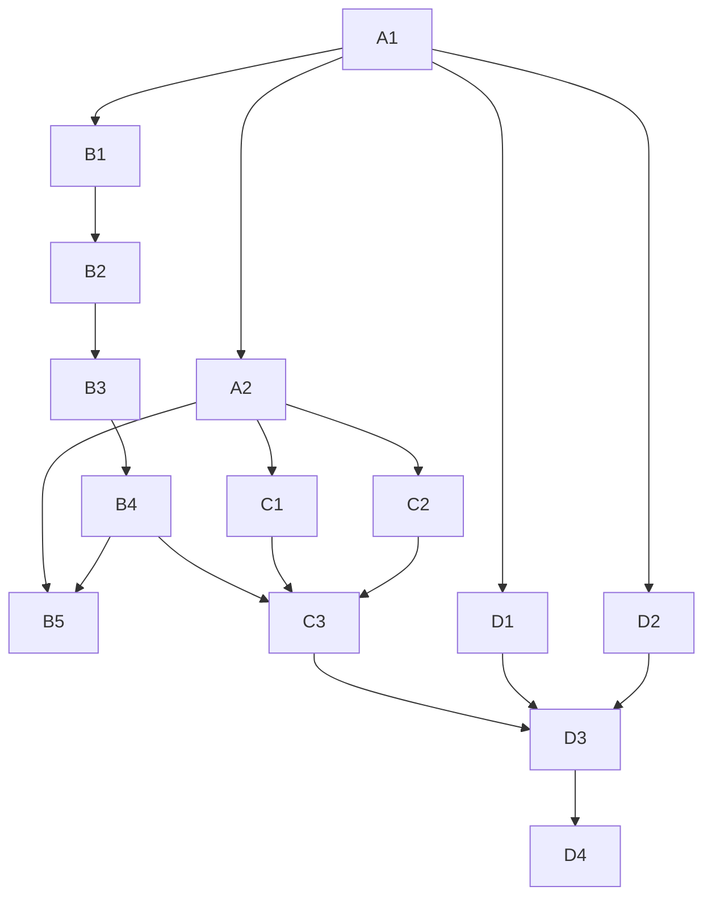

# Tarefas e dependencias

| ID | Tarefa | Depende de | Evidencia de termino | Estado |
| --- | --- | --- | --- | --- |
| A1 | Revalidar main, worktrees, conflitos e aba do sistema | nada | Git atual e navegador | feito: main local/remota 2327a28; raiz agora sem conflitos de indice; painel observado |
| A2 | Inventario deterministico completo de deltas nao commitados | A1 | result.json do audit, hashes e classificacoes | feito no escopo src/scripts/web e caminhos documentais; 53 runtime/import, 113 exports, 59 comentarios/tipos; limites no relatorio |
| B1 | Conferir consumidores dos dez exports selecionados | A1 | busca e leitura de declaracoes atuais e diff goal1 | feito com limite explicito para consumidores dinamicos |
| B2 | Aplicar proposta literal em candidato isolado | B1 | nove arquivos alterados, dez palavras export retiradas | feito em codex/remaining-alignment-20261018; corpos e valores conferidos |
| B3 | Verificar tipos e testes | B2 | typecheck, test e test:lab com saida real; teste focado | feito: tipos exit 0; core 8539 pass / 2 skip / 0 fail; lab 650 pass / 0 fail; antes da mudanca, 193 testes real passaram |
| B4 | Revisar e integrar o diff validado | B3 | review-diff, ship-pr e prova do conteudo final em main | PR 5 aberto em rascunho; integracao em main retida pelo gate do agente completo |
| B5 | Alinhar a superficie interna restante | A2, B4 | coorte literal e consumidores atuais, verificacao completa e PR | 133 exports publicados em 7dc4574; mais 16 em 14 arquivos apos revisao dos 17 casos lexicais/indiretos, com consumidor real preservado; tipos e suites core/lab/web passaram de novo; 159 marcadores retirados no PR ao todo; 28 casos de runtime, 33 reservados e dois contratos ainda separados; ../export-consumer-alignment/tasks.md |
| C1 | Revisar consolidacao de cliente API e seus testes | A2 | todos os consumidores, compatibilidade e isolamento | parcial: contratos e consumidores nomeados conferidos; 89 testes offline passaram na origem; conjunto altera autenticacao, integracao bloqueada para decisao automatica; api-consolidation-review.md |
| C2 | Revisar migracao documental e regras locais | A2 | referencias resolvidas e preservacao dos artefatos congelados | parcial: C2a publicada e verificada; auditoria de 611 Markdown contra 694 destinos e links registrada; dos 535 auxiliares, nove equivalentes na worktree; o legado cobre 1146 caminhos, 1145 equivalentes apos CRLF e um catalogo JSON divergente; document-asset-review.md, folder-document-provenance-review.md e ../lab-annex-alignment/tasks.md |
| C3 | Reconciliar conflitos antigos e deltas exclusivos | B4, C1, C2 | nenhuma perda de WIP; conflitos resolvidos com prova | parcial: zero conflitos na raiz, dependencia transitiva reposta, tipos/core/lab/web passam; merge local ainda aberto e restante WIP preservado, conforme bootstrap-root.md |
| D1 | Abrir interface local e observar estado | A1 | navegador com aplicativo renderizado e estado verificado | feito para observacao: novo export e core desktop reais em 47321, perfil vazio; inicio e configuracoes observados, handlers 200 e guardas 403; ../core-browser-validation/; nao prova ciclo operacional |
| D2 | Diagnosticar frescor com timestamps por fonte | A1 | origem da expiracao provada e reamostragem real | parcial: 30/30 snapshots reais prontos na reamostragem; falha anterior nao reproduzida |
| D3 | Medir agente completo e inferencia Jev | C3, D1, D2 | ciclos, latencias, recusas e custos observados | parcial: adaptador real respondeu 5/5 em contexto publico, HTTP 200, p50 301,436 ms e p95 373,992 ms; sem candidatos operacionais e sem ciclo de carteira; model-public-observation.md |
| D4 | Avaliar resultado liquido e criterio de producao | D3 | evidencia conciliada, cobertura e limitacoes | pendente |

Transacoes, ordens, assinaturas, segredos, mudancas de risco, dependencias de producao, billing e migracoes nao recebem decisao automatica. Registrar bloqueio e seguir com tarefas elegiveis. Esta tabela nao reduz o objetivo integral a B2 ou ao preview.
