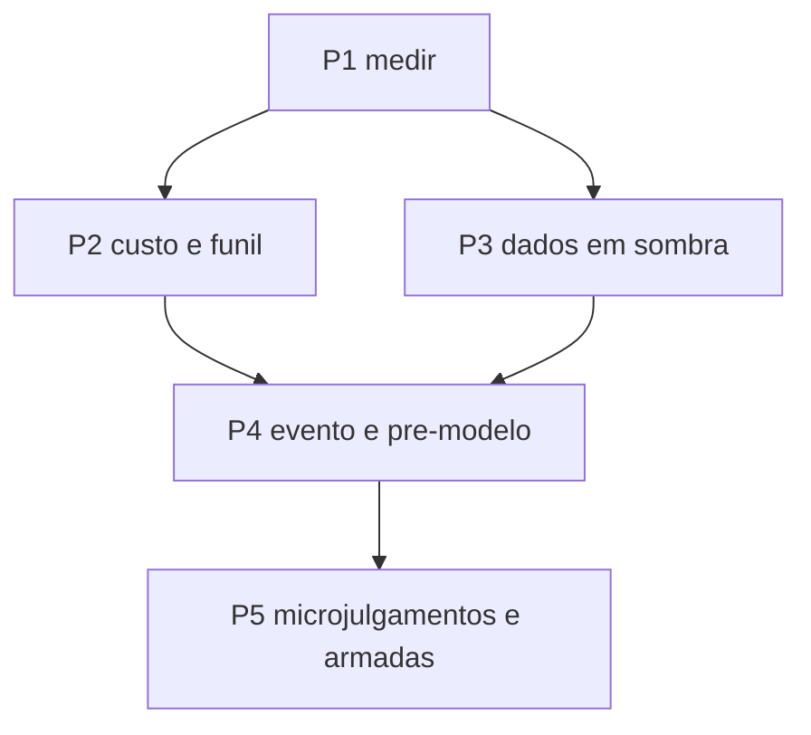

# Spec: retorno líquido composto por ciclo de 1 minuto, em sombra primeiro

Status: rascunho (saída da pesquisa; ainda não aprovada)
Dono: usuário

## Contexto

O dono quer que o agente do INONU TRADER, com o Jev e o System One decidindo, gere lucro líquido a cada ciclo de 1 minuto ou menos, composto sobre o capital total da carteira (referência dele: 0,5% a 1% por ciclo), com dados de todos os criptoativos em tempo real sem gastar a cota de API, usando a OnchainOS só para decisão e execução. Hoje o agente decide a cada 2 minutos (5 quando frio), com teto local de 720 consultas por dia, opera Solana em spot com cerca de US$ 118 a 121, e a medição existente mostra 0 de 7 voltas positivas (-0,41% bruto). A pesquisa ([research.md](research.md)) trata a meta como hipótese a medir e a organiza numa escada de metas e numa decomposição em janelas.

## Metas

- Medir, em sombra e com custo decomposto, o retorno líquido por ciclo e por janela de oportunidade, com amostra suficiente para refutar ou confirmar cada degrau da escada de metas (0,02%, 0,05%, 0,16%, 0,25%, 0,5% e 1% líquidos por ciclo).
- Ter, sem gastar a cota OnchainOS, estado em tempo real de todo o universo da bolsa OKX (1965 instrumentos) e do conjunto de tokens Solana negociáveis, com idade por fato e cobertura declarada por fonte.
- Reduzir o tempo do evento até a decisão do Jev de dezenas de segundos para poucos segundos, sem multiplicar as consultas (ciclo por evento com prova de consumo).
- Levar o custo de ida e volta medido ao Brief antes da decisão e descartar candidatos cujo atrito supera o movimento esperado.

## Não metas

- Prometer lucro, recuperar perdas ou declarar que a meta de 0,5% a 1% por ciclo é alcançável.
- Raspar páginas do OKX Wallet ou da OnchainOS (decisão de termos do dono; o API Agreement 9.4 proíbe raspadores de Market Data).
- Contratar qualquer plano pago, mexer em limites de risco, liberar live, migrar journals ou assinar ordens.
- Alavancagem, perpétuos, empréstimo do caixa e redes que não sejam Solana (decisão do dono de 2026-10-15).
- Tocar em `src/decision-review/evolution/**` ou mudar o contrato de consumo em `src/decision-review/**` sem a zona do Codex.

## Critérios de aceitação

Da fase de pesquisa (cumpridos nesta data):

- [x] Limites de API do OnchainOS (Market e Trade), da bolsa OKX, de Solana e agregadores levantados com estado de verificação por linha ([api-limites-e-fontes.md](api-limites-e-fontes.md)).
- [x] Matriz de opções de dados incluindo a raspagem, com termos e recomendação ([api-limites-e-fontes.md](api-limites-e-fontes.md), seção 7).
- [x] Escada de metas, requisitos por trade, capacidade e amostra para falsificar ([matematica-da-meta.md](matematica-da-meta.md)).
- [x] Arquitetura candidata, orçamento de tempo do ciclo e degraus de velocidade ([arquitetura-e-decisao.md](arquitetura-e-decisao.md)).
- [x] Catálogo de fontes de vantagem com nível de evidência ([fontes-de-edge.md](fontes-de-edge.md)).
- [x] Linha de base, gargalos G1 a G10 e protocolo de validação ([validacao-e-baseline.md](validacao-e-baseline.md)).
- [x] Ciclo 1 convertido em nós do grafo (42 nós `iter-pesquisa-retorno-composto` e `rc-*`; `bun scripts/cerebro.ts verify` retornou `ok seq=912` e `lint` retornou `ok sem orfaos`, em 2026-10-17). O ciclo 2 entra em seguida.

Das fases seguintes (a comprovar, cada um com seu comando de verificação definido no plano):

- [ ] Cada etapa do ciclo grava início e fim; p50, p95 e p99 por etapa disponíveis para pelo menos 1000 ciclos.
- [ ] O custo de ida e volta por token e classe de liquidez é medido por cotação sintética em lote, com os componentes separados, sem enviar ordem.
- [ ] O estado local da bolsa sustenta 1965 instrumentos por 24 h sem perda não contada e com idade por fato.
- [ ] Os 57% de candidatos fechados antes do Jev têm markout medido contra os escolhidos.
- [ ] A hipótese "média líquida por ciclo maior que zero" tem veredito (confirmada ou refutada) com intervalo de confiança, custos reais e amostras não sobrepostas.

## Restrições

- Sem recursos pagos, sem dinheiro real, sem segredos em arquivos (regra do template e do `AGENTS.md`).
- Tudo começa em sombra; promoção a real só por decisão explícita e escrita do dono.
- Use Bun; nenhum texto renderizado com ponto médio, travessão ou meia-risca; sem indicadores piscantes.
- Mudanças em journals de `data/` (inclusive estender `fills.jsonl`) são migração de schema e ficam bloqueadas para o dono; medidas novas entram em arquivo novo e aditivo.
- Zona do Codex: `src/decision-review/**`; arquivos quentes (`source-ecosystem.ts`, `scheduler.ts`, `cycle.ts`): um integrador por vez, com `git status` antes.

## Plano de tasks

Ver [plan.md](plan.md) e [tasks.md](tasks.md). Resumo: P1 medir (sem mudar comportamento), P2 portão de custo e funil, P3 camada de dados em sombra, P4 ciclo por evento e pré-modelo em paralelo, P5 microjulgamentos e entradas armadas só se a sombra mostrar edge maior que o custo.

## Perguntas em aberto

- Qual a cota real da organização na TypeSafe e qual o RPS vigente da conta na OnchainOS? (dono, console e suporte)
- Qual o custo all-in decomposto por ida e volta, por classe de liquidez, com pelo menos 30 execuções? (precisa de ordens reais de calibração, bloqueio do dono, ou de cotação sintética em lote)
- Qual o capital-base conciliado (US$ 100, 118, 121 ou 126)?
- Os IDLs oficiais de Raydium CLMM, Orca Whirlpool e Meteora DLMM batem com os layouts de bibliotecas comunitárias?
- As decisões de design do ciclo 2 ([wayfinder.md](wayfinder.md)) já foram levadas ao Jev? (o teto diário foi removido em 2026-10-17; a primeira decisão, `rc-primeira-etapa`, já tem consenso; ver [status.md](status.md))

## Status

- Fase atual: pesquisa concluída; planejamento a iniciar
- Aprovado em: não aprovado
