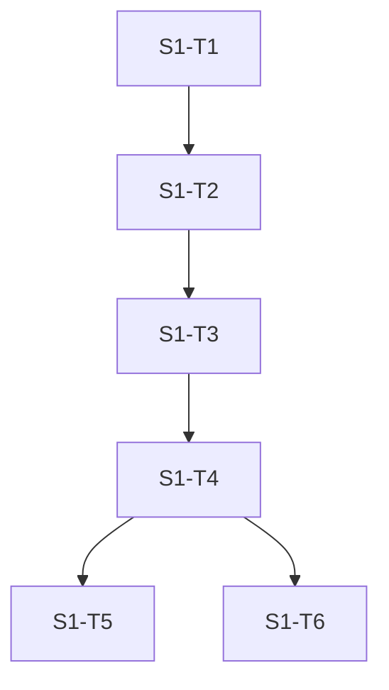

# Spec: carimbo de tempo por etapa do ciclo (S1)

Status: rascunho (fatia S1 da primeira etapa de implementação, autorizada pelo consenso do Jev, recibo `jev-rc-primeira-etapa`)
Dono: usuário

## Contexto

O agente do INONU TRADER roda um ciclo de decisão a cada poucos minutos. Hoje o único tempo gravado é o total do ciclo (`durationMs`, em `src/agent/cycle.ts`, no relatório). Ninguém sabe quanto cada etapa custa: livro, fatos, ecossistema, timing dos candidatos e das posições, momentum, consulta ao modelo, ordem e fechamento. Sem isso, a meta de reduzir o tempo do evento até a decisão (pesquisa do ciclo 1) não pode ser medida. A medição existente mostra total p50 de 4,1 s e p95 de 34,6 s em 21 ciclos, sem nenhuma decomposição por etapa.

Esta fatia cria um módulo puro, injetável e sem acesso a disco, que mede as etapas de um ciclo e resume as amostras em p50, p95, p99 e máximo. Ela não liga o módulo ao ciclo. A ligação fica descrita em `integracao_proposta` para uma fatia futura.

## Metas

- Oferecer um cronômetro de etapas com relógio injetado (`createStageTimer({ now })`) que aceita `start`, `end`, `record` e `snapshot`, com etapas aninhadas tratadas de forma independente.
- Resumir amostras por etapa com n, nulas, p50, p95, p99 e max, usando percentil pelo método do posto mais próximo, documentado no código.
- Formatar cada amostra como uma linha JSONL `{ts, ciclo, etapa, ms, consultou}` e gravá-la por uma função `append` injetada, contando falhas sem interromper quem chama.
- Tratar relógio que voltou (duração negativa) como amostra nula, contada e nunca descartada em silêncio.

## Não metas

- Não ligar o módulo a `src/agent/cycle.ts`, `src/agent/wire.ts`, `src/agent/scheduler.ts`, `src/intel/source-ecosystem.ts` nem `src/agent/api-budget.ts`. Isso é a integração proposta, não implementada.
- Não gravar em disco dentro do módulo, não ler arquivos, não criar diretórios e não tocar em `data/` nem em journals.
- Não mudar decisão, executor, risco, consulta ao Jev ou cadência.
- Não medir cotação, atrito, markout ou latência de rede. Esta fatia só mede o tempo que o próprio ciclo gasta em cada etapa.
- Não adicionar dependência nova de produção.

## Critérios de aceitação

- [ ] O arquivo de teste `src/agent/stage-timing.test.ts` existe, tem de 8 a 14 casos e falha antes da implementação porque o módulo não existe. Comando: `bun --no-env-file test src/agent/stage-timing.test.ts`
- [ ] Depois da implementação, todos os casos do arquivo passam. Comando: `bun --no-env-file test src/agent/stage-timing.test.ts`
- [ ] O módulo tipa sem erro dentro do typecheck do projeto. Comando: `bun run typecheck`
- [ ] Etapa aninhada: cada etapa recebe a sua própria duração, na ordem em que termina. Coberto pelo caso 2.
- [ ] Etapa sem fim não gera amostra e aparece em `abertas`. Coberto pelo caso 3.
- [ ] Duração negativa vira amostra com `ms: null`, conta em `nulas` e não entra nos percentis. Coberto pelos casos 5 e 6.
- [ ] Percentil de amostra pequena segue o posto mais próximo: com n = 21 valores de 1 a 21, p50 = 11, p95 = 20, p99 = 21. Coberto pelo caso 9.
- [ ] Nenhum texto do arquivo novo tem ponto médio, travessão ou meia-risca. Comando: `grep -nP "[\x{00B7}\x{2013}\x{2014}]" src/agent/stage-timing.ts src/agent/stage-timing.test.ts` deve retornar vazio.
- [ ] Nenhum arquivo quente foi alterado. Comando: `git status --short src/agent/cycle.ts src/agent/wire.ts src/agent/scheduler.ts src/intel/source-ecosystem.ts src/agent/api-budget.ts` deve retornar vazio.

## Restrições

- Sem recursos pagos. Sem dinheiro real. Sem segredos em arquivos.
- Só arquivos novos: `src/agent/stage-timing.ts` e `src/agent/stage-timing.test.ts`.
- Tempo sempre vem do `now` injetado. Proibido chamar `Date.now()` ou `performance.now()` dentro do módulo.
- Sem acesso a disco. A gravação é feita pela função `append` injetada.
- Nomes de etapa fechados em `STAGES`. Etapa desconhecida lança `TypeError` (erro de programação, coberto pelo caso 14). As demais entradas inválidas nunca lançam.
- Código no estilo dos arquivos vizinhos (`src/agent/momentum.ts`): comentário de cabeçalho em prosa, comentários esparsos, nomes em inglês como no repo e textos em português.

## Plano de tasks (grafo quando houver três ou mais passos dependentes)

| Task | Depende de | Critério de done | Comando de verify |
|---|---|---|---|
| S1-T1 | - | Arquivo de teste com 14 casos, falhando porque o módulo não existe | `bun --no-env-file test src/agent/stage-timing.test.ts` (esperado: falha por módulo ausente) |
| S1-T2 | S1-T1 | `createStageTimer`, `start`, `end`, `record`, `snapshot` implementados; casos 1 a 8 verdes | `bun --no-env-file test src/agent/stage-timing.test.ts` |
| S1-T3 | S1-T2 | `percentile`, `summarize`, `formatStageLine` e `recordStages` implementados; 14 casos verdes | `bun --no-env-file test src/agent/stage-timing.test.ts` |
| S1-T4 | S1-T3 | Tipagem limpa; texto sem ponto médio, travessão ou meia-risca | `bun run typecheck` e o `grep` da seção de critérios |
| S1-T5 | S1-T4 | Arquivos quentes sem alteração | `git status --short src/agent/cycle.ts src/agent/wire.ts src/agent/scheduler.ts src/intel/source-ecosystem.ts src/agent/api-budget.ts` |
| S1-T6 | S1-T4 | Ponto de integração escrito no spec, sem código | revisão do spec contra `integracao_proposta` |

Grafo:

## Desenho do módulo

- `STAGES` é a lista fechada das nove etapas: livro, fatos, ecossistema, timing_candidatos, timing_posicoes, momentum, modelo, ordem, fechamento.
- `createStageTimer` guarda o instante de `start` por etapa. `end` calcula `now() - inicio`, grava a amostra na ordem em que termina e devolve a duração. Se o resultado for negativo ou não finito, a amostra fica com `ms: null` e `end` devolve `null`.
- `end` sem `start` anterior não grava nada e devolve `null`. Um segundo `start` na mesma etapa, ainda aberta, substitui o instante anterior; a primeira abertura não gera amostra.
- `record(etapa, ms)` grava uma duração já medida. Valor não finito ou negativo vira `ms: null`. Zero é válido.
- `snapshot()` não limpa o estado. Devolve `amostras` em ordem de término e `abertas` com as etapas sem fim.
- `percentile(ordenados, p)` usa o posto `ceil(p * n / 100)` com inteiros para evitar erro de ponto flutuante, limitado a [1, n]. Lista vazia devolve `null`. `p` fora de (0, 100] lança `RangeError`.
- `summarize(amostras)` agrupa por etapa, na ordem de `STAGES`, e só inclui etapas com pelo menos uma amostra. `n` conta as amostras com `ms` finito; `nulas` conta as demais. Percentis e máximo usam só `n`; sem valores, ficam `null`.
- `formatStageLine` gera `JSON.stringify` com a ordem de chaves `ts, ciclo, etapa, ms, consultou` mais `\n` no fim. `ts` é o instante em milissegundos desde a época, para não depender de formatação de data.
- `recordStages({ timer, ts, ciclo, consultou, append })` formata cada amostra do `snapshot` e chama `append` linha a linha. Exceção em `append` é capturada e conta em `falhas`. Devolve `{ gravadas, falhas }`.

## Ponto de integração proposto (não implementado nesta fatia)

- `src/agent/cycle.ts`, na função `cycle` (início em `const t0 = deps.now();`, linha 421): criar `createStageTimer({ now: deps.now })` junto de `t0` e envolver cada bloco com `start` e `end`: livro, fatos (perto da leitura de `bookAgeMs`), ecossistema, timing_candidatos, timing_posicoes, momentum, modelo (entre `askedAtMs` e `answeredAtMs`, linhas 1004 e 1016), ordem e fechamento (a função `report`, linha 440).
- `src/agent/wire.ts`: ao gravar o relatório do ciclo, chamar `recordStages` com `append` que escreve em `.scratch/stage-timing/etapas.jsonl`. O arquivo fica em `.scratch/` (ignorado pelo git, evidência local), e não em `data/`, porque journals em `data/` estão fora do escopo.
- Campo `etapas` opcional no relatório, só para leitura, sem mudar decisão nem executor.

## Perguntas em aberto

- Local do arquivo de etapas: `.scratch/stage-timing/` (recomendado, local e ignorado pelo git) ou `data/stage-timing/` (exige decisão sobre journals). Levar ao Jev antes da integração.
- Etapa desconhecida: lançar `TypeError` (recomendado, erro de programação) ou ignorar em silêncio. Levar ao Jev.
- Segundo `start` em etapa aberta: substituir o instante (recomendado) ou contar a primeira abertura como sem fim. Levar ao Jev.
- Formato de `ts`: milissegundos desde a época (adotado) ou ISO 8601. Levar ao Jev antes da integração.

## Status

- Fase atual: spec
- Aprovado em: pendente (aguarda o ciclo de verificação do dono; nenhuma decisão de risco, dinheiro ou dado depende desta fatia)

