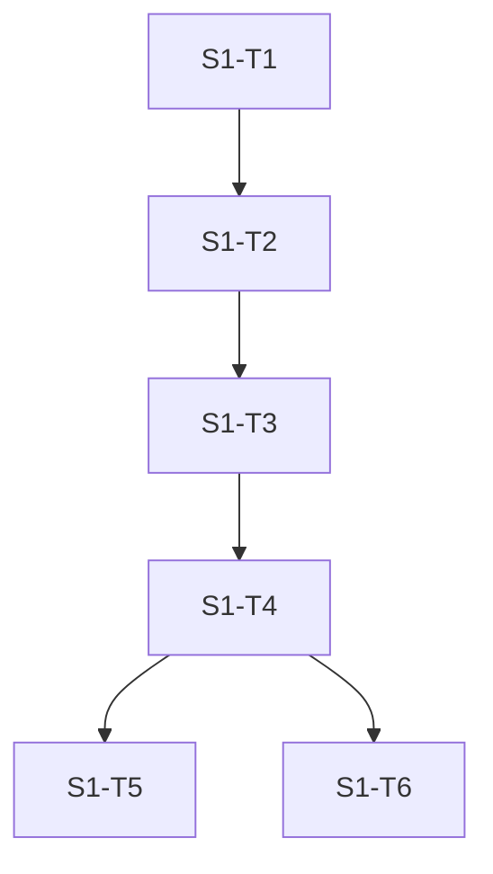

# Tarefas: S1 carimbo de tempo por etapa do ciclo

Ordem TDD: o teste falha primeiro. Comando padrão de teste: `bun --no-env-file test src/agent/stage-timing.test.ts`. Typecheck: `bun run typecheck`.

| Task | Depende de | Critério de done | Comando de verify |
|---|---|---|---|
| S1-T1 | - | Arquivo `src/agent/stage-timing.test.ts` com 14 casos, falha por módulo ausente | `bun --no-env-file test src/agent/stage-timing.test.ts` (esperado: falha) |
| S1-T2 | S1-T1 | `createStageTimer` com `start`, `end`, `record`, `snapshot`; casos 1 a 8 verdes | `bun --no-env-file test src/agent/stage-timing.test.ts` |
| S1-T3 | S1-T2 | `percentile`, `summarize`, `formatStageLine`, `recordStages`; 14 casos verdes | `bun --no-env-file test src/agent/stage-timing.test.ts` |
| S1-T4 | S1-T3 | Tipagem limpa; sem ponto médio, travessão ou meia-risca no arquivo novo | `bun run typecheck`; `grep -nP "[\x{00B7}\x{2013}\x{2014}]" src/agent/stage-timing.ts src/agent/stage-timing.test.ts` vazio |
| S1-T5 | S1-T4 | Arquivos quentes sem alteração | `git status --short src/agent/cycle.ts src/agent/wire.ts src/agent/scheduler.ts src/intel/source-ecosystem.ts src/agent/api-budget.ts` vazio |
| S1-T6 | S1-T4 | Integração proposta escrita no spec, sem código | revisão de `integracao_proposta` |

Grafo

Notas
- S1-T5 e S1-T6 podem ser feitas em qualquer ordem depois de S1-T4.
- Nenhuma tarefa toca `src/decision-review/**`, `data/`, journals ou configuração de produção.

