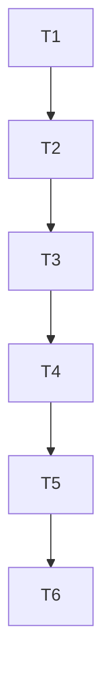

# Tarefas: S2 contador de rota e projecao de cota

Comando de typecheck do projeto: `bun run typecheck` (tsconfig.verification.json inclui src e scripts). Comando de teste do arquivo: `bun --no-env-file test src/onchain-read/route-counter.test.ts`.

| Task | Depende de | Criterio de done | Comando de verify |
|---|---|---|---|
| T1 | - | Arquivo de teste com os 14 casos escritos e falhando (modulo ainda nao existe ou export ausente) | `bun --no-env-file test src/onchain-read/route-counter.test.ts` (esperado: falha) |
| T2 | T1 | `PLANOS`, `PlanoId`, `Plano`, `X402_USD_POR_CHAMADA`, `excedenteX402Usd` implementados; casos 12, 13, 14 verdes | `bun --no-env-file test src/onchain-read/route-counter.test.ts` |
| T3 | T2 | `createRouteCounter`, `record`, `byRoute`, `janela` implementados; casos 1 a 6 verdes | `bun --no-env-file test src/onchain-read/route-counter.test.ts` |
| T4 | T3 | `projectMonth`, `chamadasPorMinuto` implementados; casos 7 a 11 verdes | `bun --no-env-file test src/onchain-read/route-counter.test.ts` |
| T5 | T4 | Typecheck do projeto sem erro com o arquivo novo | `bun run typecheck` |
| T6 | T5 | Grep de pontuacao proibida limpo e `git status` mostra so os dois arquivos novos | `grep -nP "\x{00B7}\|\x{2014}\|\x{2013}" src/onchain-read/route-counter.ts src/onchain-read/route-counter.test.ts` |

Grafo:

