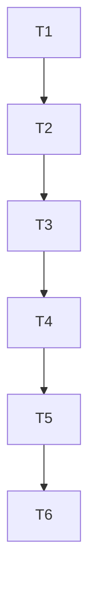

# Spec: Custo de ida e volta em lote por cotação sintética

Status: rascunho
Dono: usuario

## Contexto

Hoje o custo de uma volta (compra e venda do mesmo token) existe só como cotação única, sem decomposição por componente, sem classe de liquidez e sem distribuição. A linha de base mede atrito de 0,42% em ativo líquido com seis pares de um só ativo, 1,8% em intermediário (n=1) e pelo menos 2,1% em raso (n=1). Com n tão pequeno não há mediana nem p90 por classe. Sem decompor o custo e sem medir n por classe, não é possível testar a hipótese de edge nem fixar o limiar de sombra (validacao-e-baseline.md, seções 1 e 2; tickets T09 e T11 do ciclo 2).

Quem sente é o dono e o agente em sombra: a decisão de medir primeiro depende deste número por classe.

Esta fatia cria só um módulo puro. Ele recebe uma função de cotação injetada, pede compra e venda de cada token em cada tamanho, decompõe o custo em taxa do pool, impacto de preço, rede e imposto do token, marca como desconhecido o que faltar, classifica cada rodada por faixa de liquidez e resume cada classe com intervalo de confiança. Não chama rede, não cria script, não envia ordem.

## Metas

- Para cada par (token, tamanho), obter o custo de ida e volta decomposto em quatro componentes, em percentual do tamanho, cada componente podendo ser desconhecido.
- Nunca converter campo ausente em zero: um componente sem dado torna desconhecido o total da perna e o total da rodada.
- Classificar cada rodada por faixa de liquidez (liquido, intermediario, raso) com limiares injetados, usando a perna menos líquida; sem liquidez em alguma perna, a classe é desconhecida.
- Resumir por classe com n, média, desvio amostral e intervalo de confiança de 95%, com estado medido (n de 30 ou mais), amostra insuficiente (n de 1 a 29) ou nao medido (n igual a 0).
- Ser testável sem rede: todos os testes usam quote falso.

## Não metas

- Não chamar OKX, Jupiter, OnchainOS ou Solana RPC, e não criar cliente real.
- Não ligar o módulo a cycle.ts, wire.ts, scheduler.ts, source-ecosystem.ts ou api-budget.ts. A ligação é proposta em integracao_proposta e fica para fatia própria.
- Não gravar journal em data/ e não criar script em scripts/.
- Não decidir nem executar nada: sem ordem, sem dinheiro, sem live, sem mudança de risco.
- Não medir patrimônio, retorno líquido em USD ou markout. Isso é outra fatia.
- Não tocar src/decision-review/** nem src/decision-review/evolution/**.

## Critérios de aceitação

- [ ] Com quote falso completo, o total da rodada é a soma dos quatro componentes de compra e de venda, e o impacto entra em módulo. Prova: bun --no-env-file test src/okx-market/rt-batch.test.ts (casos 1 e 5).
- [ ] Componente ausente, cotação nula, erro da cotação e número não finito viram desconhecido, nunca zero. Prova: mesmo arquivo (casos 2, 3, 4 e 5).
- [ ] Cada rodada chama a cotação duas vezes (compra e venda), com lado, endereço e tamanho em USD. Prova: caso 14.
- [ ] A classe usa a menor liquidez entre as duas pernas e vira desconhecida se alguma perna não tiver liquidez. Prova: casos 6 e 7.
- [ ] O resumo reporta n, média, desvio, IC de 95%, desconhecidas e estado; n igual a 0 gera nao medido e n de 1 a 29 gera amostra insuficiente. Prova: casos 8 a 12.
- [ ] Entradas inválidas lançam erro antes de qualquer chamada à cotação. Prova: caso 13.
- [ ] bun --no-env-file run typecheck não mostra erro novo nos dois arquivos desta fatia.
- [ ] Nenhum ponto médio, travessão ou meia-risca nos arquivos novos. Prova: comando de grep em comandos_de_verificacao.

## Restrições

- Sem recursos pagos. Sem dinheiro real. Sem segredos em arquivos.
- Somente arquivos novos: src/okx-market/rt-batch.ts e src/okx-market/rt-batch.test.ts. Nenhum arquivo existente é editado.
- Nomes alinhados com src/okx-market/round-trip.ts (campos com sufixo Pct, classes em português). Nenhuma importação em tempo de execução de round-trip.ts ou synthetic-round-trip.ts.
- Rede: nenhuma. A cotação é função injetada.
- Texto renderizado sem ponto médio, travessão ou meia-risca. Comentários esparsos no estilo do repo.
- O git status do início tem conflitos não resolvidos (UU) em .agents/skills. O typecheck pode já estar vermelho por isso: registrar a linha de base antes de escrever e só exigir ausência de erro novo nos dois arquivos desta fatia.

## Plano de tasks

| Task | Depende de | Critério de done | Comando de verify |
|---|---|---|---|
| T1 | - | Arquivo de teste com 14 casos escrito e falhando por módulo ausente (RED) | bun --no-env-file test src/okx-market/rt-batch.test.ts |
| T2 | T1 | Tipos exportados e validação de entrada (caso 13) verdes | bun --no-env-file test src/okx-market/rt-batch.test.ts |
| T3 | T2 | Decomposição de perna, desconhecido e cotação injetada (casos 1 a 5 e 14) verdes | bun --no-env-file test src/okx-market/rt-batch.test.ts |
| T4 | T3 | Classificação por liquidez pela perna menos líquida (casos 6 e 7) verde | bun --no-env-file test src/okx-market/rt-batch.test.ts |
| T5 | T4 | Resumo por classe com IC, estado e desconhecidas (casos 8 a 12) verde | bun --no-env-file test src/okx-market/rt-batch.test.ts |
| T6 | T5 | Typecheck sem erro novo, grep de caracteres proibidos vazio, git status com só os dois arquivos novos | bun --no-env-file run typecheck |

Grafo:

## Perguntas em aberto

- Métrica de liquidez: liquidezUsd do pool (TVL) ou profundidade a 1% de impacto (levar ao Jev, ver duvidas_para_o_jev).
- Intervalo de confiança: aproximação normal com 1,96 e piso de 30, ou t de Student.
- Impacto: guardar em módulo (recomendado) ou com sinal.
- Perna sem liquidez: classe desconhecida (recomendado) ou classificar pela perna disponível.
- Unidade das taxas: o adaptador da cotação real converte para percentual do tamanho; este módulo só recebe Pct.

## Status

- Fase atual: spec
- Aprovado em: pendente de decisão do Jev (ver duvidas_para_o_jev)

