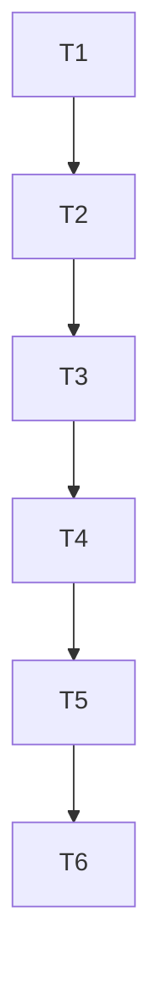

| Task | Depende de | Critério de done | Comando de verify |
|---|---|---|---|
| T1 | - | Arquivo rt-batch.test.ts com os 14 casos escrito e falhando por módulo ausente (RED) | bun --no-env-file test src/okx-market/rt-batch.test.ts |
| T2 | T1 | Tipos exportados e validação de entrada (caso 13) verdes; cotação nunca chamada em entrada inválida | bun --no-env-file test src/okx-market/rt-batch.test.ts |
| T3 | T2 | Cotação injetada com try/catch, decomposição de perna, desconhecido por componente, impacto em módulo (casos 1 a 5 e 14) verdes | bun --no-env-file test src/okx-market/rt-batch.test.ts |
| T4 | T3 | Classe pela menor liquidez entre as pernas; desconhecida se faltar liquidez (casos 6 e 7) verdes | bun --no-env-file test src/okx-market/rt-batch.test.ts |
| T5 | T4 | Resumo por classe com n, média, desvio, IC 95%, desconhecidas e estado (casos 8 a 12) verdes | bun --no-env-file test src/okx-market/rt-batch.test.ts |
| T6 | T5 | Typecheck sem erro novo nos dois arquivos; grep de caracteres proibidos vazio; git status com só os dois arquivos novos | bun --no-env-file run typecheck |

Grafo:

