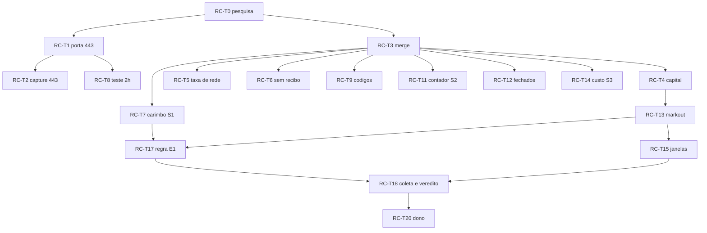

# Tarefas: retorno líquido composto por ciclo, em sombra primeiro

Data: 2026-10-17. Consolidado do ciclo 1 e do ciclo 2 ([plan.md](plan.md), [wayfinder.md](wayfinder.md)). Cada tarefa vira, no momento certo, um item da fila do objetivo (`bun scripts/hooks/goal.ts add planejar|implementar ... --verify`) depois de passar pelo Jev. Verificação padrão de código: `bun run typecheck && bun run test && bun run test:lab`, **comparada com a base `c67b39e` em worktree limpo** (o checkout principal está em merge e sem `src/generated/prompts`).

Legenda: **B** bloqueio do dono (registrar e seguir); **C** zona do Codex; **J** decisão do Jev com consenso (D*); **R** regra (sem consenso, opção mais reversível).

| ID | Tarefa | Fase | Depende de | Origem | Critério de done | Verificação |
| --- | --- | --- | --- | --- | --- | --- |
| RC-T0 | Pesquisa e registro (ciclos 1 e 2) | F0 | - | | docs em `docs/specs/retorno-composto-por-ciclo/` e grafo | `bun scripts/cerebro.ts verify` e `lint` |
| RC-T1 | Migrar o feed vivo da bolsa para a porta 443 | F1 | - | descoberta (changelog OKX) | `OKX_PUBLIC_WS_URL` e `DEFAULT_WS` sem porta; testes de desktop e feed esperam a URL nova | feita e comprovada em worktree limpo (147 testes verdes); falta o commit |
| RC-T2 | Migrar `public-market-capture` para a 443 com novos recibos de acesso | F1 | RC-T1 | descoberta | `ENDPOINTS` e `node-adapter.ts` na 443; recibos reemitidos | `bun test src/public-market-capture`. **B**: recibos de autoridade são do dono |
| RC-T3 | Resolver o merge em andamento do checkout principal | F0 | - | F0 | `wire.ts`, `cycle.ts` e demais sem marcadores; `bun build` sem erro | `bun run typecheck`. **B**: trabalho do dono; ensaio em `.scratch/revisao-branches/` |
| RC-T4 | Snapshot agregado por perna e conciliação do capital-base | F0 | RC-T3 | T01, D1 **J** | `valueComplete` em 3 horários por 3 dias; faixa de erro declarada | relatório; sem fixar base |
| RC-T5 | Distribuição da taxa de rede nas ordens com taxa gravada; reconciliar 25 e 26 preenchimentos | F0 | RC-T3 | T07, D7 **J** | mediana de 85.427 lamports reproduzida ou corrigida | relatório de leitura |
| RC-T6 | Contar ordens sem recibo por semana, com idade | F0 | RC-T3 | T16, D10 **J** | contagem, idade mediana e máxima | relatório; sem mudar fluxo |
| RC-T7 | Carimbo de tempo por etapa do ciclo (fatia S1) | F1 | RC-T3 | T13, D8 **J** | p50, p95, p99 por etapa de 1000 ciclos; campo em memória no `CycleReport` | testes do módulo; integração só após RC-T3. **Fatia S1 escrita e em validação** |
| RC-T8 | Teste de 2 h em canal quieto e idade por canal com relógio corrigido | F1 | RC-T1 | T14, T20, D12 **J** | veredito sobre o pong; p99 de idade por canal em 24 h | relatório; sem mudar constante antes |
| RC-T9 | Relatório diário de status e códigos de erro dos eventos OnchainOS | F1 | RC-T3 | T17, T18, D11 **J** | distribuição de 402, 429, 50011 em 7 dias | relatório; `apiCode` só com aprovação |
| RC-T10 | Corrigir `onchainos-coverage.md` (402 e "conexões por segundo") e `api-budget.ts` `PAID_PLANS` | F1 | - | T18, D11 | docs e constantes alinhados com a página oficial | revisão de diff |
| RC-T11 | Contador de chamadas por rota e projeção (fatia S2, refazer) | F1 | RC-T3 | T17 | plano Growth, Scale e Pro com valores lidos; `null` nunca vira "sem teto"; `porStatus` seguro; NaN e negativos rejeitados | testes; **reprovada na revisão**, precisa nova especificação |
| RC-T12 | Classificar os 411 fechados antes do Jev (contador em memória) | F2 | RC-T3 | T04, D4 **J** | causa por candidato ou "desconhecido" | relatório; sem campo novo no journal |
| RC-T13 | Markout pelo placar existente (15 min, 1 h, 4 h e 24 h), com n e N efetivo | F2 | RC-T4 | T02, D3 **R** | distribuição por token | relatório |
| RC-T14 | Custo de ida e volta em lote (fatia S3) e decomposição de 20 transações por RPC | F2 | RC-T3 | T09, T10, D7 **J** | componentes por classe com n; "amostra insuficiente" abaixo de 30 | testes do módulo; relatório. **Fatia S3 escrita e em validação** |
| RC-T15 | Rotular janelas de 1, 5 e 15 min com markout, sem gate | F2 | RC-T13 | T06, T11, D6 **R** | janelas rotuladas, não sobrepostas | relatório; refazer D6 no Jev depois |
| RC-T16 | Cobertura da bolsa sobre os mints, marcada como proxy | F2 | - | T05, T12, T19, D5 **J** | cobertura do hot-tokens em 7 dias | relatório; identidade por endereço adiada |
| RC-T17 | Log de sombra de 48 h e regra de promoção E1 congelada em commit | F3 | RC-T7, RC-T13 | T03, D2 **J** | sigma, rho e cadência medidos; H, N, IC, holdout e multiplicidade fixados | commit da regra antes da coleta |
| RC-T18 | Coleta de sombra e veredito (PASSA, REPROVA, INCONCLUSIVO) | F4 | RC-T17 | T03, T06, T11 | N efetivo mínimo; 3 janelas de mercado | relatório com IC. **B**: nenhum veredito autoriza dinheiro |
| RC-T19 | Cadência do Jev na sombra | F4 | - | T15, D9 **R** | manter relógio de 2 minutos | sem mudança |
| RC-T20 | Decisão do dono sobre capital e saída da sombra | F5 | RC-T18 | | decisão escrita | **B** |

Bloqueios do dono (fora da fila; ver [status.md](status.md)): B1 planos pagos; B2 risco de termos da OKX; B3 cota real da TypeSafe e RPS da OKX; B4 ordens reais de calibração; B5 estender journals, limites de risco, capital-base, live e produção; B6 capacidade de consultas acima de 720; B7 aprovação de recibos do `public-market-capture`.

